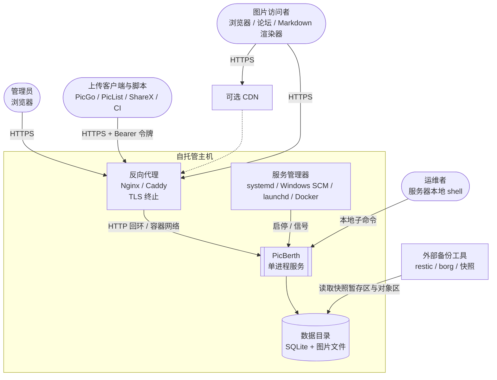
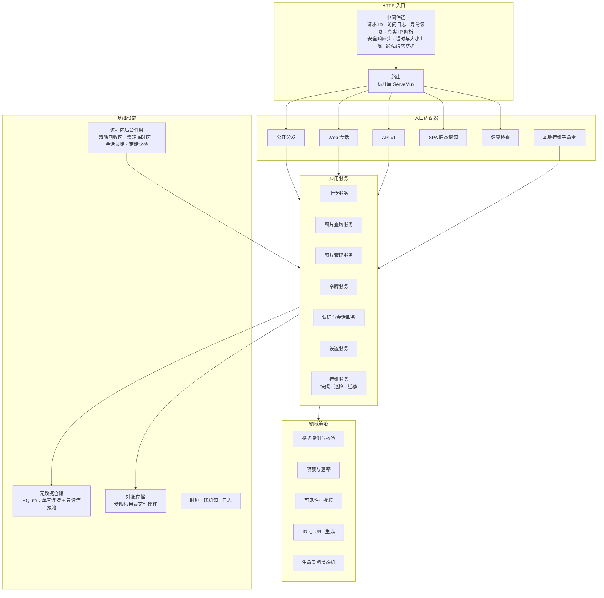
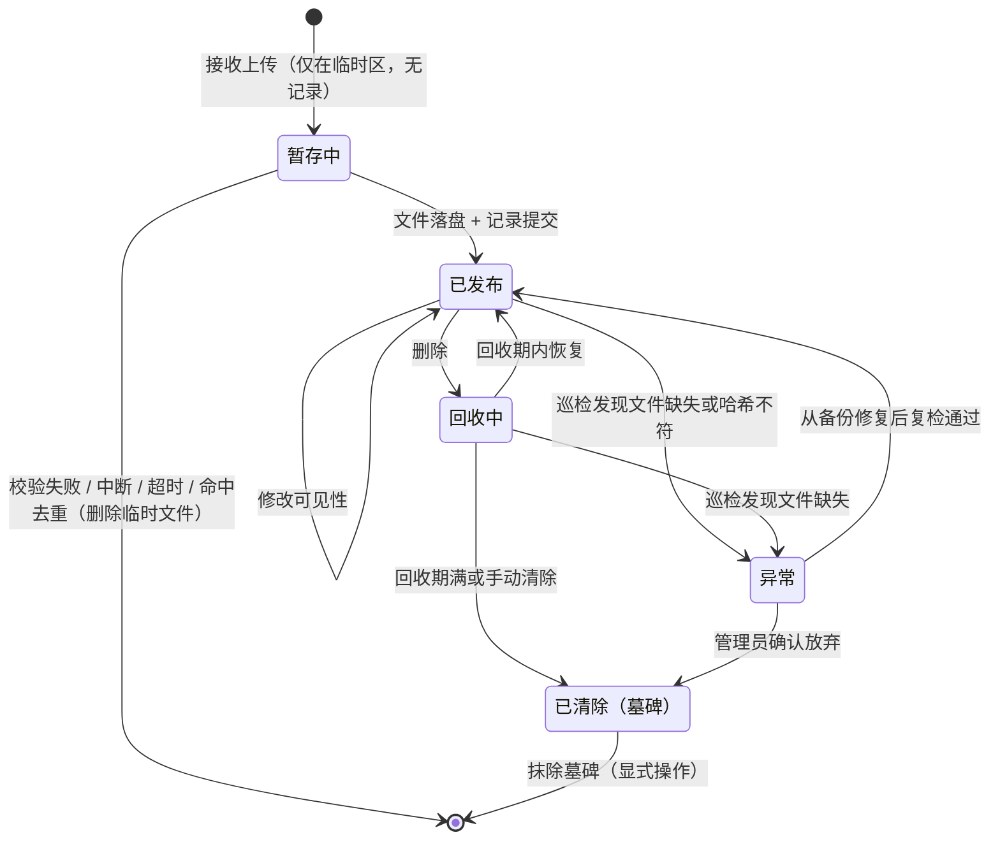
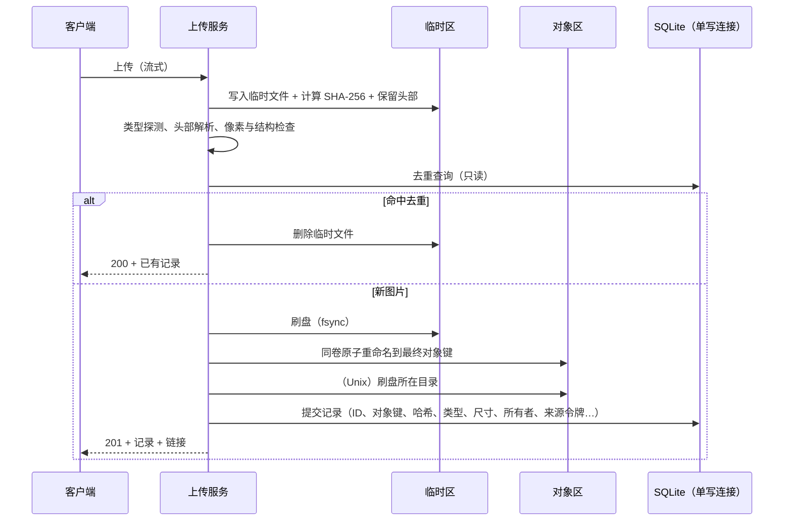
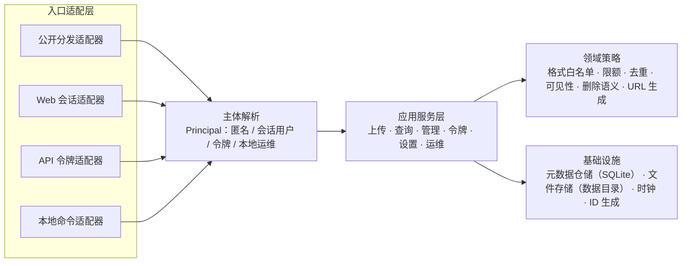
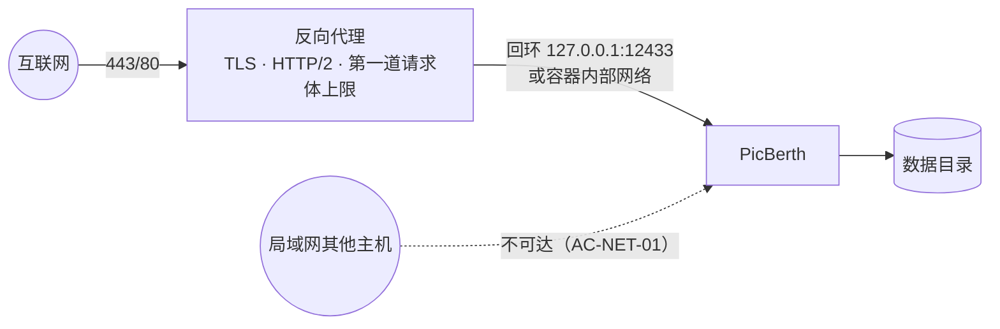

# PicBerth 自托管图床：产品需求研究与架构设计基线

| 项 | 内容 |
|---|---|
| 文档类型 | 需求研究与架构设计基线（研究阶段交付物） |
| 版本 | v0.1（提议稿） |
| 日期 | 2026-10-21 |
| 状态 | 全部 ADR 为"提议"；P0 原型完成并通过对应验收后转为"已接受" |
| 适用范围 | 基于 Go、Svelte、SQLite3 与本地文件系统的单实例自托管图床；原生二进制（Linux / Windows / macOS）与 Docker 镜像两种发行形式 |
| 本阶段不包含 | 业务代码、数据库表结构与 SQL、具体 HTTP 路径与参数、Dockerfile / Compose / 反向代理配置代码、项目目录结构、开发教程 |

### 阅读约定

| 标记 | 含义 |
|---|---|
| `（SQLITE-WAL）` 等大写编号 | 第 3 章证据登记表中的一手事实，附来源、版本与核实状态 |
| H-xx | 未验证假设（3.2），附验证计划 |
| C-xx / DC-xx | 既定约束 / 由证据派生的约束（第 2 章） |
| QA-xx | 质量属性场景（2.3） |
| J1–J6 | 用户待完成的工作（1.2） |
| F-xx / N-xx | MVP 能力 / 非目标（第 4 章） |
| T-xx | 安全威胁（8.3） |
| I1–I5 | 数据一致性不变式（6.6） |
| ADR-xxx | 架构决策记录（第 14 章） |
| AC-xxx | 验收标准（第 15 章） |
| R-xx / Q-xx / P-xx | 风险 / 待确认问题 / 原型与后续研究（第 16 章） |

陈述分为"事实""推断""假设"三级（R4.3）：事实引用证据编号；推断写明推理依据；假设带 H 编号。**本报告不把推断或假设表述为事实。**

### 目录

- 第一部分　执行摘要
  - 1 产品定位与执行摘要
- 第二部分　研究框架（四项前置工作）
  - R1 顶尖专家在功能与选型之外会额外研究什么
  - R2 原始研究素材清单
  - R3 研究方法与工具
  - R4 独立正确性证明框架
- 第三部分　设计基线
  - 2 技术约束和需求边界
  - 3 原始证据与未验证假设
  - 4 MVP 功能范围及非目标
  - 5 Go 后端与 Svelte 前端的整体架构
  - 6 SQLite3 与本地图片文件生命周期
  - 7 Web 前台、后台和 HTTP API 的业务边界
  - 8 身份认证、权限控制与安全威胁模型
  - 9 Linux、Windows、macOS 跨平台兼容性
  - 10 原生二进制与 Docker 部署架构
  - 11 Nginx/Caddy 反向代理及网络安全边界
  - 12 数据完整性、备份、恢复和迁移策略
  - 13 性能、资源占用和运维需求
  - 14 架构候选方案及 ADR 记录
  - 15 独立验收矩阵与正确性验证标准
  - 16 重大风险、待确认问题和后续研究优先级
- 附录 A　术语

---

# 第一部分　执行摘要

## 1. 产品定位与执行摘要

### 1.1 一句话定位

**PicBerth 是一个面向个人与小团队的自托管图床：一个可执行文件（或一个容器镜像）加一个数据目录，就能在自有服务器上提供图片上传、长期稳定的外链分发和管理。**

它明确**不是**：相册/照片管理（Immich、Lychee 的领域）、网盘或通用文件分享、面向陌生人开放的公共匿名图床平台、图片处理/CDN 服务。

三条核心价值主张（后续所有取舍都以此为准绳）：

| # | 价值主张 | 可检验的含义 |
|---|---|---|
| V1 | **链接长期稳定** | 一个图片 URL 一经发出，在图片未被删除、公开基础地址未改变的前提下，永远返回同一份字节；URL 不暴露、也不依赖内部存储路径。 |
| V2 | **数据自控且可恢复** | 全部持久状态 = 一个数据目录（SQLite 数据库 + 图片文件）；存在经过演练、可由第三方复核的备份与恢复流程。 |
| V3 | **部署维护极简且默认安全** | 无外部数据库/缓存/对象存储依赖；原生与容器两种发行形式语义一致；默认只监听回环地址，不意外暴露公网端口。 |

### 1.2 目标用户与 Jobs-to-be-Done

> 以下用户画像与 JTBD 是**基于同类产品生态（PicGo/PicList/ShareX 等上传客户端、Lsky Pro/Chevereto/Zipline 等自托管图床）的研究假设**，尚未经过本项目自己的用户访谈验证，统一登记为假设 H-U-01～H-U-06（见第 3 章），验证方法见第 16 章 P-12。

| 画像 | 描述 | 优先级 |
|---|---|---|
| U1 技术写作者 / 开发者 | 拥有 VPS、NAS 或家用服务器；用 Markdown 写博客、文档、笔记（Typora、Obsidian、VS Code 等），常借助 PicGo / PicList / ShareX 一类上传工具；能完成反向代理配置。 | 主要 |
| U2 小团队 / 家庭的管理员 | 为 2–20 人提供图片外链能力；需要区分上传来源、能随时撤销某个来源的权限。 | 次要（MVP 以"单管理员 + 多个命名令牌"满足） |
| U3 自动化调用方 | 脚本、CI、聊天机器人、监控系统上传截图或图表并取得链接。 | 主要（以 API 形式） |
| 非目标用户 | 运营面向陌生人的公开匿名图床（需要内容审核、滥用治理、法律合规响应）；需要多地域高可用的企业。 | — |

| ID | Job（当……时，我想……，以便……） | 期望结果（可度量） | 推导出的需求 |
|---|---|---|---|
| J1 截图即链接 | 当我在 Markdown 编辑器里粘贴截图时，我想由上传工具自动上传并插入链接，以便不中断写作，也不担心第三方图床关停导致"图挂"。 | 局域网/同区域网络下 2 MB 图片从请求发出到拿到链接的服务端处理时间 p95 < 1 s（不含网络传输）；链接多年有效。 | API 兼容主流上传客户端的"自定义上传器"模式；响应中直链字段位置稳定；重复上传幂等；URL 不可变。 |
| J2 浏览器手动分享 | 当我要把图片发到论坛或 IM 时，我想拖拽或粘贴上传并一键复制 URL / Markdown / HTML / BBCode，以便快速贴出。 | 3 次交互内完成（选择 → 上传 → 复制）；移动端可用。 | 上传前台、多格式复制、剪贴板安全上下文的降级方案、响应式布局。 |
| J3 自动化上传 | 当脚本或 CI 产出图片时，我想用一个受限令牌上传并拿到链接，以便集成到流水线。 | 错误可由程序区分（稳定错误码）；被限流时知道何时重试。 | 令牌范围、机器可读错误、429 + Retry-After 语义、幂等。 |
| J4 放心运维 | 当我维护或迁移服务器时，我想确信备份能完整恢复、升级不会丢图，以便敢于升级和迁移。 | 恢复演练 100% 通过一致性校验；跨操作系统迁移后所有链接可用。 | 一致性快照、恢复校验、迁移前自动备份、降级保护、可移植的数据目录格式。 |
| J5 及时止损 | 当我误传了含隐私信息的图片或发现链接被滥用时，我想立刻让它不可访问，并知道哪些影响无法撤回，以便控制损失。 | 删除提交后下一次源站请求即不可访问；界面明确提示 CDN/浏览器缓存可能残留。 | 删除即时生效、回收期、缓存语义说明、元数据隐私提示、令牌即时吊销。 |
| J6 掌握状况 | 我想知道空间占用和异常（磁盘将满、文件缺失、代理配置错误），以便在出问题前处理。 | 磁盘低于水位、巡检发现差异、代理配置可疑时，状态页均有显式告警。 | 状态页、健康检查、一致性巡检、配置自检。 |

### 1.3 核心结论

1. **技术栈适配，但有明确前提**。Go + Svelte + SQLite3 + 本地文件系统适合"个人与小团队自托管图床"的定位，前提是：数据目录位于单台主机的本地文件系统（SQLite WAL 不能用于网络文件系统）；负载处于 2.4 的规模包络内（SQLite 官方以"日访问量低于 10 万次"为保守参考）；使用无 cgo 的 SQLite 驱动以保持单 CI 交叉编译；内嵌的 SQLite 版本 ≥ 3.51.3（修复 WAL-reset 缺陷）。
2. **采用模块化单体、单进程、单实例**（ADR-001）。所有业务规则集中在一个应用服务层；数据库采用"单写连接 + 只读连接池"；数据目录有独占锁，杜绝两个实例（包括"原生 + 容器"）同时打开。
3. **前端用普通 Svelte + Vite 构建单页应用，不使用 SvelteKit**（ADR-002）。构建产物编译期内嵌进二进制（ADR-003）。Go 是唯一的信任与规则权威，SPA 只是公开 API 的一个客户端；与 SvelteKit 静态 SPA 模式的差距在评分误差内，该决定低成本可逆。
4. **数据一致性靠"写入顺序 + 不变式 + 巡检"，而不是分布式事务**（ADR-005）。上传先持久化文件再提交记录；删除先提交状态再移动文件；"删除"与"清除"分离；记录永不物理删除（墓碑），ID 永不复用，因此**一个链接永远不会指向另一张图片**。
5. **默认安全的上传边界**：格式白名单为 JPEG、PNG、GIF、WebP（AVIF 视原型结果），排除 SVG；类型由内容探测决定；像素上限在完整解码之前检查；授权只在服务层做，并用权限矩阵穷举测试；任何令牌都不能签发令牌；首个管理员只能通过一次性初始化凭据创建。这些控制都能在同类项目的真实漏洞中找到对应的反例（第 8 章）。
6. **网络边界由配置显式声明，而不是从请求中推断**：对外链接使用显式配置的公开基础地址；真实客户端 IP 只从受信任代理的转发头中按"最右侧不受信任地址"解析；Docker 只发布到宿主机回环地址，并要求 Docker Engine ≥ 28.3.3。
7. **跨平台一致性靠"消除差异入口"**：所有落盘名称由服务端生成且只含 `[0-9a-z]`；所有文件操作经 `os.Root`；Content-Type 由程序自己探测并存储，不依赖操作系统注册表。已证实的平台差异（Windows 上无法删除正在被读取的文件、非 Unix 平台重命名不保证原子）集中处理，并由三平台 CI 与断电测试覆盖。
8. **备份可以被证明是一致的**：以 `VACUUM INTO` 生成数据库快照，再按快照中的清单复制文件，复制期间暂停"清除"；由"文件不可变、先文件后记录、只有清除会移除文件"三条性质推出备份中不存在缺失文件（12.2）。
9. **由安全公告推导出的版本下限**（截至 2026-10-21）：Go 工具链 go1.26.10 / go1.27.3；`golang.org/x/image` ≥ v0.45.0；内嵌 SQLite ≥ 3.51.3；Docker Engine ≥ 28.3.3。这些下限会变化，由 CI 中的 govulncheck 持续维护。
10. **在写第一行业务代码之前，必须完成 5 个 P0 原型**：用户研究与上传客户端兼容（P-12）、SQLite 驱动基准（P-01）、图片样本语料库（P-04）、Windows 文件语义（P-03）、进程级崩溃一致性（P-02）。它们会改变数据格式、链接形态或 API 形态，事后修改代价最高。

### 1.4 十五个架构问题的结论索引

| # | 问题 | 结论 | 置信度 | 详见 |
|---|---|---|---|---|
| 1 | Go + Svelte + SQLite3 + 本地文件系统是否适合？ | 适合，有四个前提（见 1.3 第 1 条） | 高（前提有一手依据）；性能余量待 P-01、P-09 | 2.2、ADR-001、ADR-004 |
| 2 | 是否采用单实例、单进程、模块化单体？ | 是；附带失效条件 | 高 | ADR-001、5.3 |
| 3 | Svelte 静态资源与 Go 服务的职责关系？ | Go 是唯一权威；SPA 纯呈现、编译期内嵌、与 API 同版本发布；带哈希资源长期缓存、入口 HTML 不缓存 | 高 | 5.5、ADR-003 |
| 4 | 是否需要 SvelteKit？ | 不需要；无 SSR/SEO 需求，SvelteKit 的服务端能力在此部署形态下不可用；决定可逆 | 中高 | ADR-002 |
| 5 | 前台、后台与第三方 API 如何共享业务规则？ | 单一应用服务层；SPA 只调用公开的版本化 API，不存在后门接口；由契约测试机械证明 | 高 | 7.1–7.2、AC-API-03 |
| 6 | 如何区分公开图片与需认证的管理操作？ | 四个入口面；公开分发面只读、不依赖 Cookie、可部署在独立源；私有图片禁止共享缓存；对不存在与私有一律 404 | 高 | 7.1、6.4、8.5 |
| 7 | 如何保证 SQLite 元数据与图片文件一致？ | 先文件后记录的写入顺序 + 五条不变式 + 启动快检与全量巡检 | 高（推理）；断电行为待 P-02 | 6.4–6.6、ADR-005 |
| 8 | 如何避免上传中断、磁盘耗尽、崩溃造成数据问题？ | 临时区 + 流式上限 + 磁盘水位 + 逐步故障分析与自动修复；同步级别不降低 | 中（待 P-02、P-09） | 6.6、12.1、13.3 |
| 9 | 如何确保三平台文件处理一致？ | 消除差异入口；`os.Root`；已证实差异集中处理；三平台 CI 矩阵 | 中（Windows 断电与杀毒软件行为待 P-02、P-03） | 第 9 章 |
| 10 | Docker 与原生如何共享数据、配置、升级语义？ | 同一代码路径，差异只体现在镜像预设的默认值；数据格式、配置键、迁移语义完全相同，可互相迁移 | 高 | 10.1、10.4 |
| 11 | 代理下的 HTTPS、真实 IP、请求大小与安全边界？ | 代理终止 TLS；受信任代理白名单 + 最右侧不受信任地址；代理与应用双层体积上限；显式公开基础地址；Nginx 默认 1 MiB 上限必须调大 | 高 | 第 11 章、ADR-010 |
| 12 | 如何确保备份同时覆盖 SQLite 与图片文件？ | 一致性快照协议及其正确性论证；恢复校验命令；跨平台可移植的数据目录格式 | 高（推理）；外部卷快照待 P-10 | 12.2–12.3 |
| 13 | 如何在减少依赖的同时保持可维护性？ | 运行时依赖限定为 SQLite 驱动与三个 `golang.org/x/` 模块；前端运行时只依赖 `svelte`；新增依赖必须有 ADR 并由 CI 比对 | 高 | 5.6、AC-MAINT-01 |
| 14 | 哪些进入 MVP，哪些延后？ | 见能力清单（Must/Should/Later/Won't）与非目标清单 | — | 第 4 章 |
| 15 | 哪些假设需要原型或实测确认？ | 12 条技术假设（H-T-*）、用户与规模假设（H-U-*、H-S-*），对应 12 个原型 | — | 3.2、16.3 |

# 第二部分　研究框架（四项前置工作）

> 本部分回答任务书第四节"在提出最终架构前首先完成的四项工作"。后续第三部分的每一个架构结论都能回溯到这里定义的研究议题、素材、方法和证明框架。

## R1. 顶尖专家在功能与选型之外会额外研究什么

一个只看功能清单的设计者会直接画模块图；有经验的设计者会先研究"什么会让这个系统在第三年失败"。下表列出额外研究议题、为什么必须研究、以及它实际改变了哪些设计决策。

| # | 研究议题 | 为什么必要 | 影响的设计决策 | 章节 |
|---|---|---|---|---|
| X-01 | 产品定位与目标用户 | 图床的两种形态（个人工具 vs 公共平台）在安全、合规、滥用治理上的成本相差一个数量级；定位不清会导致范围蔓延。 | 匿名上传默认关闭（F-11）；公共平台运营列为非目标（N-06）；令牌而非多用户满足小团队（F-34/F-38）。 | 1、4 |
| X-02 | MVP 范围与明确非目标 | 没有非目标清单，每一个"顺手加上"的功能（转码、S3、相册）都会消耗安全审查与维护预算。 | 4.3 非目标清单及其重新评估触发条件。 | 4 |
| X-03 | 单体架构是否足够 | 需要用证据而非直觉证明单体足够，并写下"何时不再足够"。 | ADR-001 及其失效条件。 | 5、14 |
| X-04 | 图片与元数据生命周期 | 图床最常见的真实故障不是性能，而是"图挂了"（文件丢失、链接变更、删除后不可恢复）。 | URL 不可变、ID 永不复用、软删除 + 回收期、生命周期状态机。 | 6 |
| X-05 | 文件系统与 SQLite 一致性 | 两个存储之间没有分布式事务；必须设计写入顺序、不变式和对账机制。 | "先文件后记录"写入协议、不变式 I1–I5、启动快检与全量巡检。 | 6、12 |
| X-06 | 身份认证与访问控制 | 自托管应用最常见的失守方式之一是首次初始化被抢占、令牌权限过大。 | 一次性初始化凭据（F-40）、令牌范围且不可签发令牌（7.3）。 | 7、8 |
| X-07 | 恶意文件与上传安全 | 图片是攻击者可完全控制的二进制输入，历史上有大量解码器漏洞与存储型 XSS。 | 格式白名单、内容签名+结构校验、像素上限、SVG 排除、强制 Content-Type 与 nosniff。 | 6.3、8 |
| X-08 | API 滥用、盗链、资源耗尽 | 公开可达的上传/分发端点会被扫描、刷流量、塞满磁盘。 | 多层限额、磁盘水位、令牌限速、Referer 防盗链定位为弱控制。 | 8、11、13 |
| X-09 | 反向代理信任边界 | 错误信任 X-Forwarded-For 会让限流与审计失效；错误的请求体限制会造成"上传失败但原因不明"。 | 受信任代理白名单、显式公开基础地址、代理与应用双重请求体上限。 | 11 |
| X-10 | 浏览器安全与前后端通信 | 管理界面和用户内容如果同源，用户内容中的任何脚本执行都能劫持管理会话。 | Cookie 属性、跨站请求防护、CSP、可选独立图片源（F-24）。 | 8 |
| X-11 | 跨平台兼容性 | Windows 的保留文件名、文件共享锁、重命名语义，macOS 的大小写不敏感与 fsync 语义，都会让"在 Linux 上测过"的代码出错。 | 服务端生成的纯小写 ASCII 文件名、受限根目录访问、平台差异测试矩阵。 | 9 |
| X-12 | 备份、恢复与迁移 | 只备份数据库或只备份文件都等于没有备份；直接复制在用数据库文件可能得到损坏副本。 | 一致性快照协议、恢复校验命令、跨平台可移植的数据目录格式。 | 12 |
| X-13 | 版本升级与长期维护 | 自托管用户往往跳版本升级、偶尔回退；一次失败的迁移就会失去用户信任。 | 前向迁移 + 迁移前快照 + 降级拒绝；依赖最小化与漏洞扫描。 | 12、14 |
| X-14 | 架构过度设计风险 | 为假想需求（S3、集群、插件）预留的抽象会持续消耗维护成本，并扩大攻击面。 | 只为"可测试性"保留存储抽象，不为"未来后端"抽象；非目标清单。 | 5.6 |
| X-15 | 隐私与元数据（补充） | 手机照片常含 GPS 坐标；公开图片会把用户住址泄露给任何访问者。 | 定位元数据检测与提示（F-09），剥离作为高优先 Later（F-10）。 | 8.4 |
| X-16 | 供应链安全（补充） | 前端构建依赖 npm 生态；2025 年发生过大规模 npm 包投毒事件。 | 前端依赖最小化、锁文件、CI 中只用锁定版本安装；Go 依赖用 govulncheck。 | 5.6、14 |
| X-17 | 可访问性与移动端（补充） | 上传与复制链接是高频操作，常在手机上完成；拖拽交互天然对键盘与读屏用户不友好。 | 拖拽的等价按钮路径、live region、剪贴板降级。 | 7.5 |
| X-18 | 可观测性与自诊断（补充） | 自托管用户通常没有监控系统；问题往往在"图已经挂了很久"之后才被发现。 | 状态页告警、健康检查、配置自检（如检测到未受信任代理却带转发头）。 | 13 |

## R2. 原始研究素材清单

### R2.1 采集规则

1. **只把一手来源当作事实来源**：官方文档、规范原文、源代码、官方漏洞数据库与安全公告、发布说明、项目自己的 Issue 与提交记录。博客、问答网站、二手汇总只用于发现线索，线索必须回到一手来源核实后才能进入证据登记表。
2. **每条事实记录五项**：来源 URL、版本或标签/提交、核实日期、关键原文摘录、适用范围（平台、版本区间、前提条件）。
3. **来源之间冲突时如实记录冲突**，不擅自取舍，并把它列为待验证项。本轮核实中已发现的冲突见 R2.3。
4. **事实会过期**：版本号、漏洞下限、浏览器支持状态等"易变事实"在证据表中标注核实日期（本轮为 2026-10-21），进入实现阶段时须重新核实。

### R2.2 素材类别

| 类别 | 一手素材 | 本报告用途 | 状态 |
|---|---|---|---|
| Go 官方 | go.dev 发布说明与发布策略、pkg.go.dev 标准库文档、`golang/go` 源码（`net/http`、`os`、`internal/poll`、`mime`、`image`）、Go 漏洞数据库（vuln.go.dev） | 运行时行为、平台差异、安全下限 | 已核实（第 3 章 GO-*） |
| SQLite 官方 | sqlite.org 的 WAL、事务、PRAGMA、损坏原因、备份、`VACUUM INTO`、`sqlite3_rsync`、适用场景、BLOB 性能、网络使用、限制、安全、FAQ、发布记录 | 并发、持久性、备份、一致性 | 已核实（SQLITE-*） |
| Go SQLite 驱动 | 三个候选驱动的仓库、模块代理元数据、发布说明 | ADR-004 | 已核实（DRV-*） |
| Svelte / Vite / Node / mise / Playwright | svelte.dev、vite.dev、nodejs.org 与 `nodejs/Release`、mise.jdx.dev 与其 GitHub 发布记录、playwright.dev | 前端与工具链决策 | 已核实（FE-*、MISE-*） |
| 浏览器规范与兼容数据 | WHATWG Fetch、W3C CSP3、Referrer Policy、Clipboard API、Fetch Metadata、MDN 与 browser-compat-data、web-features（Baseline） | 安全头、浏览器基线、剪贴板与上传进度 | 已核实（HDR-*、FE-*） |
| HTTP 规范 | RFC 9110、9111、8246、9457、7239、6266、6750、9745、8594、7578；IETF Idempotency-Key 草案状态 | 缓存、条件请求、错误格式、代理头、令牌、弃用 | 已核实（RFC-*） |
| 图片格式规范 | PNG 第三版（W3C）、RFC 9649（WebP）、ITU-T T.81（JPEG）、CIPA DC-008（Exif）、GIF89a、AV1 图像文件格式（AVIF） | 格式探测、元数据位置、动画、尺寸限制 | 已核实（IMG-*），Exif 内部结构未读原文 |
| 安全规范 | OWASP ASVS 5.0、Top 10:2025、File Upload / Password Storage / Session Management / CSRF Prevention 速查表、WSTG | 安全验收基线 | 已核实（SEC-*） |
| 原始漏洞公告 | NVD、GitHub Security Advisories、CISA KEV、厂商公告（libwebp、ImageMagick、Gokapi、FileRise、Chevereto、Pillow、x/image） | 威胁的现实依据 | 已核实（CVE-*） |
| 部署组件 | docs.docker.com、nginx.org、caddyserver.com、systemd 手册、Microsoft Learn（文件命名、AF_UNIX）、Apple 文件系统文档 | 第 9–11 章 | 见第 3 章 DEP-*、NET-*、FS-* |
| 现有开源图床 | 同类项目的源码、发布记录、Issue、安全公告；上传客户端（PicGo、PicList、ShareX）的官方文档 | 真实缺陷模式、客户端兼容要求 | 见第 3 章 OSS-* |
| 方法论原典 | C4 Model 官网、Nygard 2011 ADR 原文、HBR 2016 JTBD 原文、EventStorming 官网、Microsoft STRIDE 文档、LINDDUN 官网、OWASP Threat Dragon | R3 方法选择 | 已核实（M-*） |

### R2.3 本轮核实中发现的来源冲突与易错点

| 主题 | 冲突或易错点 | 处理 |
|---|---|---|
| Referrer Policy 默认值 | W3C /TR/ 上的候选推荐（2017）仍写 `no-referrer-when-downgrade`；编辑草案（2026）写 `strict-origin-when-cross-origin` | 以编辑草案与浏览器实际行为为准；无论哪个默认值，"Referer 可能缺失"的结论不变 |
| Playwright 与 macOS 14 | 系统要求页写支持 macOS 14；1.59 发布说明写已移除 macOS 14 上的 WebKit 支持 | CI 的 macOS 运行器使用 15 或更高 |
| Edge 的 JPEG XL 支持 | browser-compat-data 写 Edge 不支持；MDN 图片类型页写 Edge 155 支持 | 不影响本设计（JPEG XL 未纳入白名单） |
| SQLite `busy_timeout` 的作用域 | PRAGMA 页面措辞为"为进程设置"，C 接口页面描述为每个连接 | 按每个连接设置（ADR-004 连接模型） |
| "SQLite 比文件系统快 35%" | 只适用于约 10 KB 的小 BLOB 与热缓存；冷缓存与大 BLOB 时文件系统更快 | ADR-006 引用完整前提 |
| 动画 WebP | x/image 的头部解析成功但完整解码失败 | F-04、F-33 的降级路径 |
| `nosniff` | 规范明确它不作用于图片上下文 | 6.4 与 8.5 的表述已据此修正 |
| `CrossOriginProtection` | 会拒绝 `same-site` 请求；Origin 回退比较不比较协议 | 8.2；若未来采用"同站不同源"的部署形态需重新评估 |
| OWASP Top 10:2025 发布日期 | OWASP 官方页面未给出日期，只有二手来源 | 证据表只引用其类别列表与"已发布（最终版）"状态 |
| ncruces 驱动的实现方式 | 大量二手资料仍称其基于 wazero；v0.33.0 起已改为 wasm2go | 以模块历史为准（DRV-NCRUCES） |

### R2.4 真实图片样本与异常文件（候选来源，待逐一确认许可与可获得性）

以下来源由设计者根据既有知识列出，**本轮未逐一核实其当前可用性与许可条款**，在 P-04 开始前必须核实：

| 候选来源 | 内容 | 用途 |
|---|---|---|
| PngSuite（Willem van Schaik） | 覆盖 PNG 各种合法与非法变体的测试图 | PNG 解析与拒绝 |
| libwebp 测试数据仓库 | 有损、无损、透明、动画 WebP | WebP 头部解析、动画识别 |
| AOMedia av1-avif 仓库中的测试文件 | AVIF 静态图与图像序列 | F-08 结构校验 |
| Go 标准库与 x/image 的 testdata 目录 | 解码器回归样本 | 与所用解码器版本一致的基线 |
| exif-samples 类公开样本集 | 各厂商相机与手机的 EXIF（含 GPS、方向） | F-09、P-05 |
| corkami 文件格式研究样本 | 多语言文件（polyglot）与格式边界情况 | AC-SEC-10 |
| 自行构造的样本 | 像素洪泛（头部声明超大尺寸）、截断文件、伪装扩展名、超长 EXIF、在结束标记后附加数据、SVG/HTML 伪装成图片 | AC-SEC-10..13 |
| 真实用户样本 | 来自 P-12 受访者自愿提供的日常截图与手机照片（去除敏感内容后） | 验证"正常输入不被误拒"（误拒率） |

### R2.5 真实部署环境、用户流程与故障记录

| 素材 | 采集方式 | 用途 |
|---|---|---|
| 同类项目的 Issue 与安全公告 | 按"升级/迁移失败""图片丢失""413/上传失败""反向代理""权限""SVG/XSS"等关键词检索并逐条阅读原文 | 故障模式清单（第 3 章 OSS-*） |
| 目标用户的部署环境 | P-12 访谈：操作系统、是否使用 NAS、是否使用 Docker Desktop、使用哪个反向代理、如何备份 | 验证 H-S-* 与 R-05、R-06 |
| 用户操作流程 | P-12 中观察受访者用现有工具完成 J1、J2 的全过程（录屏或记录步骤） | 7.5 界面设计与 AC-UI-* |
| 本项目原型期的故障记录 | 所有原型（P-01..P-10）的失败都以"现象、环境、根因、修正的设计决策"格式归档 | 作为第 3 章证据的补充，持续更新 |

## R3. 研究方法与工具

方法的选择原则：每种方法必须产出一个可被他人复核的具体工件；不产出工件的方法不采用。

| 方法 | 研究目标 | 产出工件 | 使用阶段 | 本报告中的应用 |
|---|---|---|---|---|
| Jobs-to-be-Done | 从"用户想完成的进展"出发确定范围，防止功能堆砌 | Job 陈述表、期望结果指标 | 需求 | 1.2 的 J1–J6；4.2 每项能力的依据列 |
| 用户场景分析 | 把 Job 展开成端到端操作流程，暴露边界情况（中断、重试、移动端、剪贴板不可用） | 场景脚本，后续直接转为 E2E 测试用例 | 需求 → 测试 | 7.5、15 章 AC-UI-* |
| C4 Model | 用统一抽象层级（上下文 / 容器 / 组件）描述架构，避免"框框箭头图"含义不清 | 上下文图、容器图、组件图（Mermaid 文本，可版本化） | 架构 | 5.1–5.3 |
| Event Storming | 识别领域事件、命令、聚合与状态转换，发现生命周期中的缺口（如"清除"与"删除"的区别） | 事件清单、状态机 | 领域建模 | 6.1–6.2 |
| Architecture Decision Records | 记录每个关键决策的背景、候选、取舍与后果，使未来维护者能判断何时推翻 | ADR 集合（Nygard 格式 + 本报告扩展的"验收"与"重审条件"字段） | 架构 | 14 章 |
| 架构权衡矩阵 | 在候选方案间做显式、加权的比较，避免单一维度决策 | 加权评分表（权重来自 2.3 质量属性优先级） | 架构 | 14 章各 ADR |
| STRIDE | 对每个数据流与信任边界系统地枚举安全威胁 | 威胁表（元素 × 威胁类别 × 控制 × 验收项） | 安全 | 8.3 |
| LINDDUN | 枚举隐私威胁（可关联、可识别、泄露、不知情等），补足 STRIDE 对隐私的盲区 | 隐私威胁表 | 安全 / 隐私 | 8.4 |
| OWASP ASVS | 用公开的、可逐条核对的要求集合作为安全验收基线，而不是自定义清单 | ASVS 要求映射表（Level 1 全量 + Level 2 选定章节） | 安全验收 | 8.6、15 章 |
| 故障场景分析（FMEA 式） | 对每一步写入/删除/备份操作枚举"在此刻崩溃/断电/磁盘满"会怎样 | 故障表（步骤 × 故障 × 后果 × 检测 × 恢复） | 可靠性 | 6.6 |
| API 契约测试 | 证明实现与 OpenAPI 契约一致，并证明 Web 与第三方 API 行为一致 | 契约测试套件，CI 必跑 | 测试 | AC-API-* |
| 浏览器兼容性测试 | 在主要渲染引擎上验证上传、进度、复制、响应式布局 | 跨浏览器 E2E 套件 + 真机抽检清单 | 测试 | AC-UI-* |
| 数据一致性与备份恢复测试 | 故障注入 + 恢复演练，以不变式而非"看起来正常"判定结果 | 故障注入测试、恢复演练记录 | 测试 | AC-DATA-*、AC-BAK-* |
| 跨平台与容器部署验证 | 同一套测试在三个操作系统与容器中运行；数据目录跨环境迁移 | CI 矩阵结果、迁移演练记录 | 测试 | AC-X-* |

工具适用性评估（本阶段只评估，不实施）：

| 工具 | 适用场景 | 适用性 | 局限 / 注意事项 |
|---|---|---|---|
| Mermaid | C4 图、时序图、状态机，以文本形式进入版本库并可审阅差异 | 高 | 本报告用通用流程图语法表达 C4 层级（据设计者了解，Mermaid 的 C4 专用语法仍为实验性，本轮未核实）；图不能自动与代码保持同步。 |
| Go 测试工具链（`go test`、表驱动测试、原生模糊测试、竞态检测器、基准测试） | 单元/集成测试、图片解析器模糊测试、并发正确性、性能基线 | 高 | 原生模糊测试自 Go 1.18 起提供；竞态检测器依赖 cgo，需在 CGO_ENABLED=0 的发行构建之外单独运行（均为设计者既有认识，进入实现前核实）。 |
| govulncheck | Go 依赖与标准库漏洞的可达性分析 | 高 | 只覆盖 Go 漏洞数据库中已登记的漏洞。 |
| Playwright | 跨 Chromium / Firefox / WebKit 的 E2E：文件上传、拖拽、剪贴板权限、移动视口 | 高 | WebKit 构建不等同于真实 Safari；iOS Safari 必须真机或云真机抽检。 |
| curl | 可复现的 HTTP 行为验证：条件请求、Range、缓存头、错误格式、代理头；作为独立测试人员的最低门槛工具 | 高 | 无法覆盖浏览器安全策略（CSP、SameSite）。 |
| k6 | 分发与上传负载测试、限流行为验证 | 中高 | 负载结果强依赖参考硬件，必须记录硬件与操作系统；不替代长时间稳定性测试。 |
| OWASP Threat Dragon | 以图形方式维护 STRIDE 威胁模型，模型文件可入库 | 中 | 对单体小系统，表格形式的威胁模型同样有效；可选。 |
| OpenAPI 校验工具 | 契约文档本身的语法与风格校验、响应与契约比对 | 中高 | 需要选择一个维护活跃的工具并锁定版本；属于开发期依赖，不进入运行时。 |
| 自动化可访问性检查（如 axe 类引擎） | 在 E2E 中检测可访问性违规 | 中 | 只能发现约一部分问题，必须辅以键盘与读屏人工走查。 |
| 虚拟机强制断电 / 故障注入文件系统 | 验证断电后的数据持久性 | 中 | 成本较高，放在发布前门禁而非每次提交。 |

## R4. 独立正确性证明框架

### R4.1 原则

1. **结论与证据分离**：每个架构结论必须指向第 3 章证据登记表中的条目（一手来源 + 版本 + 适用范围），或明确标注为假设（H-xx）。
2. **可证伪**：每个结论都写出"什么观测结果会证明它是错的"，即重审条件。
3. **验收标准可由第三方独立执行**：验收方法只能依赖公开规范、本仓库的测试工件与通用工具（curl、浏览器、CI），不能依赖设计者的口头解释。
4. **不变式优先于用例**：数据正确性用不变式表达（例如"任何可见记录都有对应文件且哈希一致"），由巡检工具在任意时刻机械检查，而不是只检查几个手工挑选的用例。

### R4.2 每个主要结论的证明模板

第 14 章的每个 ADR 与第 15 章的验收矩阵都使用以下字段：

| 字段 | 含义 | 示例（ADR-005 写入协议） |
|---|---|---|
| 结论 | 一句话决策 | 上传时先将文件持久化到最终位置，再提交数据库记录 |
| 原始依据 | 第 3 章证据 ID | SQLITE-TXN、GO-SYNC、GO-RENAME |
| 需求 / 风险来源 | 2.3 质量属性、8 章威胁、1.2 Job | QA-R1、J4 |
| 候选与取舍 | 至少两个候选及被否决的原因 | 先记录后文件（需要"待定"状态与额外写入）；被否决原因：更多状态、相同的对账需求 |
| 可测量验收标准 | 数值或布尔判定 | 1,000 次随机时点强制终止后，I1 违例数 = 0 |
| 独立验证方法 | 第三方如何复现 | CI 中的故障注入测试 + 巡检命令输出 |
| 重审条件 | 何时必须重新评估 | 出现任何 I1 违例；或更换文件系统/驱动后测试结果改变 |

### R4.3 陈述等级

本报告中的陈述分为三级，并在行文中区分：

| 等级 | 含义 | 标注方式 |
|---|---|---|
| 事实 | 已在一手来源中核实，记录了来源、版本与核实日期 | 引用证据 ID，如（SQLITE-WAL） |
| 推断 | 由事实经过明确推理得出，推理过程可复核 | "由此推出……"并引用其依据 |
| 假设 | 尚无证据，或依赖未来测试结果 | H-xx 编号，并在第 16 章给出验证计划 |

# 第三部分　设计基线

## 2. 技术约束和需求边界

### 2.1 既定约束（来自项目任务书，不在本阶段重新讨论）

| ID | 约束 |
|---|---|
| C-01 | 服务端语言为 Go；优先标准库，第三方依赖必须有明确必要性。 |
| C-02 | 前端使用 Svelte；尽量不引入第三方 UI 组件库；构建为静态资源并由 Go 服务提供，支持单二进制部署；不预设 SvelteKit、SSR 或独立 Node.js 服务。 |
| C-03 | 元数据使用 SQLite3；**图片主体不得以 BLOB 存入数据库**。 |
| C-04 | 图片存储于服务器本地文件系统的指定数据目录；不强制依赖任何云存储或外部存储服务。 |
| C-05 | 使用 mise 管理开发工具链版本，本地、其他开发机与 CI 一致可复现。 |
| C-06 | 发行形式：Linux / Windows / macOS 原生可执行文件 + Docker 镜像，核心功能、数据结构与运行语义一致。 |
| C-07 | 原生部署默认监听 `127.0.0.1:12433`，由 Nginx 或 Caddy 反向代理提供对外访问与 HTTPS。 |
| C-08 | 单实例优先；不为未确认的分布式需求增加复杂度。 |
| C-09 | 本阶段不编写代码、SQL、API 路径、部署配置代码或项目目录结构。 |

### 2.2 由证据派生的约束

这些约束不是偏好，而是由第 3 章登记的一手事实推导出的必然要求；若相应事实被推翻，约束需要重新审查。

| ID | 派生约束 | 推导依据 |
|---|---|---|
| DC-01 | 数据库文件必须位于本地文件系统；**不支持**将数据目录放在 NFS/SMB 等网络文件系统上。 | SQLite WAL 要求所有访问进程位于同一主机，且不能用于网络文件系统（SQLITE-WAL、SQLITE-NET）。 |
| DC-02 | 同一数据目录在任一时刻只能被一个服务进程打开；进程启动时必须获取数据目录独占锁，失败即拒绝启动。 | 单实例假设 + SQLite 多进程写入只会带来争用；防止误启动两个实例（含"原生 + 容器"同时挂载同一目录）。 |
| DC-03 | 数据库备份不得通过直接复制正在使用的数据库文件完成，必须使用 SQLite 提供的在线备份机制产生一致性快照。 | SQLITE-CORRUPT、SQLITE-BACKUP |
| DC-04 | 文件名、目录名一律由服务端生成，仅使用小写 ASCII 字母与数字；用户提供的原始文件名只作为元数据保存，永不参与路径拼接。 | Windows 保留名与非法字符、macOS 默认大小写不敏感、各平台长度限制不同（WIN-NAMING、APFS、LINUX-NAMEMAX）；路径遍历类漏洞（GO-CVE-WINPATH）。 |
| DC-05 | 发行构建应不依赖 cgo，以便在单一 CI 环境中为三个操作系统与多个 CPU 架构交叉编译，并产出无外部动态库依赖的可执行文件。 | Go 交叉编译在 CGO_ENABLED=0 时无需目标平台 C 工具链（GO-CROSS）；纯 Go / Wasm 的 SQLite 驱动可满足（DRV-*）。最终驱动选择见 ADR-004。 |
| DC-06 | 容器内服务必须监听容器网络命名空间的非回环地址，否则端口映射无法到达；"不暴露公网"的责任由宿主机端口发布方式承担。 | Docker 端口发布机制与默认绑定所有接口（DOCKER-PORT、DOCKER-FW）。 |
| DC-07 | 服务端必须对请求体大小、请求头读取时间、上传总时长设置上限，不能依赖 Go 的默认值。 | `http.Server` 超时字段为零即不超时（GO-SRV-TIMEOUT）。 |
| DC-08 | 生成对外链接时使用显式配置的公开基础地址，不从请求的 Host 或 X-Forwarded-* 头推断。 | 转发头可被客户端伪造（RFC-7239 安全考虑、CADDY-PROXY、NGX-PROXY）；Host 头注入会污染生成的链接。 |
| DC-09 | 真实客户端 IP 只在请求来自显式配置的受信任代理地址时才从转发头解析；未配置时一律使用 TCP 对端地址。 | 同上；Go `net/http` 不解析转发头（GO-REMOTEADDR）。 |

### 2.3 质量属性场景（可度量目标）

以下数值是**设计目标**而非事实；其中标注"待原型"的项在第 16 章对应原型完成后才能定稿。

| ID | 质量属性 | 刺激 → 期望响应 | 目标 | 验证 |
|---|---|---|---|---|
| QA-R1 | 可靠性：崩溃一致性 | 在上传、删除、清除的任意时刻强制终止进程 → 重启后 | 不存在"数据库记录可见但文件缺失"的图片；临时文件与孤儿文件在下一次巡检中被识别；零数据库损坏 | AC-DATA-01..04 |
| QA-R2 | 可靠性：断电 | 在写入过程中模拟断电（虚拟机强制关机） | 已向客户端返回成功的上传在恢复后存在且哈希一致 | AC-DATA-05（待原型 P-02） |
| QA-R3 | 可恢复性 | 在持续上传期间执行快照备份，再恢复到另一台、另一种操作系统的机器 | 恢复后一致性校验 0 差异；全部公开链接返回与原机相同的字节 | AC-BAK-01..03 |
| QA-S1 | 安全：默认暴露面 | 以默认配置启动原生二进制 | 只监听回环地址；无默认账号；未初始化时管理界面不可被网络访问者接管 | AC-SEC-01..03 |
| QA-S2 | 安全：恶意上传 | 上传伪装扩展名、多语言文件（polyglot）、解压炸弹、畸形头部、SVG | 全部被拒绝或以无害方式存储；进程内存峰值不超过配置上限 | AC-SEC-10..16 |
| QA-P1 | 可移植性 | 同一版本在 Linux/Windows/macOS 原生与 Docker 中运行同一套 API 契约测试与数据测试 | 100% 通过；数据目录可在四种环境之间互相迁移 | AC-X-01..04 |
| QA-O1 | 可运维性 | 升级到新版本 | 自动迁移前快照；失败时可用旧版本 + 快照回滚；旧版本拒绝打开新版本数据 | AC-UPG-01..03 |
| QA-PF1 | 性能：分发 | 公开图片的条件请求与普通 GET | 在参考硬件上达到 13.1 的吞吐目标（待原型 P-09）；命中条件请求时不读取图片文件 | AC-PERF-01 |
| QA-PF2 | 性能：内存 | 上传 1 个大小为上限的文件 | 进程常驻内存增量与文件大小无关（流式处理）；目标 < 32 MiB（待原型） | AC-PERF-02 |
| QA-M1 | 可维护性 | 新增一个运行时依赖 | 必须在 ADR 中说明必要性、替代方案、许可证与维护状态；CI 中的漏洞扫描通过 | AC-MAINT-01..02 |
| QA-A1 | 可访问性 | 仅用键盘与屏幕阅读器完成上传与复制链接 | 关键路径无阻断；自动化可访问性检查无严重级问题；目标对齐 WCAG 2.2 AA | AC-UI-03 |

### 2.4 规模包络（假设）

| ID | 假设 | 值 | 若被突破 |
|---|---|---|---|
| H-S-01 | 图片总数 | ≤ 1,000,000 | 重新评估目录分片与索引策略 |
| H-S-02 | 数据总量 | ≤ 1 TB（受单机磁盘约束） | 运维文档补充卷扩容方案 |
| H-S-03 | 单文件上限 | 默认 20 MiB，可配置，硬上限 100 MiB | 超过时需重审"无断点续传"（F-12） |
| H-S-04 | 并发上传 | ≤ 10 | 重审写入串行化策略 |
| H-S-05 | 图片分发 | 峰值数百请求/秒（源站，未计 CDN） | 建议加 CDN，而非改架构 |
| H-S-06 | 管理员 / 令牌数 | 1 个管理员；≤ 100 个令牌 | F-38 多用户 |

这些数值来自对个人/小团队图床场景的推断，**尚无实测或用户数据支撑**，需由 P-09（负载测试）与 P-12（用户研究）验证。

## 3. 原始证据与未验证假设

### 3.1 证据登记表

- **核实日期**：除特别注明外，均为 2026-10-21，由阅读一手来源原文完成。
- **状态**：✅ 已在一手来源中核实；◐ 部分核实（关键部分已核实，个别细节未读原文或只有二手来源，已注明）；○ 设计者既有知识，本轮未核实，进入实现前必须核实。
- 易变事实（版本、漏洞下限、浏览器支持）在进入实现阶段时必须重新核实。

#### Go 语言与标准库

| ID | 事实 | 一手来源 | 版本 / 日期 | 状态 |
|---|---|---|---|---|
| GO-REL | 最新稳定版 go1.27.3 与 go1.26.10（2026-10-19）；每个主版本在出现两个更新的主版本之前获得修复；Go 1.27 要求 macOS 13 或更高 | go.dev/doc/devel/release#policy；go.dev/doc/go1.27 | 2026-10 | ✅ |
| GO-MUX | `ServeMux` 支持方法与通配符模式；GET 模式同时匹配 HEAD；Go 1.26 起尾斜杠重定向改为 307 | go.dev/doc/go1.22；pkg.go.dev/net/http#ServeMux；go.dev/doc/go1.26 | Go 1.22 | ✅ |
| GO-COP | `CrossOriginProtection`：安全方法放行；`Sec-Fetch-Site` 为 same-origin/none 放行，其他非空值（含 same-site）拒绝；两头皆无则放行；Origin 主机等于 Host 则放行且不比较协议；GO-2025-3955 绕过问题在 1.25.1 修复 | src/net/http/csrf.go；pkg.go.dev/net/http#CrossOriginProtection | Go 1.25.0 | ✅ |
| GO-SRV-TIMEOUT | `http.Server` 的读/写超时为零或负即不超时；请求头读取与空闲超时为零时取读超时，因此默认全部不超时；默认最大请求头 1 MB 且不限制请求体；GO-2026-6089 修复了未加密 HTTP/2 前导检查时不应用请求头超时的问题 | pkg.go.dev/net/http#Server | — | ✅ |
| GO-MAXBYTES | `MaxBytesReader` 超限后读取返回错误，并在可能时通知关闭连接；用于限制请求体 | pkg.go.dev/net/http#MaxBytesReader | — | ✅ |
| GO-RESPCTRL | `http.ResponseController` 可按请求设置读写截止时间（用于对上传请求单独放宽） | pkg.go.dev/net/http#ResponseController | Go 1.20 | ○ |
| GO-SERVECONTENT | `ServeContent` 处理 Range 与 If-Match / If-Unmodified-Since / If-None-Match / If-Modified-Since / If-Range；未设置 Content-Type 时先按扩展名查表、再嗅探前 512 字节；GO-2026-6609（大量小 Range 导致 CPU 耗尽）在 1.26.9 / 1.27.2 修复 | src/net/http/fs.go；pkg.go.dev/vuln | — | ✅ |
| GO-SNIFF | `DetectContentType` 实现 WHATWG MIME 嗅探，最多看前 512 字节；识别 ICO、BMP、GIF、WebP、PNG、JPEG；**不识别 AVIF、HEIC、SVG** | src/net/http/internal/sniff.go | — | ✅ |
| GO-MIME | `mime` 包的扩展名表在 Unix 上由系统 MIME 文件补充、在 Windows 上由注册表补充，结果可能因机器而异 | src/mime/type.go | — | ✅ |
| GO-ROOT | `os.Root` 提供受限于某目录的文件操作（1.24 引入，1.25 增加 Rename、MkdirAll、RemoveAll 等）；不能阻止跨越文件系统边界、绑定挂载；Windows 上不能使用保留设备名；2026 年修复了 4 个逃逸问题，最新的 GO-2026-6604（Windows 交接点）在 1.26.9 / 1.27.2 修复 | pkg.go.dev/os#Root；src/os/root.go；pkg.go.dev/vuln | Go 1.24 / 1.25 | ✅ |
| GO-ISLOCAL | `filepath.IsLocal`（1.20）为纯词法判断，不考虑符号链接；`filepath.Localize`（1.23） | pkg.go.dev/path/filepath | — | ✅ |
| GO-CVE-WINPATH | CVE-2023-45283：Windows 上 `\??\` 前缀未被视为根；CVE-2023-45284：`IsLocal` 漏判带尾随空格与上标数字的保留名 | pkg.go.dev/vuln/GO-2023-2185、GO-2023-2186 | 2023 | ✅ |
| GO-SYNC | `File.Sync` 在 macOS 上使用 `F_FULLFSYNC`（普通 fsync 不保证落盘，issue #26650），不支持时回退；在 Windows 上调用 `FlushFileBuffers` | src/internal/poll/fd_fsync_darwin.go；src/syscall/syscall_windows.go | — | ✅ |
| GO-RENAME | Windows 上 `os.Rename` 调用 `MoveFileExW` 且只带"替换已存在"标志；文档："在非 Unix 平台上，即使在同一目录内 Rename 也不是原子操作" | src/os/file_windows.go；pkg.go.dev/os#Rename | — | ✅ |
| GO-EMBED / GO-SLOG | `embed` 自 Go 1.16；`log/slog` 自 Go 1.21 | go.dev/doc/go1.16；go.dev/doc/go1.21 | — | ✅ |
| GO-IMAGE | `DecodeConfig` 只读格式头部、不分配完整像素缓冲；`Decode` 可能按头部声明的宽高分配内存；官方建议处理任意图片时先调用 `DecodeConfig`；标准库含 GIF/JPEG/PNG 编解码，Go 1.26 替换了 JPEG 编解码实现 | pkg.go.dev/image；go.dev/doc/go1.26 | — | ✅ |
| GO-XWEBP | `x/image/webp` 只解码不编码；支持有损、无损、透明；**不支持动画**，但对动画文件 `DecodeConfig` 会成功 | x/image webp 包文档与源码 | v0.47.0 | ✅ |
| GO-XIMAGE-CVE | x/image 在 2023–2026 年间有 TIFF、BMP、WebP、VP8L 的多个 DoS / panic 漏洞，其中 WebP 相关的 GO-2026-4961（v0.42.0）、GO-2026-5061（v0.43.0）与 VP8L 过量内存问题 GO-2026-6222（v0.45.0）决定了下限；Go 漏洞库中**没有** image/gif、image/png、image/jpeg 的条目 | vuln.go.dev | — | ✅ |
| GO-MULTIPART | CVE-2022-41725、CVE-2023-24536（部件数 1000 / 头部数 10000 上限）、CVE-2023-45290 已修复；`ParseMultipartForm` 超出内存阈值的文件部分写入系统临时目录，且官方公告指出磁盘用量仍需由 `MaxBytesReader` 限制；`MultipartReader` 用于流式处理；GO-2026-6608 在 1.26.9 / 1.27.2 修复 | pkg.go.dev/vuln；pkg.go.dev/mime/multipart；src/net/http/request.go | — | ✅ |
| GO-PBKDF2 | 标准库提供 `crypto/pbkdf2` | go.dev/doc/go1.24 | Go 1.24 | ○ |
| GO-VULNCHECK | govulncheck 基于源码调用图或二进制符号表做可达性分析，未被调用的漏洞列为"信息性" | pkg.go.dev/golang.org/x/vuln/cmd/govulncheck | x/vuln v1.9.0 | ✅ |
| GO-TOOLCHAIN | go.mod 的 `toolchain` 指令与 `GOTOOLCHAIN` 自 Go 1.21；下载的工具链经校验和数据库验证 | go.dev/doc/toolchain | Go 1.21 | ✅ |
| GO-REPRO | "Go 1.21.0 是第一个可完美复现构建的 Go 工具链"；不需要 cgo 的程序以 `CGO_ENABLED=0 go build -trimpath` 即可复现构建 | go.dev/blog/rebuild | 2023-08-28 | ✅ |
| GO-CROSS | 交叉编译时 cgo 默认关闭；Go 1.20 起找不到 C 编译器时也关闭 | pkg.go.dev/cmd/cgo；go.dev/doc/go1.20 | — | ✅ |
| GO-DBSQL | `SetMaxOpenConns` 默认无限制；`DB` 是并发安全的连接池；事务绑定单一连接；连接级状态只在事务或单独连接内可依赖 | pkg.go.dev/database/sql | — | ✅ |
| GO-REMOTEADDR | `Request.RemoteAddr` 由服务器设置为"IP:端口"；`httputil.ReverseProxy` 的 `NewSingleHostReverseProxy` 会保留客户端发来的 X-Forwarded-*（仅作参考） | src/net/http/request.go、server.go；pkg.go.dev/net/http/httputil | — | ◐（整个包中不存在转发头解析这一点未全文检索） |

#### SQLite 驱动

| ID | 事实 | 一手来源 | 版本 / 日期 | 状态 |
|---|---|---|---|---|
| DRV-MODERNC | 纯 Go（C 转译）；无需 cgo；覆盖 darwin/linux/windows 的 amd64/arm64 等；内嵌 SQLite 3.53.4；BSD-3-Clause；go.mod 要求 go 1.26；文档提醒以 Exec 设置的 PRAGMA 会随池中连接被后续调用者继承 | proxy.golang.org；pkg.go.dev；GitLab 仓库 | v1.60.1（2026-09-29） | ✅ |
| DRV-NCRUCES | SQLite 编译为 Wasm 再经 wasm2go 转为 Go，**v0.33.0（2026-03-21）起不再使用 wazero**；无需 cgo；MIT；尚未 1.0；内存占用"高于替代方案"；无文件锁平台须将连接池限为 1 | GitHub 仓库与各版本 go.mod | v0.35.6（2026-09-23） | ✅（内嵌 3.53.4 由模块版本号推断） |
| DRV-MATTN | 需要 cgo 与 C 编译器；内嵌 SQLite 3.53.4；MIT | GitHub 仓库 | v1.14.52（2026-09-05） | ✅ |

#### SQLite

| ID | 事实 | 一手来源 | 版本 | 状态 |
|---|---|---|---|---|
| SQLITE-REL | 最新 3.54.1（2026-10-16）；3.54.0 起不再支持 Windows XP/CE | sqlite.org/changes.html | — | ✅ |
| SQLITE-WAL | 读写互不阻塞但同一时刻只有一个写者；"所有使用数据库的进程必须在同一台主机上；WAL 不能用于网络文件系统"；默认 1000 页自动检查点；长读事务可阻止检查点、WAL 可能无限增长；WAL 模式设置是持久的；`-wal` 文件是数据库持久状态的一部分 | sqlite.org/wal.html | — | ✅ |
| SQLITE-WALRESET | WAL-reset 竞态缺陷影响 3.7.0–3.51.2，3.51.3（2026-03-13）修复，另有 3.50.7、3.44.6 回移植 | sqlite.org/wal.html §11；releaselog/3_51_3.html | — | ✅ |
| SQLITE-TXN | 只允许一个写事务；DEFERRED 事务升级可能返回 BUSY；IMMEDIATE 成功后该事务内不会再遇到 BUSY；WAL 下读事务在他人写入后升级会得到 `SQLITE_BUSY_SNAPSHOT`；忙处理器在可能死锁时不被调用 | lang_transaction.html；isolation.html；rescode.html；c3ref/busy_handler.html | — | ✅ |
| SQLITE-SYNC | 默认 `synchronous=FULL`（WAL 下同样）；"WAL 模式在 NORMAL 下始终一致，但会失去持久性"，提交可能在断电后回滚 | pragma.html#pragma_synchronous | — | ✅ |
| SQLITE-FULLFSYNC | `fullfsync` 默认关闭，仅 macOS 支持 `F_FULLFSYNC` | pragma.html | — | ✅ |
| SQLITE-CORRUPT | 损坏原因包括：事务进行中复制数据库文件；复制数据库而不复制日志文件；删除热日志；网络文件系统上的锁失效；进程内任意 `close()` 会取消 POSIX 建议锁；使用中重命名/删除数据库；多个硬链接；磁盘对同步撒谎 | sqlite.org/howtocorrupt.html | — | ✅ |
| SQLITE-BACKUP | 在线备份 API 产出一致快照，但其他连接写入会使其重启，写入频繁时"可能永远无法完成" | sqlite.org/backup.html | — | ✅ |
| SQLITE-VACUUMINTO | `VACUUM INTO` 输出"一致性快照"、体积最小、不含已删除数据的痕迹；目标须不存在或为空文件；3.40.0 起按 `synchronous` 设置刷盘 | lang_vacuum.html；releaselog/3_27_0.html | 3.27.0 | ✅ |
| SQLITE-RSYNC | `sqlite3_rsync` 在源库被写入期间生成一致的副本，可经 SSH | sqlite.org/rsync.html | 3.47.0 | ✅ |
| SQLITE-CHECK | `quick_check` 为 O(N) 且不校验唯一约束与索引一致性；`integrity_check` 不检查外键；`foreign_key_check` 单独执行 | pragma.html | — | ✅ |
| SQLITE-FK | 外键约束默认关闭，须对每个连接单独开启 | foreignkeys.html | — | ✅ |
| SQLITE-STRICT | STRICT 表；旧版本无法打开含 STRICT 表的数据库 | stricttables.html | 3.37.0 | ✅ |
| SQLITE-USERVERSION / SQLITE-APPID | `user_version` 为文件头中供应用使用的整数；`application_id` 用于标识文件类型 | pragma.html | — | ✅ |
| SQLITE-WHENTOUSE | "日访问量低于 10 万次的网站都应当没问题"（保守估计）；写密集、需要多服务器、数据与应用隔着网络、大量并发写者时更适合客户端/服务器数据库 | sqlite.org/whentouse.html | — | ✅ |
| SQLITE-BLOB | 小于约 100 KB 的 BLOB 库内读取更快，更大的外部文件更快；默认 4 KiB 页时交叉点在 50–100 KB（2011 年测量） | intern-v-extern-blob.html | — | ✅ |
| SQLITE-FASTERTHANFS | "快 35%"针对 8–12 KB 的小 BLOB、热缓存；冷缓存与大 BLOB 时文件系统更快 | fasterthanfs.html | 2017 | ✅ |
| SQLITE-NET | 网络文件系统上的锁"已知会出错并导致数据库损坏"；数据在另一台机器上时应使用客户端/服务器数据库 | useovernet.html | — | ✅ |
| SQLITE-LIMITS | 默认 4096 字节页时最大约 17.5 TB；`SQLITE_MAX_LENGTH` 默认 10 亿字节 | limits.html | — | ✅ |
| SQLITE-SEC | 处理不可信数据库文件时的防御设置（DEFENSIVE、关闭 trusted_schema 等） | security.html | — | ✅ |
| SQLITE-FAQ | 每秒可执行数万条插入，但每秒事务数受限于同步次数；写锁通常只持续几毫秒 | faq.html | — | ✅ |

#### 前端与工具链

| ID | 事实 | 一手来源 | 版本 / 日期 | 状态 |
|---|---|---|---|---|
| FE-SVELTE | 最新 `svelte` 5.57.2；Svelte 5 以 runes 控制编译器 | npm 注册表；svelte.dev/docs/svelte/what-are-runes | 2026-10-06 | ✅ |
| FE-SVELTE-VITE | "也可以通过 vite-plugin-svelte 直接与 Vite 一起使用 Svelte"；构建产物为 dist 中的 HTML/JS/CSS；"多数情况下还需要选择一个路由库"；同页"推荐使用 SvelteKit" | svelte.dev/docs/svelte/getting-started | — | ✅ |
| FE-KIT-STATIC | SPA 模式"对性能有较大负面影响""损害 SEO""JavaScript 失败或禁用时不可用"；静态适配器仅适用于无服务端逻辑的站点 | svelte.dev/docs/kit/single-page-apps；adapter-static | @sveltejs/kit 3.1.0 | ✅（"运行时无需 Node"为推断） |
| FE-KIT3 | SvelteKit 3 要求 Node 22.17+、Svelte 5.57.1+、Vite 8.0.12+；配置移入 Vite 配置；`$lib` 改为 `#lib` | svelte.dev/docs/kit/migrating-to-sveltekit-3 | 2026 | ✅ |
| FE-VITE | 最新 8.3.5；默认构建目标 `baseline-widely-available` = Chrome/Edge 111、Firefox 114、Safari/iOS 16.4；不提供 polyfill；需 Node 20.19+ / 22.12+；`server.proxy` 仅用于开发；构建产物带哈希，HTML 应设为不缓存 | vite.dev/config/build-options；vite.dev/guide | 2026-10 | ✅ |
| FE-NODE | v24 已于 2026-10-20 进入维护期（EOL 2028-04-30）；v26 于 2026-10-28 成为 Active LTS（EOL 2029-04-30）；v22 EOL 2027-04-30；v20 已 EOL；自 Node 27 起改为每年一个版本 | nodejs.org/en/about/previous-releases；github.com/nodejs/Release | — | ✅ |
| FE-NPM-INCIDENT | 2025-09-08 chalk、debug 等包维护者账号遭钓鱼劫持并发布恶意版本（GHSA-2v46-p5h4-248w、GHSA-4x49-vf9v-38px / CVE-2025-59144）；CISA 2025-09-23 通报自我复制蠕虫"Shai-Hulud"感染 500 余个包；GitHub 随后吊销全部经典令牌、限制写令牌有效期 | GitHub 公告；cisa.gov；github.blog | 2025 | ✅（受影响包完整清单与 2026 年后续事件未核实） |
| MISE-CONFIG | `mise.toml` 的 `[tools]` 支持简单版本与"后端:工具"形式；`mise install`、`mise exec`、任务（tasks） | mise.jdx.dev/dev-tools/；/cli/exec；/tasks/ | v2026.10.17 | ✅ |
| MISE-LOCK | 锁文件自 v2026.2.0 起稳定；按平台记录下载 URL 与 sha256 校验和，可含来源证明；`mise install --locked`；cargo/go/gem 后端只记录顶层版本 | mise.jdx.dev/dev-tools/mise-lock.html；v2026.2.0 发布说明 | — | ✅ |
| MISE-WIN | 原生支持 Windows；asdf 插件在 Windows 上不可用；内联任务在 Windows 默认用 `cmd /c`，可用 `run_windows` 指定 Windows 专用命令；文件任务需扩展名或 shebang | mise.jdx.dev/faq.html；/tasks/file-tasks.html | — | ✅ |
| MISE-ACTION | 官方 GitHub Action 在存在锁文件时自动执行锁定安装 | github.com/jdx/mise-action | v5.2.1 | ✅ |
| FE-PLAYWRIGHT | 在 Windows/Linux/macOS 上支持 Chromium、Firefox、WebKit；1.59 起 WebKit 不再支持 macOS 14；WebKit 最接近 Safari 的是在 macOS 上运行；剪贴板权限支持因浏览器而异 | playwright.dev | 1.64.1 | ✅ |
| FE-CLIPBOARD | 异步剪贴板 API 仅在安全上下文可用；以 HTTP 访问局域网 IP 不是安全上下文 | w3c.github.io/clipboard-apis；MDN | — | ✅ |
| FE-UPLOAD-PROGRESS | XHR 提供上传进度事件；fetch 没有上传进度 API（相关提案仍开放且无人推进）；流式请求体未达到 Baseline | MDN；whatwg/fetch#607；developer.chrome.com | — | ✅ |
| FE-FORMATS | WebP 自 2023-03-16、AVIF 自 2026-07-25 为 Baseline 广泛可用；Chrome 155（2026-10-06）开始支持 JPEG XL 解码，但尚非 Baseline；HEIC 仅 Safari 支持 | web-features 3.43.0；browser-compat-data 8.1.6；developer.chrome.com/blog/jpeg-xl-in-chrome | — | ✅ |
| FE-FETCHMETA | `Sec-Fetch-Site` 自 2023 年 3 月（Safari 16.4）起各主流浏览器可用 | MDN | — | ✅ |
| FE-INPUT | 文件输入的 `accept` 只是提示，必须由服务端校验；拖拽与粘贴均可读取文件 | MDN | — | ✅ |

#### 安全规范、HTTP 与图片格式

| ID | 事实 | 一手来源 | 版本 / 日期 | 状态 |
|---|---|---|---|---|
| SEC-UPLOAD-CS | 扩展名白名单；不信任 Content-Type；签名校验不能单独使用；改用应用生成的文件名；设置大小上限；存储在不同主机或 Web 根目录之外；重写图片不保证去除全部恶意内容；只允许授权用户上传；可用时进行杀毒扫描 | OWASP File Upload Cheat Sheet | 活文档 | ✅ |
| SEC-ASVS（ASVS-V3、ASVS-V5） | ASVS 5.0.0（2025 年 5 月）；V5 文件处理（5.1.1、5.2.1–5.2.6、5.3.1–5.3.3、5.4.1–5.4.3）；V3 中 3.2.1、3.3.1、3.3.3、3.4.4、3.4.5、3.5.3、3.5.4、3.5.8；V4 中 4.1.1、4.1.3 | github.com/OWASP/ASVS（v5.0.0_release） | 2025-05 | ✅ |
| SEC-TOP10 | OWASP Top 10:2025 已发布最终版，A01–A10 类别如 8.7 所列 | top10.owasp.org/2025；github.com/OWASP/Top10 | — | ◐（发布日期只有二手来源） |
| SEC-PWD | Argon2id 最低配置之一为 19 MiB 内存、2 次迭代、并行度 1；bcrypt 最多 72 字节；PBKDF2-HMAC-SHA256 为 60 万次迭代 | OWASP Password Storage Cheat Sheet | — | ✅ |
| SEC-SESSION | Secure 与 HttpOnly 为强制；SameSite 首选 Strict；推荐 `__Host-` 前缀；会话标识至少 64 位熵，自定义生成时用 ≥128 位 CSPRNG；登录时重新生成；低风险应用空闲超时 15–30 分钟 | OWASP Session Management Cheat Sheet | — | ✅ |
| SEC-CSRF | 仅面向现代浏览器时可依赖 Fetch Metadata（`Sec-Fetch-Site` 为主要信号）并必须有 Origin/Referer 回退；SameSite 只是纵深防御 | OWASP CSRF Prevention Cheat Sheet | — | ✅ |
| SEC-WSTG | WSTG-BUSL-08（上传非预期类型）、WSTG-BUSL-09（上传恶意文件） | github.com/OWASP/wstg | v4.2 | ◐（BUSL-09 正文未读） |
| RFC-9110 | 强/弱 ETag 与比较规则；条件头优先级；服务器可以忽略 Range；404 与 410 语义 | rfc-editor.org/rfc/rfc9110 | 2022 | ✅ |
| RFC-9111 / RFC-8246 | `private` 禁止共享缓存存储；`no-store` 不是可靠的隐私机制；`immutable` 表示新鲜期内不会更新 | rfc9111；rfc8246 | 2022 / 2017 | ✅ |
| RFC-9457 | Problem Details，取代 RFC 7807；避免泄露内部细节 | rfc9457 | 2023 | ✅ |
| RFC-7239 | 转发信息"不能被认为是正确的"；即使代理被列入白名单，进入代理之前的地址链条仍不可信 | rfc7239 §8.1 | 2014 | ✅ |
| RFC-6266 | `filename*` 优先；文件名仅作建议并应去除路径信息 | rfc6266 | 2011 | ✅ |
| RFC-6750 | 令牌应通过 Authorization 头传递；不推荐查询参数；不应出现在页面 URL 中 | rfc6750 | 2012 | ✅ |
| RFC-DEPRECATION | RFC 9745（Deprecation 头，标准轨，2025-03）与 RFC 8594（Sunset 头，信息性，2019） | rfc9745；rfc8594 | — | ✅ |
| RFC-7578 | multipart/form-data 中的文件名不应被盲目使用，不应使用其中的目录信息 | rfc7578 | 2015 | ✅ |
| IDEMPOTENCY-DRAFT | Idempotency-Key 头草案已过期，未成为 RFC（最新 -07，2025-10-15） | datatracker.ietf.org | — | ✅ |
| RFC-6585 / RFC-4918 | 429 由 RFC 6585 定义；507 由 RFC 4918 定义 | rfc6585；rfc4918 | — | ○ |
| IMG-PNG3 | PNG 第三版为 W3C 推荐标准（2025-06-24）；eXIf 块；APNG；§13.4 指出 eXIf 可能含 GPS 坐标，JPEG 等含 EXIF 的格式有同样的隐私风险 | w3.org/TR/png-3 | 2025 | ✅ |
| IMG-WEBP | RFC 9649（2024-11）：EXIF、XMP 块；ANIM/ANMF 动画块 | rfc9649 | — | ✅ |
| IMG-JPEG / IMG-EXIF | ITU-T T.81；最新 Exif 3.1（CIPA DC-008-2026） | itu.int；cipa.jp | — | ◐（Exif 的 APP1 与 GPS IFD 细节未读原文） |
| IMG-GIF | GIF89a 规范；循环播放扩展不在规范内 | w3.org/Graphics/GIF/spec-gif89a.txt | 1990 | ✅ |
| IMG-AVIF | AVIF v1.2.0（2025-10-16）；Baseline 档位最大 8192×4352 | aomediacodec.github.io/av1-avif | — | ✅（EXIF/XMP 承载方式依赖 HEIF，未核实） |
| HDR-NOSNIFF | `nosniff` 只阻止脚本与样式目的地的类型不符，图片被明确排除 | fetch.spec.whatwg.org §3.6 | — | ✅ |
| HDR-CORP | Cross-Origin-Resource-Policy 取值与适用范围 | fetch.spec.whatwg.org §3.7 | — | ✅ |
| HDR-CSP-SANDBOX | CSP `sandbox` 指令如同将资源置于带 sandbox 属性的 iframe 中；在 meta 与 Report-Only 中被忽略 | w3.org/TR/CSP3 §6.3.2 | WD 2026-09-16 | ✅ |
| HDR-REFERRER | 默认策略为 `strict-origin-when-cross-origin`；`no-referrer` 时完全省略；降级时不发送；用户代理可允许用户禁用 Referer | w3c.github.io/webappsec-referrer-policy | ED 2026-03-20 | ✅ |

#### 漏洞与现实缺陷

| ID | 事实 | 一手来源 | 状态 |
|---|---|---|---|
| CVE-2023-4863 | libwebp 1.3.2 之前的堆溢出，已被在野利用，列入 CISA KEV | NVD；chromereleases；libwebp v1.3.2 | ✅ |
| CVE-2016-3714 | ImageTragick：ImageMagick 多个解码器经 shell 元字符执行代码，列入 CISA KEV | NVD；imagetragick.com | ✅ |
| CVE-2026-28683 | Gokapi（自托管 Go 文件分享）2.2.3 之前：上传 SVG 并生成直链导致存储型 XSS | GHSA-3c22-5j5m-4jq7 | ✅ |
| CVE-2025-68116 | FileRise 2.7.1 之前：SVG/HTML 经分享链接执行 | GHSA-35pp-ggh6-c59c | ✅ |
| CVE-2023-29408 / CVE-2014-9601 | x/image/tiff 未限制压缩块大小；Pillow 压缩 PNG 文本块导致 DoS——解压类资源耗尽的实例 | pkg.go.dev/vuln/GO-2023-1989；Pillow 2.7.0 发布说明 | ✅ |

#### 部署组件与文件系统

| ID | 事实 | 一手来源 | 版本 / 日期 | 状态 |
|---|---|---|---|---|
| DOCKER-PORT | 不指定宿主机地址时发布到 `0.0.0.0` 与 `[::]`；"发布容器端口默认是不安全的"；`127.0.0.1:端口` 发布只允许宿主机访问 | docs.docker.com/engine/network/port-publishing/ | — | ✅ |
| DOCKER-FW | Docker 与 ufw 的防火墙规则"互不兼容"，转发发生在到达 INPUT 链之前；firewalld 下 Docker 创建目标为 ACCEPT 的区域；DOCKER-USER 链先于 Docker 规则处理 | docs.docker.com/engine/network/packet-filtering-firewalls/；firewall-iptables/ | — | ✅ |
| DOCKER-ENGINE28 | 28.0.0（2025-02-19）修复远程主机直连已发布端口、邻居主机访问回环发布端口的问题；28.3.3 修复 CVE-2025-54388；当前最新 29.9.2（2026-10-20） | docs.docker.com/engine/release-notes/ | — | ✅ |
| DOCKER-STOP | `docker stop` 先 SIGTERM，Linux 容器默认 10 秒后 SIGKILL | docs.docker.com/reference/cli/docker/container/stop/ | — | ✅ |
| DOCKER-HEALTH / DOCKER-INIT / DOCKER-USER | 健康检查默认值与退出码约定；`--init` 基于 tini；建议以显式 UID/GID 的非 root 用户运行 | Dockerfile 参考；docker run 参考；构建最佳实践 | — | ✅ |
| DOCKER-VOL | 空命名卷首次挂载时复制镜像中该路径的内容；宿主机需要访问文件时卷不是好选择 | docs.docker.com/engine/storage/volumes/ | — | ✅ |
| DOCKER-DESKTOP-FS | Docker Desktop 守护进程运行在 Linux 虚拟机内；macOS 默认 VirtioFS；数据库放在虚拟机内的数据卷中性能更好；Windows 共享卷权限固定为 0777；WSL2 下应避免从 `/mnt/c` 绑定挂载；**官方文档未提及文件锁或 SQLite** | docs.docker.com/desktop/… | Desktop 4.96.0 | ✅ |
| NGX-CORE | `client_max_body_size` 默认 1m，超出返回 413 且浏览器无法正确显示；`client_body_timeout` 默认 60 秒，作用于两次读之间 | nginx.org/en/docs/http/ngx_http_core_module.html | 1.30.6 / 1.31.7 | ✅ |
| NGX-PROXY | 默认完整缓冲请求体后再转发；默认 `Host $proxy_host`；`$proxy_add_x_forwarded_for` 保留客户端自带值并追加对端地址；1.29.7 起默认以 HTTP/1.1 连接上游；支持 Unix 套接字上游 | ngx_http_proxy_module.html | — | ✅ |
| NGX-REALIP | realip 模块默认不编译；`real_ip_recursive` 开启时取最后一个不受信任地址 | ngx_http_realip_module.html | — | ✅ |
| CADDY-PROXY / CADDY-OPTIONS | 默认忽略来自不受信任客户端的 X-Forwarded-* 以防伪造；默认不信任任何代理；读取请求体无默认超时，读取请求头默认 1 分钟；支持 Unix 套接字上游 | caddyserver.com/docs/caddyfile/directives/reverse_proxy；/options | v2.11.7 | ✅ |
| CADDY-REQBODY | `request_body` 的 `max_size` 超出返回 413；文档未说明默认上限 | caddyserver.com/docs/caddyfile/directives/request_body | — | ✅（"代码中无默认上限"未核实） |
| CADDY-HTTPS | 默认对所有站点启用 HTTPS 并重定向；对 IP 与 localhost 使用内部 CA | caddyserver.com/docs/automatic-https | — | ✅ |
| WIN-NAMING | 保留名 CON、PRN、AUX、NUL、COM1–9、COM¹²³、LPT1–9、LPT¹²³（带扩展名同样保留）；非法字符；不得以空格或句点结尾；默认不区分大小写；MAX_PATH 260，解除需注册表与应用清单同时启用；Windows 不做 Unicode 规范化 | learn.microsoft.com/…/naming-a-file；maximum-file-path-limitation | 2024 | ✅ |
| APFS | macOS 默认大小写不敏感；APFS 保留大小写与规范化形式，在 High Sierra 起对规范化不敏感 | developer.apple.com（APFS Guide FAQ，已归档） | 2018 | ◐（只有归档文档） |
| LINUX-NAMEMAX | NAME_MAX 255、PATH_MAX 4096；文件名是字节串 | linux include/uapi/linux/limits.h；pathname(7) | — | ✅ |
| WIN-SHAREDELETE | Go 在 Windows 上打开文件只用读/写共享模式，不带 `FILE_SHARE_DELETE`（golang/go#32088 被拒绝）；Windows 在存在未声明删除共享的句柄时删除失败 | github.com/golang/go/issues/32088；syscall_windows.go；DeleteFileW 文档 | — | ✅ |
| WIN-AFUNIX | Windows 自 Insider Build 17063 起支持 AF_UNIX 流套接字；Go 1.12 起支持 | devblogs.microsoft.com；go.dev/doc/go1.12 | — | ◐（"1803 正式版"仅有第三方来源） |
| SYSTEMD / WIN-SVC / LAUNCHD | systemd 的 NoNewPrivileges、ProtectSystem、ReadWritePaths、StateDirectory；`x/sys/windows/svc`；launchd 要求进程不得自行守护化、关机时发送 SIGTERM | freedesktop.org systemd.exec；pkg.go.dev；Apple 归档文档 | systemd 262；x/sys v0.49.0 | ✅ |

#### 现有开源图床与上传客户端

| ID | 事实 | 一手来源 | 状态 |
|---|---|---|---|
| OSS-LSKY | PHP/Laravel，多数据库，多存储后端，GPL-3.0；最新 V 2.1（2022-08-17），README 声明开源版已停止维护；升级器失败（#311）、迁移后数据库才出现的校验缺陷（#455）、在线更新器依赖更新服务器域名解析（#513） | github.com/lsky-org/lsky-pro | ✅ |
| OSS-CHEVERETO | PHP + MySQL/MariaDB，AGPL-3.0（免费版）；CVE-2026-55417（JSON 入口跳过私密资料检查）、CVE-2020-37186（安装器数据表前缀字段 RCE）、CVE-2021-31721（图片标题 XSS）、CVE-2017-1000058（EXIF 解析器存储型 XSS） | NVD；github.com/chevereto/chevereto | ◐（CVE-2017-1000058 只读了 NVD 摘要） |
| OSS-ZIPLINE | TypeScript/Node + PostgreSQL，MIT，v4.8.0（2026-09-27）；X-Forwarded-For 限流绕过（GHSA-v938-v8wg-9497）、导入文件名路径遍历（GHSA-gr35-qcpp-65w5）、重命名路径规范化不一致导致任意文件覆盖（GHSA-rw9m-7mvm-6gxp）、上传文件存储型 XSS（GHSA-m649-gvwx-j6qv）、初始化竞态创建多个超级管理员（GHSA-wgjv-p9mm-qw77）；升级到 4.8.0 须先到 4.7.0 | github.com/diced/zipline 安全公告与发布说明 | ✅ |
| OSS-PICSUR | TypeScript/Node + PostgreSQL，图片字节存入数据库二进制列，AGPL-3.0；README 声明不再维护；PostgreSQL 大版本升级后数据无法启动（#103）、迁移"关系已存在"阻塞启动（#10） | github.com/CaramelFur/Picsur | ✅ |
| OSS-EASYIMAGES | PHP、无数据库，GPL-2.0；2.8.6 加入 SVG 支持后出现 SVG XSS（CVE-2025-13415）与借 SVG 扩展名的 RCE（CVE-2025-65474）；路径遍历（CVE-2023-7098） | github.com/icret/EasyImages2.0；NVD | ✅ |
| OSS-XBACKBONE | PHP，Apache-2.0，3.8.2 为 3.x 最后一个计划维护版本；CVE-2026-110230（附属上传操作缺少授权）；一个声称 SVG/HTML 存储型 XSS 的 PR 尚未经维护者确认 | github.com/sergix44/XBackBone | ◐ |
| OSS-CLIENTS | ShareX 自定义上传器（.sxcu）可指定 multipart 字段名，以 `{json:…}` 等解析器提取直链；PicGo v3.0.3 不再内置新的第三方图床，依赖插件；web-uploader 插件以 url / paramName / jsonPath / customHeader 描述接口；PicList v3.6.1 基于 PicGo，内置 Lsky Pro 等类型 | getsharex.com/docs/custom-uploader；github.com/Molunerfinn/PicGo；github.com/yuki-xin/picgo-plugin-web-uploader；github.com/Kuingsmile/PicList | ✅ |

#### 方法论原典

| ID | 来源 | 状态 |
|---|---|---|
| M-C4 | c4model.com（Simon Brown）：系统上下文、容器、组件、代码四层 | ✅ |
| M-ADR | Michael Nygard，"Documenting Architecture Decisions"，2011-11-15；adr.github.io | ✅ |
| M-JTBD | Christensen 等，"Know Your Customers' 'Jobs to Be Done'"，HBR 2016-09 | ✅（正文定义在付费墙后，未引用） |
| M-ES | eventstorming.com；Alberto Brandolini 的著作 | ✅ |
| M-STRIDE | learn.microsoft.com 威胁建模工具文档 | ✅ |
| M-LINDDUN | linddun.org：七类隐私威胁；GO / PRO / MAESTRO 变体 | ✅ |
| M-THREATDRAGON | OWASP Threat Dragon v2.6.2，支持 STRIDE 与 LINDDUN | ✅ |

### 3.2 未验证假设登记表

| ID | 假设 | 依赖它的决策 | 验证方式 | 若不成立 |
|---|---|---|---|---|
| H-U-01～06 | J1–J6 反映目标用户的真实需求与优先级 | 第 1、4 章范围 | P-12 | 调整 MVP 范围 |
| H-U-07 | 空闲 30 分钟 / 绝对 12 小时的会话策略可被接受 | 8.2 | P-12 | 调整默认值或增加"记住我" |
| H-S-01～06 | 2.4 的规模包络 | ADR-001、第 13 章 | P-09、P-12 | 重审 ADR-001 |
| H-T-01 | Windows（NTFS）上"刷盘后重命名"在断电后可恢复到满足 I1 的状态 | ADR-005 | P-02 | 增加意图记录或 Windows 专用的持久化步骤 |
| H-T-02 | 数据卷原子快照等价于一次断电，可被 SQLite 恢复并满足 I1 | 12.2 外部备份建议 | P-10 | 文档改为"只备份快照命令的输出" |
| H-T-03 | `VACUUM INTO` 期间 WAL 增长可接受 | ADR-016 | P-10 | 改用在线备份 API |
| H-T-04 | 头部解析 + 结构检查足以拦截绝大多数畸形样本，且误拒率可接受 | 6.3 | P-04 | 对小图增加完整解码 |
| H-T-05 | 缩略图生成的内存峰值可控 | F-33 | P-04、P-09 | 取消缩略图，浏览器懒加载原图 |
| H-T-06 | 链接带扩展名对主流渲染器与客户端是必要的 | ADR-007 | P-12 | 去掉扩展名 |
| H-T-07 | 纯 Go 驱动满足 PF-* 性能目标 | ADR-004 | P-01 | 改选驱动 |
| H-T-08 | 单写连接模型下不会有忙错误暴露给客户端 | ADR-004 | AC-DATA-04 | 调整事务粒度或忙等待 |
| H-T-09 | Docker Desktop 命名卷上 SQLite 的锁与持久性可靠 | 第 10 章 | P-06 | 文档限制 Docker Desktop 为"仅开发用途" |
| H-T-10 | `synchronous=FULL` 的写入代价在目标规模下可接受 | 12.1 | P-09 | 仍不降级；改为批量提交或接受更低上传吞吐 |
| H-T-11 | 极简自建路由与组件足以支撑 MVP 界面，维护成本低于引入 SvelteKit | ADR-002 | MVP 开发过程中的度量（代码量、缺陷数） | 迁移到 SvelteKit（成本低，ADR-002） |
| H-T-12 | 可以可靠地检测"数据目录位于网络文件系统" | R-05 | P-06 | 只保留文档警告 |

## 4. MVP 功能范围及非目标

### 4.1 范围划分原则

1. **以 JTBD 为准入门槛**：每一项 MVP 能力必须能追溯到 J1–J6 中至少一项，或第 8 章威胁模型中的一项必需控制。
2. **安全控制不可延后**：凡是"没有它就不能安全地对外提供服务"的能力（上传校验、资源限制、认证、令牌吊销、默认回环监听），一律列为 Must，不因"简单优先"而删减。
3. **可逆性优先**：会固化数据格式、URL 形态或 API 契约的决策（ID 方案、URL 结构、版本化方式、数据目录布局原则）必须在 MVP 一次做对；纯功能性增量（相册、标签、统计）可以延后。
4. 级别定义：**Must** = MVP 发布阻断项；**Should** = MVP 目标内，若原型验证失败可降级；**Later** = 明确延后，但 MVP 的数据模型/契约不得阻碍其后续加入；**Won't** = 非目标。

### 4.2 能力清单

| ID | 能力 | 级别 | 依据 | 说明 / 降级条件 |
|---|---|---|---|---|
| **上传** |||||
| F-01 | Web 单文件与多文件上传（文件选择、拖拽、粘贴） | Must | J2 | 批量 = 客户端编排多个单文件请求，逐个报告结果（见 ADR-009）。 |
| F-02 | 每文件独立的进度、错误信息与重试 | Must | J2 | 进度依赖 XHR 上传事件（见第 3 章 FE-UPLOAD-PROGRESS）。 |
| F-03 | HTTP API 上传（令牌认证） | Must | J1, J3 | 与 Web 走同一业务服务。 |
| F-04 | 格式白名单：JPEG、PNG（含 APNG）、GIF、WebP（含动画）；基于内容签名与结构解析校验，不信任扩展名与客户端 Content-Type | Must | 威胁 T-E1、T-D2 | 见 6.3。注意 x/image 的 WebP 解码器不支持动画，但其头部解析对动画文件会成功（GO-XWEBP）：动画 WebP 可以通过准入校验，但无法生成缩略图，须走 F-33 的降级路径。JPEG XL 尚未达到 Baseline，不纳入。 |
| F-05 | 资源限制：单文件大小、像素总数、单请求文件数、并发上传数、速率、磁盘剩余水位 | Must | 威胁 T-D1–T-D4 | 默认值在原型 P-09 后确定。 |
| F-06 | 同一所有者内容去重（对存储字节计算 SHA-256），重复时返回已有记录 | Must | J1（重试幂等） | 可在设置中关闭。跨所有者去重为 Won't（隐私侧信道）。 |
| F-07 | 上传结果：直链 + URL/Markdown/HTML/BBCode 复制 | Must | J2 | 剪贴板不可用时提供可选中文本降级。 |
| F-08 | AVIF 上传 | Should | 兼容性 | AVIF 已于 2026-07-25 成为 Baseline"广泛可用"（FE-FORMATS），用户需求预计上升；但 Go 标准库与 x/image 均无 AVIF 解码器，标准库内容嗅探也不识别 AVIF（GO-SNIFF），只能自行解析 ISOBMFF 容器结构（品牌标识、尺寸属性）。若原型 P-04 判定结构校验不足以控制风险，则推迟。AVIF 无缩略图，管理界面直接显示原图。 |
| F-09 | 元数据隐私：检测 EXIF GPS 等定位信息并在界面与 API 响应中显式提示；管理列表可按"含定位信息"筛选 | Must | J5、LINDDUN | MVP 原样保存字节。 |
| F-10 | 选择性剥离定位元数据（保留方向等显示必需字段） | Later（高优先） | J5 | 直接删除整个 EXIF 会丢失 Orientation 导致照片显示方向错误；需原型 P-05 证明无损且可靠。 |
| F-11 | 匿名 / 访客上传 | Later | 风险 R-07 | 若加入，必须同时具备配额、速率限制、举报与快速下架能力，并默认关闭。 |
| F-12 | 断点续传（如 tus 协议） | Won't（MVP） | — | 图片体积小，整体重传 + 内容去重已满足；若提高单文件上限再评估。 |
| F-13 | 上传时转码、压缩、加水印 | Won't | 资源与安全面 | — |
| **访问** |||||
| F-20 | 公开图片直链：不可枚举的随机 ID、内容不可变、强缓存、条件请求与 Range 支持 | Must | V1 | 见 6.4。 |
| F-21 | 图片可见性：公开 / 私有；私有图片仅对已认证会话可见且不允许共享缓存 | Must | 访问边界 | — |
| F-22 | 有时效的签名分享链接 | Later | — | MVP 的密钥与 URL 设计须为其预留空间。 |
| F-23 | 基于 Referer 的防盗链白名单 | Later | 盗链 | Referer 可缺失、可伪造（见 11.5），只能作为弱控制；MVP 依赖限流与代理层控制。 |
| F-24 | 可单独配置的"公开图片基础地址"（允许与管理界面不同源） | Should | 威胁 T-E1；ASVS 3.5.4 | 不同源可将用户内容与管理会话 Cookie 隔离。 |
| F-25 | 访问计数与统计 | Later | — | 避免每次图片请求触发数据库写入；若加入须内存聚合后批量落库。 |
| **管理** |||||
| F-30 | 图片列表（分页）与详情 | Must | J5, J6 | — |
| F-31 | 筛选（时间、格式、可见性、大小、来源令牌、含定位信息）、排序；按原始文件名 / ID / 哈希检索 | Must | J5 | 标签、相册、全文检索为 Later。 |
| F-32 | 删除（进入回收区）、回收期内恢复、批量删除、批量修改可见性 | Must | J5 | 见 6.5。 |
| F-33 | 缩略图（可重建的派生缓存） | Should | 管理列表性能 | 若原型 P-04 显示解码内存峰值不可控，降级为浏览器懒加载原图。 |
| F-34 | API 令牌管理：创建（明文只显示一次）、命名、范围、过期时间、吊销、最近使用时间 | Must | J3, J5 | — |
| F-35 | 系统设置：上传限制、允许格式、去重开关、回收期、公开基础地址展示 | Must | — | 基础设施类配置只读展示（见 ADR-011）。 |
| F-36 | 状态页：版本、运行时间、磁盘与数据库占用、图片数量、最近备份、巡检结果、配置告警 | Must | J6 | — |
| F-37 | 管理操作审计记录 | Should | 威胁 T-R1 | 记录谁在何时做了什么（登录、删除、令牌签发/吊销、设置变更）。 |
| F-38 | 多用户与角色 | Later | U2 | 数据模型从第一天起为每张图片记录"所有者"，避免日后迁移。 |
| F-39 | 相册、标签 | Later | — | — |
| **认证** |||||
| F-40 | 首次初始化：通过本地命令或启动时生成的一次性初始化凭据创建管理员；禁止"谁先访问谁当管理员"的无保护 Web 初始化 | Must | 威胁 T-S3 | — |
| F-41 | 管理员密码登录、服务端会话、登录失败限速 | Must | — | — |
| F-42 | 离线重置管理员密码（本地命令，需要数据目录访问权） | Must | J4 | 无邮件依赖。 |
| F-43 | TOTP 双因素 | Later | — | — |
| F-44 | OIDC / LDAP / SSO | Won't（MVP） | — | — |
| **运维** |||||
| F-50 | 存活 / 就绪健康检查 | Must | 容器编排、J6 | 容器内健康检查由程序自身子命令完成，不依赖镜像中的 curl。 |
| F-51 | 结构化日志（输出到标准错误，由服务管理器或容器收集） | Must | — | — |
| F-52 | 一致性快照备份命令 + 恢复后校验命令 | Must | J4 | 见第 12 章。 |
| F-53 | 一致性巡检：启动时快速检查，手动触发全量检查（含哈希校验） | Must | J4, J6 | — |
| F-54 | 自动数据库结构迁移，迁移前自动快照，拒绝在旧版本程序上打开新版本数据 | Must | J4 | — |
| F-55 | 优雅关闭（排空进行中的上传，清理临时文件） | Must | — | — |
| F-56 | Windows 服务模式；systemd / launchd 部署说明 | Should | 跨平台 | — |
| F-57 | 内置定时备份 | Later | — | MVP 推荐用 cron / systemd timer / 任务计划程序调用快照命令。 |
| F-58 | Prometheus 指标 | Later | — | — |

### 4.3 明确的非目标

| ID | 非目标 | 理由 | 重新评估的触发条件 |
|---|---|---|---|
| N-01 | 多实例、高可用、水平扩展 | SQLite 单写者、本地文件系统；目标规模下单实例足够（见第 13 章的规模假设）。 | 实测负载持续超过 13.1 的规模包络，且无法通过纵向扩容解决。 |
| N-02 | S3 / OSS / WebDAV 等远端存储后端 | 违背"零外部依赖"，引入最终一致性与凭据管理。 | 有多个独立用户提出且本地磁盘成为确认瓶颈。届时以"只读同步/导出"优先于"在线后端"。 |
| N-03 | 图片处理流水线（动态裁剪、格式转换、按参数缩放的 URL、水印） | 资源耗尽与解码器攻击面；与"原样保存"的完整性承诺冲突。 | — |
| N-04 | SVG、HEIC、TIFF、BMP、视频 | SVG 可携带脚本：EasyImages 2.0 加入 SVG 支持的同一版本即出现 SVG 存储型 XSS 与借 SVG 扩展名上传 PHP 的远程代码执行（OSS-EASYIMAGES），Gokapi 2026 年也因 SVG 直链出现存储型 XSS（CVE-2026-28683）；HEIC 只有 Safari 支持（FE-FORMATS）；x/image 的 TIFF 与 BMP 解码器在 2023–2026 年间有多个 DoS 漏洞（GO-XIMAGE-CVE）。 | 有明确需求时以"附件下载 + 沙箱 CSP + 独立源"方式单独评估。 |
| N-05 | 公开画廊、社交、评论、SEO 页面 | 不需要 SSR，也会放大滥用面。 | 出现"公开展示页"需求时同时重审 ADR-002（SvelteKit）。 |
| N-06 | 面向陌生人的公共匿名图床运营 | 内容审核、滥用处置和法律合规超出本产品的风险承受能力。 | — |
| N-07 | 多租户、SSO/OIDC/LDAP | 个人/小团队场景不需要。 | U2 用户规模增长并提出需求。 |
| N-08 | 内置 TLS 证书管理（ACME） | 职责交给 Nginx/Caddy；避免重复实现。 | 大量用户在无代理环境部署的证据。 |
| N-09 | 插件系统、事件总线、消息队列、外部缓存 | 无需求支撑的复杂基础设施。 | — |
| N-10 | 自研桌面 / 移动客户端 | 复用 PicGo、PicList、ShareX 等现有生态。 | — |
| N-11 | 内容审核 / AI 识别 | 与 N-06 一致。 | — |

## 5. Go 后端与 Svelte 前端的整体架构

### 5.1 C4 第 1 层：系统上下文

信任边界：B1 互联网 ↔ 反向代理；B2 反向代理 ↔ PicBerth（回环或容器网络）；B3 PicBerth ↔ 数据目录（操作系统权限）；B4 运维者 ↔ 本地子命令（操作系统账户）。第 8 章威胁模型按这四条边界展开。

### 5.2 C4 第 2 层：容器

| 容器 | 技术 | 职责 | 不做什么 |
|---|---|---|---|
| 反向代理 | Nginx / Caddy（用户自备） | TLS、HTTP/2/3、对外端口、第一道请求体上限、可选访问控制与缓存 | 不承担业务规则；应用不能假设代理一定存在（容器内直连调试时） |
| PicBerth 进程 | 单个 Go 可执行文件 | 全部业务逻辑、认证授权、上传处理、图片分发、内嵌 SPA 静态资源、后台维护任务、本地运维子命令 | 不终止 TLS（N-08）；不运行 Node.js |
| SPA（运行在浏览器中） | Svelte 编译产物（HTML/JS/CSS） | 上传前台与管理后台的界面与交互 | 不持有任何信任决策；不保存令牌 |
| 数据目录 | 本地文件系统 | SQLite 数据库（含 `-wal`/`-shm`）、图片对象区、上传临时区、回收区、派生缓存区（缩略图）、备份暂存区、实例锁文件、格式版本标记 | 不放在网络文件系统上（DC-01） |

SQLite 是进程内库而非独立服务，因此在 C4 中不是单独的"容器"，而是 PicBerth 进程使用的数据存储。

数据目录布局只规定**原则**，具体命名留给实现阶段：
- 各区域在同一文件系统上，以保证"临时区 → 对象区""对象区 → 回收区"的移动是同卷原子重命名（GO-RENAME）。
- 对象区按 ID 前缀分为两级子目录，避免单目录百万文件；分片目录名只用十六进制字符——这天然排除了 Windows 的 `CON`、`AUX`、`NUL`、`PRN` 等保留名（它们都含非十六进制字母），仍需由测试显式断言（AC-X-03）。
- 派生缓存区可整体删除并重建，因此不属于备份必需内容。

### 5.3 C4 第 3 层：PicBerth 进程内组件

关键约束：
- **只有应用服务能修改状态**；入口适配器之间不互相调用。
- **元数据仓储采用"单写连接 + 只读连接池"**：所有写事务经由同一个连接串行执行，从根本上消除多个写事务互相等待和读事务升级为写事务导致的 `SQLITE_BUSY_SNAPSHOT`（SQLITE-TXN）；读请求由连接池并发执行，WAL 保证读写互不阻塞（SQLITE-WAL）。
- **后台任务在进程内以定时器驱动**，不引入外部调度器或消息队列；任务通过应用服务执行，遵守同样的不变式。
- **本地运维子命令与服务进程共享同一套应用服务代码**，但两者不能同时打开同一数据目录（DC-02）：需要在服务运行时执行的操作（如快照）由服务进程提供，子命令通过受保护的本地方式触发或要求先停止服务——具体机制在实现阶段由 ADR 决定。

### 5.4 进程生命周期

启动顺序：解析配置 → 获取数据目录独占锁 → 检查数据目录格式版本 → 打开数据库并执行快检 → 执行待处理迁移（迁移前快照）→ 清理上传临时区中的残留文件 → 启动后台任务 → 开始监听 → 就绪检查转为成功。

关闭顺序（收到 SIGTERM / SIGINT / Windows 服务停止请求）：就绪检查转为失败 → 停止接受新连接 → 在截止时间内等待进行中的请求（尤其是上传）完成 → 停止后台任务 → 关闭数据库 → 释放实例锁。截止时间必须短于服务管理器的强制终止宽限期——Docker 对 Linux 容器的默认宽限期只有 10 秒，超时即发送 SIGKILL（DOCKER-STOP），因此默认关闭截止时间取 8 秒，并在部署文档中说明"如需等待大文件上传完成，应同时调大容器停止宽限期"。未完成的上传在下次启动时由临时区清理处理。

### 5.5 Svelte 静态资源与 Go 服务的职责关系

| 方面 | Go 服务 | Svelte SPA |
|---|---|---|
| 信任与授权 | 唯一权威：认证、授权、校验、限额、URL 生成 | 无；只根据服务端返回的结果渲染 |
| 业务规则 | 全部 | 只做与服务端相同参数的预检以改善体验，参数从服务端读取 |
| 会话 | 签发与校验 HttpOnly 会话 Cookie | 无法读取会话凭据；通过"会话状态"查询得知是否已登录 |
| 静态资源 | 编译时通过 `embed` 内嵌（GO-EMBED）；带内容哈希的资源使用长期不可变缓存，入口 HTML 不缓存 | 由 Vite 构建，产物文件名带内容哈希（FE-VITE） |
| 路由 | 为 UI 路由命名空间返回入口 HTML；UI、API、公开图片三个命名空间互不重叠，保证任何图片 ID 都不可能与 UI 路由冲突 | 使用 History API 的极简客户端路由 |
| 版本一致性 | SPA 与 API 在同一二进制中发布，不存在版本错配；响应中携带服务端版本标识 | 检测到版本标识变化（升级后长时间未刷新的标签页）时提示刷新 |
| 开发期 | 提供"从磁盘读取前端资源"的开发模式 | Vite 开发服务器通过 `server.proxy` 把 API 请求代理到本地 Go 服务（FE-VITE） |

**不引入第三方 UI 组件库的可行性**：MVP 的界面元素有限（按钮、表单、对话框、通知、表格/网格、上传区、分页）。原生 `<dialog>`、`<input type="file">`、`<button>` 等元素自带键盘与读屏语义，优先使用原生元素可以同时降低依赖数量和可访问性风险。上传使用 `XMLHttpRequest` 以获得上传进度事件，其余请求使用 `fetch`（FE-UPLOAD-PROGRESS）。

**浏览器支持基线**：直接采用 Vite 当前默认构建目标 `baseline-widely-available`，即 Chrome/Edge 111+、Firefox 114+、Safari/iOS Safari 16.4+（FE-VITE），不引入兼容旧浏览器的 polyfill 插件。这一基线恰好覆盖了本设计依赖的浏览器能力：`Sec-Fetch-Site`（自 2023 年 3 月起在各主流浏览器可用，FE-FETCHMETA）、XHR 上传进度事件、文件输入/拖拽/粘贴读取文件（FE-INPUT）、原生 `<dialog>`。因此 8.2 中以 Fetch Metadata 为主的跨站请求防护对所有受支持浏览器都有效。

**剪贴板的部署约束**：异步剪贴板 API 只在安全上下文中可用；经 HTTP 以局域网 IP 访问时**不是**安全上下文（FE-CLIPBOARD）。复制按钮必须先检测安全上下文，不可用时降级为"自动选中链接文本，提示用户手动复制"（AC-UI-05）。不使用已被弃用的命令式复制接口作为主路径。

**前端依赖预算**：运行时只依赖 `svelte` 本身；开发期依赖限定为 Vite、Svelte 的 Vite 插件、TypeScript 与类型检查工具、E2E 测试工具。新增任何依赖都需要 ADR（QA-M1）。

### 5.6 依赖策略与过度设计防护

Go 运行时依赖候选：

| 依赖 | 用途 | 为什么标准库不够 | 决策 |
|---|---|---|---|
| SQLite 驱动 | 元数据存储 | 标准库无 SQLite 实现 | 必需；选型见 ADR-004 |
| `golang.org/x/crypto` | Argon2id 密码哈希 | 标准库提供 PBKDF2（Go 1.24 起，GO-PBKDF2），但 OWASP 首选 Argon2id（SEC-PWD） | 采用；由 Go 团队维护，风险低。若要求零 x/ 依赖，可退回标准库 PBKDF2 并按 OWASP 迭代次数配置 |
| `golang.org/x/image` | WebP 解码（结构校验与缩略图）、图像缩放 | 标准库只有 GIF/JPEG/PNG 解码器（GO-IMAGE） | 采用（随 F-33 缩略图与 WebP 支持） |
| `golang.org/x/sys` | 磁盘剩余空间查询、Windows 服务、文件锁 | `syscall` 包已冻结，跨平台能力不全 | 采用 |
| Web 框架、ORM、配置库、日志库、DI 容器、迁移框架 | — | 标准库 `net/http`（1.22 起支持方法与通配符路由，GO-MUX）、`database/sql`、`log/slog`、`flag` 已足够；迁移逻辑约百行 | **不采用** |

过度设计防护清单（每一项都曾在同类项目中出现，但在本产品定位下没有需求支撑）：

| 诱惑 | 不做的理由 | 允许的最小形态 |
|---|---|---|
| 存储多后端抽象（为将来的 S3 预留） | N-02；抽象的形状会被唯一实现绑死，未来仍需重写 | 一个**为可测试性**存在的窄接口：本地实现 + 用于故障注入的测试替身 |
| 微服务 / 独立前端服务 | 一个进程即可满足 H-S 规模；多进程会破坏单二进制与 SQLite 单写者模型 | — |
| 消息队列、Redis、外部缓存 | 进程内即可；文件系统页缓存已覆盖图片热点 | 进程内定时任务、内存限流器 |
| 事件溯源 / CQRS | 领域简单，审计需求用审计表满足 | 审计记录（F-37） |
| GraphQL | 资源简单、客户端为脚本与上传工具 | 版本化 REST 风格 JSON API |
| 插件系统 | N-09 | — |
| Kubernetes 清单、Helm Chart | 单实例 + 本地卷与 K8s 的调度模型冲突 | 文档说明"单副本 + 持久卷"的约束即可 |

## 6. SQLite3 与本地图片文件生命周期

### 6.1 Event Storming：领域事件

| 聚合 | 命令 | 领域事件 | 备注 |
|---|---|---|---|
| 上传 | 接收上传 | 上传已开始 → 字节已暂存 → 内容已校验 / 内容已拒绝 → 重复已识别 → 文件已落盘 → 图片已登记 | "已登记"是唯一对外可见的成功点 |
| 图片 | 修改可见性 | 可见性已变更 | — |
| 图片 | 删除 | 图片已删除（进入回收区） | 对外立即不可见 |
| 图片 | 恢复 | 图片已恢复 | 仅在回收期内 |
| 图片 | 清除（到期或手动） | 文件已清除 | 记录保留为"墓碑"，ID 永不复用 |
| 图片 | 巡检 | 文件缺失已发现 / 哈希不符已发现 / 孤儿文件已发现 | 进入"异常"状态，状态页告警 |
| 派生缓存 | 生成缩略图 | 缩略图已生成 / 缩略图已跳过（超限） | 可整体丢弃重建 |
| 令牌 | 签发 / 吊销 / 使用 | 令牌已签发 / 已吊销 / 已使用 | 使用时间低频批量落库 |
| 会话 | 登录 / 登出 / 过期 | 会话已建立 / 已结束 | — |
| 数据目录 | 快照 / 迁移 / 恢复校验 | 快照已生成 / 结构已迁移 / 校验已通过或失败 | — |

由此识别出两个容易遗漏的区分：
- **删除 ≠ 清除**：删除是元数据状态变更（可恢复），清除才移除文件字节（不可恢复）。备份协议依赖"只有清除会移除文件"（12.2）。
- **记录永不物理删除**：清除后保留最小化的墓碑记录（ID、哈希、时间、状态），保证 ID 不被复用、去重判定与审计可追溯。若用户要求彻底抹除（例如隐私原因），提供"抹除墓碑"的显式管理操作，并说明其代价（该 ID 理论上仍不会被复用，因为 ID 为高熵随机值）。

### 6.2 图片状态机

| 状态 | 记录 | 文件位置 | 公开分发响应 | 管理界面 |
|---|---|---|---|---|
| 暂存中 | 无 | 临时区 | 不可达 | 上传队列中显示进度 |
| 已发布 | 有 | 对象区 | 公开图片 200/304/206；私有图片仅会话可见 | 正常显示 |
| 回收中 | 有（标记删除时间） | 回收区 | 404 | 回收区视图，可恢复 |
| 已清除 | 墓碑 | 无 | 404 | 默认隐藏，可在审计中查到 |
| 异常 | 有（标记异常） | 缺失或损坏 | 404（不提供损坏字节） | 告警并提供修复指引 |

删除后返回 404 而非 410：410 会向任意访问者确认"这个 ID 曾经存在过"，对私有图片构成存在性泄露；两种状态对客户端的处理效果相同（RFC-9110 §15.5.5、§15.5.11）。

### 6.3 上传校验

| 步骤 | 检查 | 失败响应 |
|---|---|---|
| 1 | 请求体总量不超过上限（流式计数，超限立即中止并删除临时文件） | 413 |
| 2 | 磁盘剩余空间高于水位（开始写入前检查） | 507 / 503 |
| 3 | 依据文件头部签名探测真实类型，结果必须在白名单内；客户端声明的 Content-Type 与扩展名只用于记录，不用于决策 | 415 |
| 4 | 按探测出的格式解析头部，取得宽高与帧信息；头部无法解析视为无效 | 422 |
| 5 | 宽 × 高（动画为每帧）不超过像素上限；帧数不超过上限 | 422 |
| 6 | 格式特定的结构检查：例如文件在格式规定的结束标记之后不得附带大量额外数据（限制多语言文件，即同时是合法图片和合法其他格式的文件），阈值由样本研究确定 | 422 |
| 7 | 检测定位元数据（EXIF GPS），记录标志位，不拒绝 | — |

**为什么不在 MVP 中对每张图片做完整解码校验**：完整解码可以发现更多损坏，但代价是 13.2 所述的内存与 CPU 开销，也扩大了解码器攻击面。MVP 以"头部解析 + 结构检查"作为准入门槛；缩略图生成路径会顺带完成完整解码，其失败只标记"缩略图不可用"，不影响原图分发。该取舍由 P-04 的样本测试验证：若发现头部解析通过但浏览器无法显示的样本比例显著，则改为对小于某阈值的图片执行完整解码。

### 6.4 写入协议与链接设计

**写入顺序：先文件，后记录**（ADR-005）：

崩溃分析见 6.6。这个顺序保证：**任何已提交的记录都指向一个已持久化的完整文件**（不变式 I1）；最坏情况只会留下没有记录的孤儿文件，由巡检发现。

**ID 与链接**：
- 对外 ID 为服务端生成的高熵随机值（至少 96 位熵，以小写 base32 或十六进制编码），不可枚举、不可预测；不使用自增序号（会暴露总量并允许遍历），不使用内容哈希作为公开 ID（会让任何持有同一图片的人推断出链接）。
- 对象键（文件在数据目录中的相对路径）由 ID 派生，与原始文件名、上传时间、用户无关。
- 公开链接 = 配置的公开基础地址 + 图片命名空间 + ID + 由探测类型决定的规范扩展名。保留扩展名是因为部分论坛和 Markdown 渲染器以扩展名判断是否为图片（待 P-12 逐个客户端确认）。
- 链接与对象键解耦：未来改变数据目录内部布局不会改变任何链接。
- **ID 永不复用**：清除后保留墓碑（6.1），保证一个曾经发出的链接永远不会指向另一张图片。
- 改变公开基础地址会改变所有新生成的链接，但已发出的链接只能由旧域名的反向代理重定向来维持——管理界面在修改该设置时必须给出这一警告。

**分发响应头**：

| 头 | 公开图片 | 私有图片 | 依据 |
|---|---|---|---|
| Content-Type | 元数据中的探测类型 | 同左 | — |
| X-Content-Type-Options | `nosniff`（ASVS 3.4.4 要求所有响应携带；注意 Fetch 规范中它只阻止脚本与样式上下文的类型不符，图片上下文被明确排除，因此它不是防御"错误上下文渲染"的主要手段） | 同左 | HDR-NOSNIFF、ASVS-V3 |
| Cache-Control | 长期 `public` 缓存 + `immutable`（URL 对应的字节永不改变） | `private, no-store` | RFC-9111、RFC-8246 |
| ETag | 基于内容哈希的强校验器 | 同左 | RFC-9110 §8.8.3 |
| Last-Modified | 上传时间 | 同左 | — |
| Content-Security-Policy | 限制性策略（禁止脚本，`sandbox`），防止图片 URL 被直接作为文档打开时执行任何活动内容。这是 ASVS 3.2.1 为"用户上传文件"列出的三种手段之一（另两种是 Sec-Fetch-* 检查与 `attachment`；图片需要内联显示，故不用 `attachment`） | 同左 | HDR-CSP-SANDBOX、ASVS-V3 |
| Cross-Origin-Resource-Policy | `cross-origin`（允许被其他站点嵌入，包括启用了跨源隔离的页面） | `same-origin` | HDR-CORP |
| Content-Disposition | `inline`；如提供原始文件名，按 RFC 6266 编码 | 同左 | RFC-6266 |

**缓存与删除的根本矛盾**：长期不可变缓存使分发高效，但意味着删除无法撤回已被浏览器、CDN 或第三方代理缓存的副本。设计上不试图解决这一点（无法解决），而是：(a) 在删除确认对话框中明确告知；(b) 私有图片一律不允许共享缓存；(c) 文档说明使用 CDN 时需要手动清除缓存。

### 6.5 删除、恢复与清除

| 操作 | 数据库 | 文件 | 顺序与理由 |
|---|---|---|---|
| 删除 | 记录标记"回收中"并记录时间 | 对象区 → 回收区（同卷原子重命名） | **先提交记录**（对外立即不可见），再移动文件。崩溃于两步之间：记录为"回收中"而文件仍在对象区——巡检按记录状态补做移动。 |
| 恢复 | 标记回"已发布" | 回收区 → 对象区 | **先移动文件**，再提交记录。崩溃于两步之间：记录仍为"回收中"而文件已回到对象区——巡检补做。任何时刻都不会出现"已发布但文件不在对象区"。 |
| 清除 | 标记"已清除"（墓碑） | 从回收区删除 | **先提交墓碑**，再删除文件。崩溃于两步之间：回收区残留无主文件——巡检删除。 |

回收期默认 30 天，可配置；回收期为 0 表示删除即清除（仍按先记录后文件的顺序）。

### 6.6 一致性不变式与故障分析

| ID | 不变式 | 检查方式 |
|---|---|---|
| I1 | 状态为"已发布"的记录，其对象键对应的文件存在于对象区，长度与哈希一致 | 快检：存在性 + 长度；全检：哈希 |
| I2 | 状态为"回收中"的记录，其文件存在于回收区或对象区（后者为待补做的移动） | 快检 |
| I3 | 对象区中的每个文件都有一条"已发布"或"回收中"的记录；否则为孤儿 | 全检（目录遍历） |
| I4 | 临时区中没有超过"最长上传时长"的文件 | 启动时与定期清理 |
| I5 | 不存在两条记录指向同一对象键 | 数据库唯一约束 |

| 故障时刻 | 后果 | 检测 | 自动恢复 |
|---|---|---|---|
| 写临时文件时崩溃 | 临时区残留 | I4 | 删除 |
| 刷盘后、重命名前崩溃 | 临时区残留完整文件 | I4 | 删除（客户端未收到成功，会重试；内容去重保证重试不重复） |
| 重命名后、记录提交前崩溃 | 对象区孤儿文件 | I3 | 隔离到回收区并告警；提供"按孤儿文件补登记"的运维操作 |
| 记录提交后、响应发出前崩溃 | 客户端未收到响应但图片已存在 | — | 客户端重试命中去重，得到同一记录（幂等） |
| 删除：提交后、移动前崩溃 | I2 的待补做移动 | 快检 | 补做移动 |
| 清除：墓碑提交后、文件删除前崩溃 | 回收区无主文件 | 全检 | 删除 |
| 磁盘满（写临时文件时） | 写入失败 | 写错误 | 删除临时文件，返回 507/503；水位检查使这一情况罕见 |
| 磁盘满（数据库提交时） | 事务失败回滚 | 数据库错误 | 文件已在对象区成为孤儿，由 I3 处理；水位保证数据库通常仍有空间 |
| 断电 | 取决于刷盘语义 | 启动时数据库恢复 + 快检 | 已确认提交保留（synchronous=FULL）；文件在提交前已刷盘 |
| 外部进程删除/修改了对象区文件 | I1 违例 | 快检 / 全检 | 标记"异常"，告警，等待从备份修复 |

**跨平台刷盘语义**是上述分析成立的前提，需要按平台确认：Go 的文件刷盘在各平台调用的系统机制、目录刷盘在 Windows 上不可用时的替代、macOS 上普通 fsync 不保证写入介质等（GO-SYNC、SQLITE-FULLFSYNC）。这些细节在第 9 章讨论，并由 P-02 的断电测试验证。

## 7. Web 前台、后台和 HTTP API 的业务边界

### 7.1 四个入口面

系统对外只有四个入口面，每个入口面有独立的认证方式、缓存策略和安全头策略，但**全部业务规则只存在于一个地方：应用服务层**。

| 入口面 | 调用者 | 认证 | 允许的操作 | 关键约束 |
|---|---|---|---|---|
| E1 公开分发面 | 任何浏览器、论坛、Markdown 渲染器、爬虫 | 无（公开图片）/ 会话（私有图片） | 仅读取图片字节（GET/HEAD） | 不返回 HTML/JSON；不读取也不依赖 Cookie（公开图片）；可与管理界面不同源。 |
| E2 Web 应用面 | 管理员的浏览器 | 浏览器会话 Cookie | 加载 SPA 静态资源；登录/登出/会话状态；通过 E3 的同一版本化 API 完成其他所有操作 | 同源；跨站请求防护；严格 CSP。 |
| E3 编程 API 面 | SPA、脚本、上传客户端、CI | 会话（仅 SPA）或 Bearer 令牌 | 上传、查询、管理、令牌与设置（按权限） | 版本化；机器可读错误；限流。 |
| E4 本地运维面 | 能登录服务器的运维者 | 操作系统层面的数据目录访问权 | 初始化管理员、离线重置密码、快照备份、恢复校验、一致性巡检、迁移 | 不经过网络；与服务进程共享同一套业务服务与数据访问代码。 |

**设计约束**：Web 前台和后台**不得**拥有 API 之外的"私有后门接口"。SPA 只是 E3 的一个客户端；唯一的例外是只对浏览器有意义的会话建立/销毁操作。这保证了"Web 与 API 遵守一致的核心业务规则"可以通过对 API 的契约测试来证明，而不是靠人工比对两套实现。

### 7.2 共享业务规则的方式

- 入口适配层只做三件事：解析传输格式、把凭据解析为统一的"主体（Principal）"、把领域错误映射为该入口面的响应格式。
- 应用服务层接收"主体 + 意图"，执行授权检查与业务规则，是**唯一**能修改状态的地方。
- 下表中的规则全部在应用服务层/领域策略中实现，入口层不得重复实现或绕过：

| 规则 | Web 前台 | 管理后台 | 第三方 API | 本地命令 |
|---|---|---|---|---|
| 格式白名单与内容校验 | ✔ 同一实现 | — | ✔ 同一实现 | ✔（导入时） |
| 大小 / 像素 / 速率 / 磁盘水位 | ✔ | — | ✔ | 水位 ✔ |
| 内容去重 | ✔ | — | ✔ | ✔ |
| 可见性与访问判定 | ✔ | ✔ | ✔ | — |
| 删除与回收语义 | — | ✔ | ✔（需管理范围） | ✔ |
| 链接生成（公开基础地址 + ID） | ✔ | ✔ | ✔ | ✔ |
| 审计记录 | ✔ | ✔ | ✔ | ✔ |

**为什么授权必须在服务层而不是入口层**：同类项目的真实漏洞反复出现同一模式——某个次要入口漏做了授权检查。Chevereto 在 3.7.5 至 4.5.4 之前，私密资料的检查在 JSON 输出入口被跳过（CVE-2026-55417）；XBackBone 3.8.2 及之前的某个上传附属操作缺少授权检查（CVE-2026-110230）（OSS-CHEVERETO、OSS-XBACKBONE）。把授权放在所有入口共用的服务层，并用 7.3 权限矩阵的穷举测试（AC-SEC-06）覆盖，可以从结构上排除"新增入口忘记授权"。

前端可以做**同样的**格式/大小预检以改善体验，但这只是提示；服务端校验是唯一的信任来源。前端预检所用的限制值应从服务端设置读取，而不是硬编码，以免两边漂移。

### 7.3 权限模型（MVP）

MVP 只有一个管理员账号，但令牌有范围，避免一个泄露的上传令牌造成全面失守。

| 操作 | 匿名 | 管理员会话 | 令牌：上传 | 令牌：只读 | 令牌：管理 |
|---|---|---|---|---|---|
| 读取公开图片 | ✔ | ✔ | ✔ | ✔ | ✔ |
| 读取私有图片字节 | ✘ | ✔ | ✘ | ✔ | ✔ |
| 上传 | ✘（F-11 为 Later） | ✔ | ✔ | ✘ | ✔ |
| 查询自己上传的图片 | ✘ | ✔ | 仅本令牌上传的 | ✔ | ✔ |
| 修改可见性 / 删除 / 恢复 | ✘ | ✔ | ✘ | ✘ | ✔ |
| 创建 / 吊销令牌 | ✘ | ✔ | ✘ | ✘ | ✘ |
| 修改系统设置、触发备份 | ✘ | ✔ | ✘ | ✘ | ✘ |

关键原则：**任何令牌都不能签发令牌或修改设置**，令牌权限只能由交互式会话授予——这限定了令牌泄露的最大影响范围。

### 7.4 HTTP API 契约原则（不含具体路径与参数）

| 维度 | 原则 | 依据 |
|---|---|---|
| 版本化 | 主版本号体现在 URL 中；同一主版本内只做向后兼容的增量变更（新增可选字段、新增资源）；客户端必须忽略未知字段。 | 便于反向代理按版本路由与日志区分；被现有上传客户端广泛理解。 |
| 弃用 | 弃用通过 Deprecation 与 Sunset 响应头公告，并在文档中给出至少一个次要版本周期的过渡期。 | RFC 9745、RFC 8594（第 3 章 RFC-DEPRECATION） |
| 错误 | 统一采用 Problem Details（`application/problem+json`），每类错误有稳定的、文档化的机器可读类型标识；人类可读消息可本地化但不作为程序判断依据。 | RFC 9457 |
| 状态码语义 | 新建 → 201；命中去重返回已有资源 → 200 并显式标识；体积超限 → 413；格式不支持 → 415；内容无效 → 422；限流 → 429 + Retry-After；存储空间不足 → 507（RFC 4918 定义并已登记于 IANA 状态码注册表）或 503。 | RFC 9110、RFC 6585、RFC 4918 |
| 幂等 | 上传天然幂等于内容（同一所有者同一字节返回同一资源）；删除幂等。可评估 Idempotency-Key 头（IETF 草案，见第 3 章）作为后续增强，MVP 不依赖它。 | — |
| 分页 | 基于游标的分页，保证在并发插入/删除时结果不重复不遗漏；排序键稳定。 | — |
| 认证 | Bearer 令牌（RFC 6750）用于程序调用；令牌为高熵随机串，服务端只存哈希；令牌不得出现在 URL 查询参数中（会进入代理日志与 Referer）。 | RFC 6750 §5 |
| 契约描述 | 以一份手写的 OpenAPI 文档作为 API 契约的唯一权威描述，随二进制发布，并由契约测试双向校验（实现 ⇔ 文档）。 | 15 章 AC-API-* |
| 客户端兼容 | 已核实的客户端约束：ShareX 自定义上传器可指定 multipart 字段名，并用 `{json:路径}` 等解析器从响应中提取直链、缩略图与删除链接；PicGo 的通用 Web 上传插件以"字段名 + JSON 路径 + 自定义请求头"描述上传接口；PicList 基于 PicGo、兼容其多数插件，并内置了 Lsky Pro 等图床类型。由此推出最小兼容形态：单文件 multipart 上传、认证通过请求头传递、成功响应中直链位于固定且浅层的 JSON 路径、错误响应带人类可读消息。具体形态在 P-12 中逐个客户端验证后定稿。 | OSS-CLIENTS |
| 跨源 | 默认不开启 CORS；浏览器中的第三方前端不是 MVP 场景。若开启，必须是显式来源白名单，且只对令牌认证的请求生效，永不对会话 Cookie 认证的请求开启带凭据的 CORS。 | 防止跨站滥用会话 |

### 7.5 Web 前台与后台的界面边界

| 区域 | 主要视图 | 设计要点 |
|---|---|---|
| 上传前台 | 上传区（选择 / 拖拽 / 粘贴）、上传队列（每项进度、错误、重试）、结果（直链与多格式复制） | 键盘可完成全部操作；拖拽有等价的按钮路径；上传状态通过 ARIA live region 播报；移动端单列布局。 |
| 管理后台 | 图片列表（网格/表格、筛选、排序、分页、多选批量操作）、图片详情（元数据、链接、可见性、删除/恢复）、回收区、令牌管理、设置、状态页 | 破坏性操作二次确认并说明缓存残留；令牌明文只显示一次；状态页突出告警。 |
| 认证界面 | 登录、首次初始化（需一次性初始化凭据） | 不区分"用户不存在"与"密码错误"；限速提示不泄露阈值细节。 |

## 8. 身份认证、权限控制与安全威胁模型

### 8.1 攻击者模型与安全假设

| ID | 攻击者 | 能力 | 是否在范围内 |
|---|---|---|---|
| A1 | 互联网匿名者 | 可访问反向代理暴露的全部端点；可扫描、暴力尝试、发送畸形请求 | 是 |
| A2 | 泄露令牌的持有者 | 持有某个范围受限的 API 令牌 | 是 |
| A3 | 恶意的第三方网站 | 可诱导已登录管理员的浏览器发起跨站请求；可嵌入公开图片 | 是 |
| A4 | 恶意内容上传者 | 能以合法身份上传精心构造的文件（例如通过泄露令牌，或未来的访客上传） | 是 |
| A5 | 同主机的非特权本地用户 | 可读取权限过宽的文件 | 是（通过数据目录权限缓解） |
| A6 | 被投毒的依赖 | 构建期或运行时依赖中的恶意代码 | 部分（降低概率与影响，无法消除） |
| — | 主机 root / 物理访问 | — | 否 |

安全假设：TLS 由反向代理正确终止；主机操作系统与反向代理及时打补丁；运维者能保护数据目录与备份。

### 8.2 认证、会话与授权要点

决策见 ADR-008 与 7.3。补充要求：

| 主题 | 要求 | 依据 |
|---|---|---|
| 首次初始化 | 无管理员时，Web 初始化界面只接受启动时生成并打印到本地日志/控制台的一次性初始化凭据；或通过本地子命令创建管理员。初始化完成后该凭据失效。"创建首个管理员"必须是单一写事务内的条件操作，并发请求中只有一个能成功。 | 防止"谁先访问谁当管理员"（T-S3）；Zipline 曾因初始化竞态可创建多个超级管理员（GHSA-wgjv-p9mm-qw77），Chevereto 曾在安装器的数据表前缀字段中存在远程代码执行（CVE-2020-37186）——初始化界面应尽可能小（OSS-ZIPLINE、OSS-CHEVERETO） |
| 登录限速 | 按客户端 IP 与按账户双维度退避；不永久锁定账户（避免被他人恶意锁定），而是指数退避 | ASVS V6；依赖 ADR-010 的真实 IP 解析 |
| 会话 Cookie | `HttpOnly`、`Secure`、`SameSite=Strict`（首选）或 `Lax`、不设置 `Domain`、HTTPS 下使用 `__Host-` 前缀；会话标识 ≥ 128 位 CSPRNG；登录及权限变化时重新生成 | SEC-SESSION；ASVS 3.3.1、3.3.3 |
| 会话过期 | 空闲过期与绝对过期均可配置；默认值取 OWASP 对低风险应用建议区间（空闲 15–30 分钟）的上沿，绝对过期 12 小时。这对"偶尔打开上传页"的使用方式可能偏严格，作为假设 H-U-07 在用户研究中验证 | SEC-SESSION |
| 跨站请求防护 | 以 `Sec-Fetch-Site` 为主要信号，回退到 Origin 校验；SameSite 只是纵深防御。Go 1.25 起标准库提供了实现这一策略的 `CrossOriginProtection`；注意它对既无 `Sec-Fetch-Site` 也无 `Origin` 的请求放行（这类请求不是浏览器发出的），因此它只保护会话 Cookie 认证的请求，令牌认证的请求本就不受 CSRF 影响 | SEC-CSRF；GO-COP |
| 令牌 | 高熵随机、带可识别前缀、服务端只存哈希、明文只显示一次；只能经 Authorization 头传递，拒绝 URL 查询参数传递 | RFC-6750 §5 |
| 授权 | 每个应用服务入口显式检查主体权限；默认拒绝；令牌不可签发令牌、不可修改设置 | 7.3；OWASP Top 10:2025 A01 |
| 错误信息 | 登录失败不区分"用户不存在"与"密码错误"；对外错误不包含堆栈、路径或 SQL | RFC-9457 安全考虑；ASVS V16 |

### 8.3 STRIDE 威胁表

按 5.1 的信任边界与数据流展开。"验收"列指向第 15 章。

| ID | 元素 / 边界 | 类别 | 威胁 | 控制 | 验收 |
|---|---|---|---|---|---|
| T-S1 | 管理登录 | 仿冒 | 密码暴力破解、撞库 | Argon2id、双维度限速、失败告警 | AC-SEC-04 |
| T-S2 | API 令牌 | 仿冒 | 令牌经日志、URL、截图泄露 | 只存哈希、可识别前缀、范围、过期、即时吊销、不接受查询参数传递、日志脱敏 | AC-SEC-05、06 |
| T-S3 | 首次初始化 | 仿冒 | 暴露在公网的未初始化实例被他人抢先初始化 | 一次性初始化凭据；默认只监听回环 | AC-SEC-02 |
| T-S4 | 代理边界 B2 | 仿冒 | 伪造 X-Forwarded-For 绕过限流、污染审计 | 受信任代理白名单（ADR-010） | AC-NET-03 |
| T-T1 | 数据目录 B3 | 篡改 | 本地用户修改图片文件或数据库 | 目录权限（Unix 0700 / Windows 仅服务账户）；哈希巡检发现篡改 | AC-SEC-30、AC-DATA-06 |
| T-T2 | 生成的链接 | 篡改 | Host 头注入使生成的链接指向攻击者域名 | 显式公开基础地址（DC-08） | AC-NET-04 |
| T-T3 | 浏览器会话 | 篡改 | 跨站请求伪造导致删除图片、签发令牌 | Fetch Metadata + Origin 校验 + SameSite + 自定义请求头 | AC-SEC-07 |
| T-R1 | 管理操作 | 抵赖 | 无法追溯谁删除了图片或签发了令牌 | 审计记录（F-37），只追加 | AC-SEC-08 |
| T-I1 | 私有图片 | 信息泄露 | 私有图片被共享缓存或 CDN 缓存后公开 | `private, no-store`；不经公开命名空间以外的方式暴露 | AC-SEC-21 |
| T-I2 | 公开 ID | 信息泄露 | 枚举 ID 发现未公开分享的图片 | ≥ 96 位熵随机 ID；对不存在与私有一律 404 | AC-SEC-20 |
| T-I3 | 图片元数据 | 信息泄露 | EXIF GPS 泄露上传者位置 | 检测并提示（F-09）；Later 剥离（F-10） | AC-SEC-22 |
| T-I4 | 错误与日志 | 信息泄露 | 错误响应泄露路径、日志泄露令牌 | Problem Details 不含内部细节；日志脱敏 | AC-SEC-09 |
| T-D1 | 上传端点 | 拒绝服务 | 超大请求、慢速上传占满连接 | 代理与应用双层体积上限；请求头读取超时；上传单独截止时间；并发信号量 | AC-SEC-12、AC-NET-06 |
| T-D2 | 图片解析 | 拒绝服务 | 解压炸弹 / 像素洪泛 | 头部解析后先检查像素上限再解码；解码并发度 1；缩略图像素上限 | AC-SEC-13 |
| T-D3 | 磁盘 | 拒绝服务 | 填满磁盘使数据库无法写入 | 磁盘水位；令牌速率与（Later）配额 | AC-SEC-14 |
| T-D4 | 分发端点 | 拒绝服务 | 盗链或刷流量耗尽带宽 | 强缓存 + 可选 CDN；代理层限速；Referer 防盗链仅作弱控制（F-23） | AC-PERF-01 |
| T-D5 | multipart 解析 | 拒绝服务 | 大量部件或头部消耗内存 | 流式解析、只接受单文件部件、使用已修复相关漏洞的 Go 版本（GO-MULTIPART） | AC-SEC-15 |
| T-E1 | 上传内容 | 权限提升 | 上传的 SVG/HTML 在站点源中执行脚本，劫持管理会话（存储型 XSS） | 排除 SVG 与一切非白名单类型；内容探测而非信任扩展名；CSP `sandbox`；可选独立图片源（F-24）；SPA 中所有元数据按文本渲染，禁止以 HTML 方式插入 | AC-SEC-10、11、16 |
| T-E2 | 令牌范围 | 权限提升 | 上传令牌被用来管理或签发新令牌 | 7.3 权限矩阵 | AC-SEC-06 |
| T-E3 | 文件路径 | 权限提升 | 路径遍历读写数据目录外的文件 | 路径只由服务端生成；所有文件操作经受限根目录（GO-ROOT） | AC-SEC-17 |

T-E1 与 T-E3 的现实依据：
- EasyImages 2.0 在 2.8.6 版本加入 SVG 支持，随即出现 SVG 存储型 XSS（CVE-2025-13415），以及"把 PHP 文件改为 SVG 扩展名上传"导致的远程代码执行（CVE-2025-65474）；此前还有路径遍历（CVE-2023-7098）（OSS-EASYIMAGES）。
- Zipline 出现过上传文件存储型 XSS（GHSA-m649-gvwx-j6qv）、导入文件名导致的路径遍历（GHSA-gr35-qcpp-65w5）、重命名时路径规范化不一致导致的任意文件覆盖（GHSA-rw9m-7mvm-6gxp）（OSS-ZIPLINE）——后两者正是 DC-04"路径只由服务端生成"所要从结构上排除的类别。
- 自托管 Go 文件分享服务 Gokapi 在 2.2.3 之前存在通过上传 SVG 并生成直链实现的存储型 XSS（CVE-2026-28683，CVSS 8.7）。
- FileRise 在 2.7.1 之前存在 SVG/HTML 经分享链接执行的问题（CVE-2025-68116）。
- Chevereto 在 3.8.11 之前存在经"Exif 元数据解析器"的存储型 XSS（CVE-2017-1000058）——这说明**元数据本身也是 XSS 载体**，管理界面展示元数据时必须当作不可信文本。

（来源见第 3 章 CVE-*。）

### 8.4 LINDDUN 隐私威胁表

| 类别 | 威胁 | 控制 / 决策 |
|---|---|---|
| Linking 关联 | 跨用户内容去重会泄露"某图片已存在于本站" | 去重仅限同一所有者（F-06） |
| Identifying 识别 | EXIF 中的设备序列号、作者名、GPS 可识别上传者 | F-09 检测提示；F-10 剥离 |
| Non-repudiation 不可否认 | 审计记录可能对上传者不利（例如家庭/团队场景） | 审计只记录管理操作与令牌来源，不记录访问者 IP；保留期可配置 |
| Detecting 可检测 | 对私有或已删除 ID 返回不同状态码可推断其存在 | 一律 404（6.2） |
| Data Disclosure 数据泄露 | 原始文件名可能含个人信息；访问日志含访问者 IP | 原始文件名只对所有者可见；访问日志默认不落库，由反向代理按运维者策略处理 |
| Unawareness 不知情 | 用户不知道图片含定位信息、不知道删除无法撤回缓存 | 上传结果显式提示；删除确认对话框说明缓存残留 |
| Non-compliance 不合规 | 运营者可能需要响应删除请求 | 提供"清除 + 抹除墓碑"的完整删除路径；`VACUUM INTO` 快照不含已删除数据残留（SQLITE-VACUUMINTO） |

### 8.5 浏览器侧安全与前后端通信

| 措施 | 适用 | 依据 |
|---|---|---|
| 严格 CSP：只允许同源脚本与样式，禁止内联脚本，`frame-ancestors 'none'` | SPA 入口与所有界面响应 | ASVS V3 |
| `X-Content-Type-Options: nosniff` | 所有响应 | ASVS 3.4.4 |
| `Referrer-Policy`：界面使用 `same-origin` 或更严格；图片响应不需要额外设置 | 界面 | ASVS 3.4.5；HDR-REFERRER |
| 用户内容与管理界面隔离 | 推荐为图片配置独立的公开基础地址（不同主机名）；`__Host-` Cookie 不会发送到其他主机名 | ASVS 3.5.4；F-24 |
| SPA 中禁止把任何服务端数据作为 HTML 插入 | 所有组件 | T-E1；Svelte 的文本插值默认转义 |
| 令牌不进入浏览器存储 | SPA 使用会话 Cookie；令牌只在创建时显示一次 | T-S2 |

### 8.6 OWASP ASVS 5.0 映射（摘录）

目标等级：**Level 1 全部适用条目 + 下列 Level 2/3 条目**。不适用条目（如 V10 OAuth/OIDC）在验收清单中显式标注"不适用"及理由。

| ASVS 条目 | 等级 | 要求（摘要） | 本设计中的落实 | 偏离 |
|---|---|---|---|---|
| 5.1.1 | L2 | 文档化允许的类型、扩展名与最大体积 | 设置页与 API 文档公布白名单与上限 | — |
| 5.2.1 | L1 | 只接受能无 DoS 处理的体积 | F-05 | — |
| 5.2.2 | L1 | 扩展名与内容一致（魔数、图片重写） | 内容探测决定类型与扩展名（6.3） | 不重写图片（ADR-015），以头部与结构解析代替 |
| 5.2.4 | L3 | 每用户配额 | Later：按令牌配额 | MVP 仅速率限制 + 全局水位 |
| 5.2.6 | L3 | 拒绝像素尺寸超限的图片（像素洪泛） | 采纳（6.3 第 5 步） | — |
| 5.3.1 | L1 | 公共目录中的上传文件不会在服务端执行 | 服务端从不执行或解释上传内容 | — |
| 5.3.2 | L1 | 路径由内部数据生成，不用用户文件名 | DC-04 | — |
| 5.4.1、5.4.2 | L2 | 校验或忽略用户文件名；按 RFC 6266 编码 | 原始文件名仅作元数据；输出时按 RFC 6266 编码 | — |
| 5.4.3 | L2 | 对不可信文件做杀毒扫描 | — | **偏离**：MVP 只接受经结构校验的光栅图片，且不在服务端执行；杀毒扫描作为可选外部集成延后。需在验收中显式记录该偏离 |
| 3.2.1 | L1 | 防止用户上传文件在错误上下文中渲染 | CSP `sandbox` + 严格 Content-Type + 格式白名单 | — |
| 3.3.1、3.3.3 | L1/L2 | Cookie `Secure`、`__Host-` 前缀 | ADR-008 | 纯 HTTP 本地调试时无法满足，启动自检告警 |
| 3.4.4 | L2 | 所有响应 `nosniff` | 8.5 | — |
| 3.5.3 | L1 | 敏感操作使用非安全方法或严格的 Sec-Fetch-* 检查 | 8.2 | — |
| 3.5.4 | L2 | 不同应用使用不同主机名 | F-24（推荐但不强制） | 单主机名部署时记录为已知风险 |
| 4.1.3 | L2 | 用户不能覆盖代理设置的头 | ADR-010 | — |

### 8.7 OWASP Top 10:2025 覆盖检查

| 类别 | 主要对应 |
|---|---|
| A01 访问控制失效 | 7.3 权限矩阵、T-E2、T-I2 |
| A02 安全配置错误 | 默认回环监听、启动自检告警、ADR-012 |
| A03 软件供应链失败 | 8.8 |
| A04 加密失败 | Argon2id、令牌哈希、TLS 由代理承担 |
| A05 注入 | 参数化 SQL；无模板渲染用户内容；T-E1 |
| A06 不安全设计 | 本报告的威胁建模与不变式 |
| A07 认证失败 | 8.2 |
| A08 软件或数据完整性失败 | 哈希巡检、迁移前快照、发布物校验和 |
| A09 安全日志与告警失败 | 审计记录、状态页告警 |
| A10 异常条件处理不当 | 6.6 故障分析、优雅关闭、磁盘满处理 |

### 8.8 供应链安全

| 链条 | 控制 |
|---|---|
| Go 依赖 | 运行时依赖限定于 5.6 所列；`go.sum` 校验；CI 运行 govulncheck（GO-VULNCHECK）；工具链版本由 go.mod 的 toolchain 指令与 mise 双重锁定（GO-TOOLCHAIN） |
| 前端依赖 | 依赖数量最小化（5.5）；锁文件入库；CI 只以锁定版本安装；构建期禁用依赖的安装脚本（如可行）；升级依赖需人工审阅变更（见第 3 章 FE-NPM-INCIDENT 的现实事件） |
| 工具链 | mise 锁定 Go、Node 等版本（MISE-*） |
| 发布物 | 使用 `-trimpath` 等可复现构建选项（GO-REPRO）；发布 SHA-256 校验和；签名与构建来源证明为 Should |
| 容器镜像 | 最小基础镜像、非 root；镜像漏洞扫描纳入 CI |

## 9. Linux、Windows、macOS 跨平台兼容性

### 9.1 总体策略

跨平台一致性不靠"在每个平台上小心地写分支"，而靠**消除平台差异进入系统的入口**：

1. 所有进入文件系统的名字都由服务端生成，且只用三种文件系统都能无歧义表示的字符集（DC-04）。
2. 所有文件操作都经过同一个受限根目录抽象（`os.Root`，GO-ROOT），不拼接字符串路径。
3. 所有 MIME 类型、时间、路径分隔符都由程序自身决定，不依赖操作系统的注册表、时区或区域设置。
4. 不可消除的差异（刷盘、重命名、文件共享锁）集中在基础设施层的一个小模块中处理，并由三平台 CI 矩阵覆盖（AC-X-01）。

### 9.2 文件命名与路径

| 平台差异 | 事实 | 设计应对 |
|---|---|---|
| Windows 保留设备名 | `CON`、`PRN`、`AUX`、`NUL`、`COM1–9`、`LPT1–9` 等（含扩展名形式，如 `NUL.txt`），以及带尾随空格、上标数字的变体，曾导致 Go 的 `filepath.IsLocal` 漏判（CVE-2023-45284）（WIN-NAMING、GO-CVE-WINPATH） | 对象键与分片目录只用 `[0-9a-z]`，分片目录只用十六进制字符，固定长度；属性测试断言不与任何保留名相等（AC-X-03） |
| Windows 设备路径前缀 | `\??\` 前缀未被识别为根，曾可访问任意位置（CVE-2023-45283） | 用户输入永不参与路径；受限根目录 |
| 大小写 | Windows 与 macOS 默认大小写不敏感；Linux 敏感（APFS、WIN-NAMING） | 只用小写字符，ID 比较在应用层统一为小写 |
| Unicode 规范化 | macOS 文件系统对名称的规范化行为与 Linux 不同（APFS） | 名称为纯 ASCII，问题不存在；原始文件名（任意 Unicode）只存数据库 |
| 名称与路径长度 | Linux 单个名称上限 255 字节、路径 4096；Windows 传统路径上限 260 字符，解除限制需要注册表设置与应用清单**同时**启用，且相对路径始终受该限制（LINUX-NAMEMAX、WIN-NAMING） | 对象键相对路径保持在约 40 字符以内；启动自检时计算"数据目录绝对路径 + 最长相对路径"，超过 240 字符时告警 |
| 路径分隔符 | `/` 与 `\` | 数据库只存以 `/` 分隔的相对对象键，运行时经 `os.Root` 转换（12.3） |
| 符号链接与交接点 | `os.Root` 允许跟随根内的符号链接，但不能阻止跨越文件系统边界、绑定挂载；2026 年 Go 修复了 4 个 `os.Root` 逃逸漏洞，其中 Windows 上 `Mkdir`/`MkdirAll` 跟随交接点逃逸的问题直到 go1.26.9 / go1.27.2 才修复（GO-ROOT） | 工具链最低版本见 9.6；数据目录内部不创建、也不跟随符号链接；巡检报告数据目录中出现的任何符号链接或交接点 |

### 9.3 文件写入、重命名、删除与刷盘

| 操作 | Linux | macOS | Windows | 对设计的影响 |
|---|---|---|---|---|
| 文件刷盘 | `fsync` | Go 使用 `F_FULLFSYNC`（普通 fsync 不保证写入介质），不支持时回退到 fsync | `FlushFileBuffers` | 刷盘语义在三平台上都由 Go 处理到"写入介质"级别（GO-SYNC）；macOS 上代价更高，P-09 需单独测量 |
| 目录刷盘 | 可以（打开目录后 fsync），用于持久化重命名 | 同 Linux | 不能以相同方式对目录刷盘 | Windows 上重命名的持久性依赖 NTFS 元数据日志；这是**未经本项目验证的推断**，由 P-02 断电测试确认 |
| 重命名 | 同一文件系统内原子 | 同 Linux | Go 使用 `MoveFileExW` + 替换已存在目标，不带直写标志；Go 文档明确"在非 Unix 平台上即使在同一目录内 Rename 也不是原子操作"（GO-RENAME） | 写入协议从不重命名到已存在的目标（对象键唯一）；崩溃中途的重命名由巡检处理（6.6）；Windows 断电行为由 P-02 验证 |
| 删除/移动正在被读取的文件 | 允许（已打开的句柄继续有效） | 同 Linux | **会失败**：Go 在 Windows 上打开文件时只使用读/写共享模式、不带 `FILE_SHARE_DELETE`（相关提案已被 Go 团队拒绝），而 Windows 在文件存在未声明删除共享的句柄时拒绝删除（WIN-SHAREDELETE）。杀毒与索引服务也可能短暂持有句柄（该点无 Microsoft 官方文档，属未核实的经验） | 这是一个**已证实的平台行为差异**。6.5 的"先提交状态、再移动文件"顺序恰好化解它：状态提交后新请求立即得到 404，正在传输的请求结束后句柄关闭，移动即可成功。实现上对共享冲突类错误做退避重试，超时后交给后台任务补做（AC-X-04）。同理，临时文件必须先关闭再重命名 |
| 数据库文件被重命名或删除 | 允许但会导致损坏风险 | 同 Linux | 不允许（文件被打开时） | 程序与运维文档都禁止在服务运行时移动数据库文件（SQLITE-CORRUPT §2.5） |
| 文件锁 | POSIX 建议锁（进程内任意 close 会释放该文件上的全部锁） | 同 Linux | 强制锁语义 | 实例锁使用单独的锁文件（12.5）；不在数据库文件上做任何非 SQLite 的文件操作 |

### 9.4 MIME 类型与内容探测

- Go 的扩展名→MIME 映射表在 Unix 上会被系统 MIME 文件补充，在 Windows 上会被注册表补充，因此**同一扩展名在不同机器上可能得到不同的 Content-Type**（GO-MIME）。
- 标准库的内容嗅探能识别 GIF、PNG、JPEG、WebP，但**不能识别 AVIF**（GO-SNIFF）。
- 推论：图片的 Content-Type 必须由程序自己的格式探测器在上传时确定并存入元数据，分发时显式设置；绝不依赖扩展名映射或分发时嗅探。这同时满足"三平台行为一致"与"不被注册表污染"。

### 9.5 网络、服务管理与运行环境

| 方面 | Linux | macOS | Windows | 设计 |
|---|---|---|---|---|
| 默认监听 | `127.0.0.1:12433` | 同 | 同 | C-07 |
| 回环替代：Unix 域套接字 | 支持 | 支持 | Windows 自 Insider Build 17063（2017）起支持 AF_UNIX 流套接字，Go 1.12 起支持；"正式版自 1803 起"只有第三方来源（WIN-AFUNIX） | Later：作为可选监听方式，进一步减少端口暴露；Nginx 与 Caddy 均支持以 Unix 套接字作为上游（NGX-PROXY、CADDY-PROXY） |
| 服务管理 | systemd（提供加固选项） | launchd | Windows 服务（需 `golang.org/x/sys/windows/svc`） | F-56；停止信号统一转换为同一关闭流程（5.4） |
| 数据目录默认位置 | 由用户显式指定；未指定时使用平台惯例位置 | 同 | 同 | 启动日志打印实际使用的绝对路径 |
| 权限 | 目录 0700、文件 0600，服务以专用用户运行 | 同 Linux | 继承数据目录 ACL；文档要求仅服务账户与管理员可访问 | AC-SEC-30 |
| 时间 | 一律 UTC 存储 | 同 | 同 | 不依赖系统时区 |
| 最低系统版本 | 随 Go 版本 | Go 1.27 要求 macOS 13 或更高（GO-REL） | 随 Go 版本；SQLite 3.54 起不再支持 XP/CE（与本项目无实际影响） | 发布说明中列出 |

### 9.6 工具链与依赖版本下限（由安全公告推导）

| 组件 | 下限 | 原因 |
|---|---|---|
| Go 工具链 | go1.26.10 或 go1.27.3（截至 2026-10-21 的最新补丁版） | Go 只为最近两个主版本提供修复（GO-REL）；`os.Root` 的 Windows 交接点逃逸（GO-2026-6604）、MIME 头解析内存限制绕过（GO-2026-6608）、大量小 Range 导致 CPU 耗尽（GO-2026-6609）均在 1.26.9 / 1.27.2 修复 |
| `golang.org/x/image` | ≥ v0.45.0 | WebP 相关 panic 与 vp8l 过量内存问题（GO-2026-4961、5061、6222）（GO-XIMAGE-CVE） |
| 内嵌 SQLite | ≥ 3.51.3 | WAL-reset 缺陷（SQLITE-WALRESET）；截至核实日期，三个主流驱动均内嵌 3.53.4（DRV-*） |

这些下限会随新公告变化；CI 中的 govulncheck（AC-MAINT-02）负责持续发现新的下限。

## 10. 原生二进制与 Docker 部署架构

### 10.1 一致性契约

两种发行形式共享**同一份源代码、同一个内嵌前端、同一种数据目录格式、同一套配置键、同一套本地运维子命令、同一套升级与迁移语义**。允许存在的差异只有下表这些，并且全部通过"镜像中预设的环境变量与默认值"体现，**程序内部不存在"检测到在容器中运行就改变行为"的分支**——这保证了两种形态走的是同一条代码路径，契约测试的结果可以互相代表。

| 方面 | 原生二进制 | Docker 镜像 | 有效语义 |
|---|---|---|---|
| 默认监听地址 | `127.0.0.1:12433` | 容器网络命名空间内 `0.0.0.0:12433` | 两者都只能被本机或反向代理访问（宿主机侧只发布到回环，见 10.3） |
| 数据目录 | 用户指定；未指定时按平台惯例 | 固定的单一挂载点 | 目录内部格式完全相同 |
| 配置来源 | 命令行 / 配置文件 / 环境变量 | 主要为环境变量 | 键名一一对应（ADR-011） |
| 进程管理 | systemd / Windows 服务 / launchd | Docker | 停止信号统一进入同一关闭流程（5.4） |
| 运行身份 | 专用服务账户 | 固定的非 root UID/GID | 都不以管理员/root 运行 |
| 日志 | 标准错误 → 服务管理器 | 标准错误 → 容器日志 | 格式相同 |
| 健康检查 | 可选（供外部监控） | 镜像内置，调用程序自身的健康检查子命令 | 判定逻辑相同（13.5） |

### 10.2 原生部署

| 方面 | 设计 | 依据 |
|---|---|---|
| 发行物 | linux / windows / darwin × amd64 / arm64 的单个可执行文件 + SHA-256 校验和；均为无 cgo 构建 | DC-05、GO-CROSS |
| Linux 服务 | 以专用用户运行；文档给出 systemd 加固要点：禁止提权（NoNewPrivileges）、文件系统只读（ProtectSystem=strict）并仅对数据目录开放写权限（ReadWritePaths）、由 systemd 管理状态目录（StateDirectory） | SYSTEMD |
| Windows 服务 | 程序支持作为 Windows 服务运行（`golang.org/x/sys/windows/svc`），服务停止请求转换为统一关闭流程 | WIN-SVC |
| macOS | 以 launchd 守护进程运行；程序不得自行"守护化"；关机时 launchd 发送 SIGTERM；plist 必须由 root 拥有且不可被组或其他用户写入 | LAUNCHD |
| 首次启动 | 生成数据目录与一次性初始化凭据；打印监听地址、数据目录绝对路径、初始化方式 | F-40 |
| 分发摩擦 | macOS 对下载的未签名可执行文件有隔离属性与门禁检查，Windows 对未签名可执行文件有信誉提示——**这是设计者的既有认识，本轮未核实具体机制**；是否购买代码签名证书列为待确认问题 | Q-13（16.2 补充） |

### 10.3 Docker 部署

**网络**（最容易出错的部分）：

| 事实 | 来源 | 对设计的约束 |
|---|---|---|
| 发布端口时若不指定宿主机地址，Docker 会绑定到宿主机的全部地址（`0.0.0.0` 与 `[::]`），官方文档直言"发布容器端口默认是不安全的" | DOCKER-PORT | 官方文档与示例**只**展示"发布到 `127.0.0.1`"或"不发布端口、由同一容器网络中的反向代理访问"两种方式 |
| Docker 的端口转发规则在 `nat` 表中处理，数据包在到达 ufw 使用的 INPUT 链之前就已被转发；firewalld 下 Docker 创建目标为 ACCEPT 的专用区域——即**宿主机防火墙无法拦截已发布的端口** | DOCKER-FW | 文档明确警告"不要依赖 ufw/firewalld 保护已发布端口"；需要额外过滤时使用 Docker 文档推荐的 DOCKER-USER 链 |
| Docker Engine 28.0.0 之前，同一二层网段的其他主机可以访问发布在宿主机回环地址上的端口；28.0.0 修复了远程主机直连容器已发布端口的问题；28.3.3 修复了 firewalld 重载后已发布端口可被局域网直接访问的问题（CVE-2025-54388） | DOCKER-ENGINE28 | 文档要求 Docker Engine ≥ 28.3.3（截至核实日期最新为 29.9.2）；"发布到回环"的安全性依赖于此 |

**进程与生命周期**：

| 事实 | 来源 | 设计 |
|---|---|---|
| `docker stop` 先发送 SIGTERM，Linux 容器默认 10 秒宽限期后发送 SIGKILL | DOCKER-STOP | 关闭截止时间 8 秒（5.4）；文档说明调大宽限期的场景 |
| 健康检查默认间隔 30 秒、超时 30 秒、重试 3 次；退出码 0 为健康、1 为不健康 | DOCKER-HEALTH | 健康检查子命令遵循该退出码约定；就绪前返回 1 |
| `--init` 提供基于 tini 的 PID 1，用于回收僵尸进程与转发信号 | DOCKER-INIT | 程序不创建子进程，自身作为 PID 1 正确处理 SIGTERM，因此 `--init` 可选而非必需 |
| 官方最佳实践：能不用特权就用 `USER` 切换到非 root，并显式指定 UID/GID | DOCKER-USER | 镜像使用固定的非 root UID/GID |

**存储**：

| 事实 | 来源 | 设计 |
|---|---|---|
| 空的命名卷首次挂载时，镜像中挂载路径下的内容会被复制进卷 | DOCKER-VOL | 镜像中数据挂载路径保持为空目录，避免意外内容进入用户数据 |
| Docker Desktop（macOS/Windows）中守护进程运行在 Linux 虚拟机内；官方建议数据库放在虚拟机内的数据卷中以获得更好性能；Windows 上共享卷的权限固定为 0777 且不可配置 | DOCKER-DESKTOP-FS | Docker Desktop 用户**推荐使用命名卷**；绑定挂载的锁语义与持久性由 P-06 验证（R-06） |
| 官方文档未说明 Docker Desktop 绑定挂载上的文件锁与 SQLite 行为 | DOCKER-DESKTOP-FS | 不允许"宿主机原生实例与容器实例通过绑定挂载同时使用同一数据目录"；实例锁跨虚拟机文件共享是否有效未知，纳入 P-06 |
| Linux 宿主机上的绑定挂载，宿主机目录属主需与容器内 UID 匹配 | 推断 | 启动自检在数据目录不可写时给出包含 UID 的明确错误 |

**升级**：拉取新的版本标签 → 停止旧容器（在宽限期内优雅关闭）→ 用同一个卷启动新容器 → 启动时执行迁移（迁移前自动快照）。与原生升级语义完全相同。镜像提供不可变的完整版本标签与可移动的主版本标签，文档推荐固定完整版本标签。

**编排平台**：不提供官方 Kubernetes 清单（5.6）。若用户自行部署，必须是单副本、独占读写的持久卷，并采用"先停旧再启新"的更新策略——滚动更新会让两个实例同时打开同一数据目录，被实例锁拒绝（DC-02）。

### 10.4 两种形态之间的迁移

原生 → 容器：停止原生服务 → 运行快照命令（或直接使用已停止服务的数据目录）→ 将数据目录内容放入卷 → 调整属主为容器 UID → 启动容器 → 运行恢复校验。反向迁移同理。AC-X-02 验证该流程在四种环境之间互通。

## 11. Nginx/Caddy 反向代理及网络安全边界

### 11.1 网络边界

主机上对外开放的只有反向代理的 80/443 端口。PicBerth 的端口只对本机（原生）或容器内部网络（Docker）可见。

### 11.2 职责划分

| 职责 | 反向代理 | PicBerth |
|---|---|---|
| TLS、HTTP→HTTPS 重定向、HSTS | ✔ | — |
| 请求体上限 | 第一道（尽早拒绝，节省带宽） | 权威上限（不依赖代理存在） |
| 慢速客户端 / 超时 | ✔ | ✔（请求头读取超时、上传截止时间） |
| 真实客户端 IP | 添加转发头 | 只信任来自受信任代理的转发头（ADR-010） |
| 安全响应头、缓存头 | 不覆盖应用设置的头 | ✔（由应用统一设置，保证与代理无关的一致行为） |
| 业务规则、认证、限额 | — | ✔ |
| 粗粒度限流、地理/IP 封禁、可选缓存 | 可选 | 细粒度限流 |

### 11.3 Nginx 与 Caddy 的关键默认行为

| 方面 | Nginx（1.30.6 稳定版 / 1.31.7 主线版） | Caddy（v2.11.7） | 对 PicBerth 的含义 |
|---|---|---|---|
| 请求体上限 | 默认 1 MiB，超出返回 413；官方文档指出浏览器无法正确显示该错误 | 文档未说明默认上限，可通过 request_body 设置，超出返回 413 | Nginx 用户**必须**调大，否则几乎所有照片都会上传失败；Caddy 用户应显式设置上限。前端需把"413 且无 JSON 错误体"解释为"可能被代理拒绝，请检查代理上限"（R-08） |
| 请求体缓冲 | 默认先完整读取请求体再转发给上游 | 文档未说明（未核实） | Nginx 下浏览器进度条到 100% 时应用才开始处理；代理临时目录可能被大上传占满——文档提示代理临时目录的磁盘空间 |
| 读超时 | `client_body_timeout` 默认 60 秒，作用于两次读之间而非整个请求体 | 读取请求体无默认超时；读取请求头默认 1 分钟 | 应用自身必须设置上传截止时间（DC-07） |
| 转发头 | `$proxy_add_x_forwarded_for` 会保留客户端自带的 X-Forwarded-For 并追加对端地址——客户端可伪造链条左侧 | 默认忽略来自不受信任客户端的 X-Forwarded-*，以防伪造；默认不信任任何代理 | 应用必须取"最右侧的第一个不受信任地址"，而不是最左侧（ADR-010） |
| 真实 IP 模块 | realip 模块默认不编译进 Nginx | 内置 trusted_proxies | 不要求用户在代理上配置真实 IP 模块；由应用按受信任列表解析 |
| 上游 Host 头 | 默认把 Host 设置为上游地址（`$proxy_host`），而非客户端请求的主机名 | 默认透传客户端的 Host | 应用不依赖 Host 头生成链接（DC-08），因此两种代理行为差异不影响正确性 |
| 上游协议版本 | 1.29.7 起默认使用 HTTP/1.1 连接上游 | — | 无特殊要求 |
| HTTPS | 需自行配置证书 | 默认自动 HTTPS，并重定向 HTTP | 文档中 Caddy 作为"最省事"的推荐 |
| Unix 套接字上游 | 支持 | 支持（需显式设置 Host） | 为 9.5 的 Later 选项预留 |

来源：NGX-CORE、NGX-PROXY、NGX-REALIP、CADDY-PROXY、CADDY-OPTIONS、CADDY-REQBODY、CADDY-HTTPS（第 3 章）。

### 11.4 真实客户端 IP 的解析规则

1. 若 TCP 对端地址（Go 中为 `RemoteAddr`，格式为"IP:端口"，GO-REMOTEADDR）不在受信任代理列表中：客户端 IP = 对端地址，忽略所有转发头。
2. 否则从 X-Forwarded-For（或配置的单一头）**从右向左**遍历，跳过属于受信任代理的地址，第一个不受信任的地址即客户端 IP。
3. 链条为空或格式非法时，回退为对端地址并记录告警。

现实依据：Zipline 在 4.7.0 及之前开启代理信任后，攻击者只需变换 X-Forwarded-For 的取值就能为自己获得新的限流桶（GHSA-v938-v8wg-9497），4.8.0 改为要求显式配置受信任代理（OSS-ZIPLINE）。RFC 7239 也明确指出转发信息"不能被认为是正确的"，即使对代理做了白名单，代理之前的地址链条仍不可信（RFC-7239 §8.1）。

### 11.5 盗链与带宽滥用

- Referer 在多种合法情况下不存在：页面设置了 `no-referrer` 策略、从 HTTPS 降级到 HTTP、用户代理允许用户关闭 Referer（HDR-REFERRER）。因此基于 Referer 的防盗链**必须把"无 Referer"视为允许**，否则会误伤正常用户；它只能挡住"不刻意隐藏来源的嵌入站点"，是弱控制（F-23 为 Later）。
- 有效手段按成本排序：强缓存（让重复访问不回源）→ CDN → 反向代理按 IP 限速 → 私有图片 + 签名链接（Later）。
- 应用不在每次图片访问时写数据库（F-25），以免流量攻击转化为数据库写压力。

### 11.6 无反向代理的部署（不推荐但须安全处理）

允许用户显式配置非回环监听以便在局域网直接访问。此时：
- 启动日志与状态页给出告警（13.5）。
- 纯 HTTP 下无法设置 `Secure` / `__Host-` Cookie，ASVS 3.3.1 无法满足（8.6 已记录为偏离条件）。
- 浏览器剪贴板 API 不可用（非安全上下文），界面自动降级（AC-UI-05）。
- 文档推荐即使在局域网也使用 Caddy（其对局域网地址使用内部 CA 自动签发证书，CADDY-HTTPS）。

## 12. 数据完整性、备份、恢复和迁移策略

### 12.1 完整性的五个层次

| 层次 | 机制 | 防御的故障 | 依据 |
|---|---|---|---|
| L1 传输 | 流式计数并在超限时立即中止；流式计算 SHA-256 | 超大请求、截断上传 | GO-MAXBYTES |
| L2 文件写入 | 临时文件 → 刷盘 → 原子重命名到最终位置 →（Unix）目录刷盘 | 崩溃后出现半个文件 | GO-SYNC、GO-RENAME |
| L3 数据库 | WAL 模式；`synchronous` 保持 FULL（不降为 NORMAL）；每个连接启用外键约束；使用 STRICT 表 | 崩溃/断电后丢失已确认的提交；类型漂移 | SQLITE-SYNC、SQLITE-FK、SQLITE-STRICT |
| L4 内容 | 每个文件的 SHA-256 存入元数据；全量巡检重新计算 | 静默位腐烂、外部篡改、误删 | — |
| L5 跨存储不变式 | 6.6 中的 I1–I5，由巡检命令机械检查 | 两个存储之间的不一致 | — |

**关于 `synchronous`**：SQLite 官方文档明确，WAL 模式下 `synchronous=NORMAL` "始终一致但会失去持久性"，已提交事务在断电后可能回滚（SQLITE-SYNC）。对图床而言，"客户端已拿到链接、断电后链接却 404"正是 V1 要避免的情况，因此保持默认的 FULL。代价是每次提交多一次 WAL 同步；在 H-S-04 的并发上传规模下，这一代价预计可以接受，由 P-09 实测确认。

**SQLite 版本下限**：WAL-reset 竞态缺陷影响 3.7.0 至 3.51.2，在 3.51.3 修复（另有 3.50.7、3.44.6 回移植）（SQLITE-WALRESET）。因此**所选驱动内嵌的 SQLite 版本必须 ≥ 3.51.3（或上述回移植版本）**，CI 在构建时检查实际链接的 SQLite 版本，低于下限即失败（AC-DATA-08）。单写连接的设计（ADR-004）降低了触发该竞态的条件，但不能替代版本下限。

### 12.2 备份：一致性快照协议

**问题**：数据库与文件是两个独立存储，没有共同的事务；直接复制在用数据库文件可能得到"新旧混合"的损坏副本（SQLITE-CORRUPT §1.2）；只复制数据库文件而遗漏 `-wal` 文件同样有风险（§1.4）。

**协议**（由内置快照命令执行，也是唯一推荐的在线备份方式）：

1. 暂停"清除"操作（不暂停上传、不暂停删除——删除只是移入回收区，不删除文件）。
2. 以 `VACUUM INTO` 生成数据库快照 S。它在一个读事务内产出"一致性快照"，输出为最小体积且不含已删除数据的残留痕迹（SQLITE-VACUUMINTO）。
3. 以 S 中的记录为清单（而不是遍历目录）复制所有被引用的文件，包括处于回收区的文件，并逐一与 S 中的哈希比对；任何不一致都使备份失败。
4. 写入备份清单：数据目录格式版本、程序版本、数据库结构版本、文件数、总字节数、清单自身的校验和。
5. 恢复"清除"操作。

**正确性论证**（推断，由 AC-BAK-01 验证）：
- 文件是一次写入、此后不可变的；文件在引用它的记录提交之前已经持久化（6.4 写入协议）。
- 因此 S 中的每条记录所引用的文件，在快照时刻 t0 已存在。
- 文件只会被"清除"操作移除，而清除在整个备份期间被暂停，所以第 3 步复制时这些文件仍然存在。
- 结论：备份中每条记录都有对应文件（无缺失）；t0 之后上传的文件不在备份内（符合快照语义）。

**为什么首选 `VACUUM INTO` 而非在线备份 API**：在线备份 API 在其他连接写入时会重启，写入频繁时"可能永远无法完成"（SQLITE-BACKUP）；`VACUUM INTO` 是纯 SQL，与驱动无关，且输出不含已删除数据的残留（对"删除隐私图片"的用户有意义）。代价：它是一个长读事务，期间可能阻止检查点推进、使 WAL 文件增长（SQLITE-WAL）。由于数据库只存元数据，预计体积在百 MB 级以内（H-S-01），影响可接受；由 P-10 测量。

**与外部备份工具配合**：运维文档必须写明——
- 不要让 restic、borg、rsync、云盘同步等工具直接备份在用的数据库文件；先运行快照命令输出到备份暂存区，再让外部工具备份"暂存区 + 图片对象区"。
- 图片对象区中的文件不可变且以内容无关的稳定名称存放，增量备份工具可以高效去重。
- **推断（待 P-10 验证）**：对整个数据卷做原子快照（ZFS、btrfs、LVM 快照）得到的状态等价于一次"瞬时断电"；在 `synchronous=FULL` 与"先文件后记录"的写入顺序下，该状态可以被 SQLite 崩溃恢复并满足 I1。
- `sqlite3_rsync`（3.47.0 引入）可在源库被写入期间生成一致的远程副本（SQLITE-RSYNC），可作为后续"异地副本"能力的候选，MVP 不内置。

### 12.3 恢复

1. 停止服务。
2. 将备份的数据库快照与文件放入一个**空的**数据目录。
3. 运行恢复校验命令：`integrity_check`（注意它不检查外键）+ `foreign_key_check` + 不变式巡检 + 可选的全量哈希校验（SQLITE-CHECK）。
4. 校验通过后启动服务；校验失败时拒绝启动并输出差异报告。

**跨平台可移植性要求**：
- 数据库中只保存相对于数据目录的对象键，使用 `/` 作为分隔符，**绝不保存绝对路径或平台相关分隔符**。
- 对象键只含小写 ASCII 字母与数字（DC-04），在三种文件系统上都不会发生大小写折叠或 Unicode 规范化差异。
- 数据库文件头中写入固定的 `application_id`，数据目录中有格式版本标记，用于识别"这是不是一个 PicBerth 数据目录、是哪个格式版本"（SQLITE-APPID）。
- 原生 ↔ 容器迁移时，唯一需要处理的差异是文件属主（容器内的非 root UID 与宿主机用户不同），由运维文档给出修正步骤，并由启动自检在权限不足时给出明确错误。

### 12.4 版本升级与数据库结构迁移

| 规则 | 说明 |
|---|---|
| 只前向迁移 | 迁移脚本随二进制内嵌，按编号顺序执行；用 `user_version` 记录当前结构版本（SQLITE-USERVERSION）。 |
| 每步一个事务 | SQLite 的 DDL 是事务性的；每个迁移步骤在单一事务中完成，失败即整体回滚。 |
| 迁移前自动快照 | 执行任何迁移前，自动生成快照（12.2）到备份区；快照失败则不迁移。 |
| 降级保护 | 若数据库结构版本高于本程序已知的最高版本，拒绝启动并提示"请使用更新的版本或从迁移前快照恢复"。 |
| 回滚路径 | 新版本出问题时：停止 → 用旧版本二进制 + 迁移前快照恢复。迁移前快照之后的新上传会丢失元数据（文件仍在对象区，巡检会将其识别为孤儿文件并可导入）——这一限制必须写入升级说明。 |
| 迁移测试 | 仓库中保存每个已发布版本的数据目录样例；CI 验证"从任意历史版本升级到当前版本"都成功且不变式成立（AC-UPG-01）。 |
| 跳版本升级 | 允许，因为迁移是按序累积执行的。 |
| 不依赖在线更新服务 | 升级只需替换二进制或镜像，不在程序内实现依赖外部服务器的在线更新器。 |

同类项目的升级教训（OSS-*）：Lsky Pro 的 1.6.4→2.0 升级器因数据表前缀失败（#311），某个校验缺陷只在迁移过来的数据库上出现（#455），2.1 的在线更新器依赖更新服务器的域名解析（#513），且其开源版已停止维护；Zipline 升级到 4.8.0 必须先升级到 4.7.0；Picsur 在 compose 文件中把 PostgreSQL 从 14 升到 17 后，已有数据无法启动（#103），另有迁移因"关系已存在"失败而阻塞启动（#10）。对应的设计回应分别是：迁移测试覆盖"从每个历史版本升级"（AC-UPG-01）、允许跳版本、不内置在线更新器、嵌入式 SQLite 不存在"外部数据库大版本升级"这一类问题、迁移失败时数据库保持原版本（AC-UPG-03）。

### 12.5 灾难场景与恢复手段

| 场景 | 检测 | 恢复 |
|---|---|---|
| 数据库损坏 | 启动快检 / `integrity_check` 失败 | 从最近快照恢复；快照之后的上传文件作为孤儿文件导入 |
| 图片文件被误删或损坏 | 巡检发现 I1 违例或哈希不符 | 从备份恢复对应文件；无备份时将记录标记为"缺失"，分发返回 404，并在状态页告警 |
| 磁盘写满 | 写入失败 + 水位告警 | 应用在水位以下拒绝上传，保证数据库仍有空间完成元数据写入；释放空间后自动恢复 |
| 管理员密码遗失 | — | 本地离线重置命令（F-42） |
| 数据目录被两个实例同时打开 | 启动时获取数据目录独占锁失败 | 拒绝启动第二个实例（DC-02） |
| 勒索软件 / 误操作清空数据目录 | 外部 | 依赖离线或不可变的外部备份；本产品只保证快照可被外部工具安全备份 |

**实例锁的实现约束**：数据目录独占锁必须使用一个**单独的锁文件**，绝不能对数据库文件本身执行"打开-读取-关闭"等操作——在 POSIX 系统上，进程内对同一文件的任意 `close()` 都会释放该进程持有的所有建议锁，这是 SQLite 官方列出的损坏原因之一（SQLITE-CORRUPT §2.2）。同理，备份与巡检代码不得绕过 SQLite 直接读取数据库文件。

## 13. 性能、资源占用和运维需求

### 13.1 规模包络与性能目标

规模包络见 2.4（H-S-01～06）。在此包络内的性能目标如下；**全部数值是设计目标而非实测结果**，由原型 P-09 在记录了硬件与操作系统的参考环境上测量后定稿或修正。

| ID | 指标 | 目标 | 说明 |
|---|---|---|---|
| PF-01 | 公开图片分发吞吐（源站，2 vCPU / SSD 参考机，100 KB 图片） | ≥ 500 请求/秒，p99 < 50 ms | 远高于 H-S-05；验证单实例余量 |
| PF-02 | 条件请求（ETag 命中） | 不打开图片文件；p99 < 10 ms | 由元数据直接判定 |
| PF-03 | 上传服务端处理时间（2 MB JPEG，不含网络传输） | p95 < 300 ms（不生成缩略图）/ < 1 s（生成缩略图） | 支撑 J1 |
| PF-04 | 上传内存增量 | 与文件大小无关；单个上传 < 32 MiB | 流式处理（QA-PF2） |
| PF-05 | 空闲常驻内存 | < 50 MiB | 小型 VPS / NAS 可用 |
| PF-06 | 启动时间（100 万条记录，不含迁移） | < 3 s 至就绪 | 快检不能做全表扫描 |
| PF-07 | 管理列表首屏（每页 100 项，带缩略图） | 传输 < 3 MB | 依赖 F-33 |
| PF-08 | 可执行文件体积 | 记录并跟踪，不设硬目标 | 内嵌 SPA 与 SQLite 实现会显著影响体积 |

SQLite 官方给出的网站负载参考是"日访问量低于 10 万次应当都没问题"，并称这是保守估计（SQLITE-WHENTOUSE）。在本设计中，图片分发对数据库只有按主键的读操作，写操作只来自上传与管理，量级远低于该参考值。写吞吐的主要约束是每个事务的同步次数而非语句数量（SQLITE-FAQ）；以 H-S-04 的并发上传量估算，每秒事务数在个位数到数十的量级。这是推断，由 P-09 验证。

### 13.2 热路径分析

**公开图片分发**：按 ID 读取元数据（只读连接池、主键查询）→ 可见性判定 → 若请求带条件头且与元数据中的 ETag/时间匹配则直接返回 304 → 否则打开文件并交给标准库的内容分发逻辑处理 Range 与 HEAD（GO-SERVECONTENT）。Content-Type 取自元数据中上传时探测的类型，**不在每次请求时重新嗅探**。

**上传**：请求体经过总量上限包装 → 流式解析 multipart（不使用会把超出内存阈值的部分落到系统临时目录的整表单解析方式，以便临时文件只出现在数据目录的临时区，GO-MULTIPART）→ 同时写入临时文件、计算 SHA-256、保留文件头部用于类型探测 → 结构校验（只读取头部）→ 去重判定 → 刷盘与原子重命名 → 单写连接提交记录 →（可选）将缩略图生成任务交给有界工作池。

**解码的内存代价**（推断）：完整解码一张图片所需内存约为"宽 × 高 × 每像素字节数"，RGBA 为 4 字节/像素，因此一张 5000 万像素的图片完整解码约需 200 MB。标准库 JPEG 解码器总是解码完整分辨率。由此推出两条约束：
- 像素上限必须在完整解码之前通过只读头部的方式检查（GO-IMAGE、GO-XIMAGE-CVE）。
- 缩略图生成必须使用并发度很低（建议 1–2）的有界工作池，并有比上传像素上限更低的"缩略图像素上限"，超过时直接不生成缩略图。

### 13.3 资源上限一览

| 资源 | 控制 | 默认值（待 P-09 定稿） |
|---|---|---|
| 请求头读取时间 | 服务器级读取请求头超时 | 10 s |
| 上传总时长 | 针对上传请求单独放宽的读取截止时间（按请求设置，而非全局放宽） | 按上限体积 ÷ 最低可接受速率计算，例如 20 MiB 对应 5 分钟 |
| 单文件体积 | 应用级上限 + 代理级上限（略大，留出 multipart 开销） | 20 MiB |
| 像素总数 | 头部解析后判定 | 5000 万像素（上传）；2500 万像素（缩略图） |
| 并发上传 | 进程级信号量 | 4 |
| 并发解码 | 工作池 | 1 |
| 速率 | 按令牌 / 按 IP 的令牌桶（内存中） | 上传 60 次/分钟/令牌；登录 5 次/分钟/IP |
| 磁盘水位 | 剩余空间低于阈值时拒绝上传 | max(1 GiB, 卷容量的 2%) |
| Go 堆 | 软内存上限 | 可通过 `GOMEMLIMIT` 配置；文档给出建议值 |

### 13.4 SQLite 运行基线

| 项 | 基线 | 依据 |
|---|---|---|
| 日志模式 | WAL（持久设置） | SQLITE-WAL |
| 同步 | FULL（默认值，不降低） | SQLITE-SYNC、12.1 |
| 外键 | 每个连接打开时启用 | SQLITE-FK |
| 写入 | 单写连接；写事务以立即获取写锁的方式开始 | SQLITE-TXN |
| 忙等待 | 为只读连接设置有限的忙等待超时，覆盖检查点与恢复期间的短暂 BUSY | SQLITE-WAL §9 |
| 检查点 | 保持默认自动检查点（1000 页）；空闲时执行截断式检查点；状态页显示 WAL 文件大小，超过阈值告警 | SQLITE-WAL |
| 版本 | 内嵌 SQLite ≥ 3.51.3 | SQLITE-WALRESET |

### 13.5 运维需求

| 需求 | 内容 |
|---|---|
| 健康检查 | 存活：进程能响应。就绪：数据库可读、数据目录可写、未处于关闭流程。二者分开，避免"磁盘满"导致容器被反复重启。 |
| 日志 | 结构化日志（`log/slog`，GO-SLOG）输出到标准错误；字段至少包含时间、级别、请求 ID、主体类型、操作、结果、耗时；**不记录**令牌、密码、会话标识与完整的查询字符串。 |
| 状态页 | 版本与构建信息、运行时间、图片数与总字节、数据库与 WAL 大小、磁盘剩余与水位、最近一次快照时间、最近一次巡检结果、配置告警。 |
| 启动自检告警 | 原生部署监听非回环地址；未配置公开基础地址；收到带转发头的请求但来源不在受信任代理列表中；磁盘低于水位；数据目录权限过宽（Unix）；距离上次快照超过设定天数。 |
| 后台任务 | 回收区清除（到期）、上传临时区清理（超过最长上传时长的残留）、过期会话清理、定期快检；均可在状态页看到最近运行结果。 |
| 时钟 | 会话过期、令牌过期与回收期依赖系统时钟；文档要求启用时间同步，所有时间以 UTC 存储。 |
| 运维文档 | 安装、首次初始化、反向代理配置要点、升级、备份、恢复、迁移、常见故障排查（例如代理返回 413、上传超时、权限不足）。 |

## 14. 架构候选方案及 ADR 记录

### 14.1 记录格式

采用 Nygard 格式（背景 / 决策 / 后果），并按 R4.2 扩展"依据""验收""重审条件"三个字段。所有 ADR 当前状态均为**提议（Proposed）**；在第 16 章对应原型完成且验收通过后转为**已接受（Accepted）**。权衡矩阵中的分数是设计者的判断（1–5 分），列出它们的目的是让分歧可以被具体讨论，而不是假装精确。

### 14.2 ADR-001：模块化单体、单进程、单实例

**背景**：需要在个人/小团队规模下同时满足部署极简、数据可靠、跨平台一致。

**候选与权衡矩阵**（权重来自 2.3 质量属性优先级）：

| 准则（权重） | A 模块化单体单进程 | B Go API + 独立 Node 前端服务 | C 多实例 + 共享存储 | D 微服务 |
|---|---|---|---|---|
| 部署与运维简易（0.25） | 5 | 2 | 1 | 1 |
| 数据可靠性（0.25） | 5 | 4 | 2 | 3 |
| 默认暴露面小（0.15） | 5 | 3 | 3 | 2 |
| 可维护性（0.15） | 4 | 3 | 2 | 1 |
| 可扩展性（0.10） | 2 | 3 | 5 | 5 |
| 跨平台一致性（0.10） | 5 | 2 | 2 | 1 |
| **加权得分** | **4.55** | 2.90 | 2.20 | 2.05 |

**决策**：A。一个进程内按 5.3 的组件边界组织代码；单写连接访问 SQLite；数据目录独占锁防止多实例。

**依据**：SQLITE-WAL（单写者、同主机）、SQLITE-WHENTOUSE（中低流量网站适用，高写并发或多服务器时才需要客户端/服务器数据库）、SQLITE-NET（网络文件系统不安全）——这三条事实使 C 在不更换数据库的前提下不可行。

**后果**：无法水平扩展；可用性取决于单台主机。这与目标用户（U1–U3）的期望一致，并在 N-01 中明确。

**验收**：AC-X-01（单一可执行文件在三平台启动并通过全部契约测试）；AC-DATA-07（第二个实例无法打开同一数据目录）。

**重审条件**：P-09 测得在 H-S 包络内无法满足 PF-01/PF-03；或出现经确认的多实例需求。

### 14.3 ADR-002：普通 Svelte + Vite 单页应用，不使用 SvelteKit

**背景**：C-02 要求 Svelte 构建为静态资源、由 Go 服务提供，不预设 SvelteKit。

| 准则（权重） | A Svelte + Vite SPA | B SvelteKit + 静态适配器（SPA 模式） | C SvelteKit + Node 服务端渲染 | D Go 模板服务端渲染（基线对照） |
|---|---|---|---|---|
| 单二进制兼容（0.30） | 5 | 5 | 1 | 5 |
| 依赖与概念面小（0.20） | 5 | 3 | 2 | 5 |
| 满足界面需求（0.20） | 4 | 5 | 5 | 3 |
| 长期维护与升级风险（0.15） | 4 | 3 | 3 | 4 |
| 路由与开发体验（0.15） | 3 | 5 | 5 | 2 |
| **加权得分** | **4.35** | 4.30 | 2.90 | 4.00（违反 C-02） |

**决策**：A。A 与 B 的差距在评分误差之内，起决定作用的是：(1) 本产品没有任何需要服务端渲染或预渲染的页面——公开内容就是图片本身，管理界面在登录之后，不需要 SEO；(2) MVP 只有约 8 个视图，文件系统路由与数据加载约定带来的收益有限，而框架约定、配置与升级节奏是持续成本；(3) SvelteKit 的服务端能力（服务端 load、表单 action、服务端路由）在"由 Go 提供静态资源"的部署形态下都不能使用，采用它意味着引入一大块不可用的概念面。

**依据**：
- FE-SVELTE-VITE：Svelte 官方文档虽然"推荐使用 SvelteKit"，但在"SvelteKit 的替代方案"一节中明确说明可以"通过 vite-plugin-svelte 直接与 Vite 一起使用 Svelte"，构建产物为 HTML、JS、CSS 文件，并指出"Vite 常以独立模式构建单页应用"；同时提醒"多数情况下还需要选择一个路由库"——本设计选择自建极简路由以避免该依赖。
- FE-KIT-STATIC：SvelteKit 官方文档对 SPA 模式的评价是"对性能有较大负面影响""损害 SEO""JavaScript 失败或被禁用时应用不可用"，并建议能预渲染时优先使用静态生成。对本产品而言，这些代价无论选 A 还是 B 都存在（管理界面本质上就是 SPA），因此 B 并不能带来 SvelteKit 的主要优势。
- FE-KIT3：SvelteKit 3（2026 年）要求 Node 22.17+、Vite 8，并将配置从独立配置文件移入 Vite 配置、替换了 `$lib` 别名——这是"框架约定的升级成本"真实存在的直接证据。

**后果**：需要自行实现一个极简的客户端路由（约百行量级）；组件可在未来无痛迁移到 SvelteKit，因此该决策**可逆且代价低**。

**验收**：AC-UI-01（构建产物为纯静态文件，运行时零 Node.js 依赖）；AC-MAINT-03（前端运行时依赖仅 `svelte`）。

**重审条件**：出现需要服务端渲染或预渲染的公开页面（N-05 被推翻）；或视图数量增长到自建路由明显成为维护负担（例如 > 25 个视图）。

### 14.4 ADR-003：前端资源编译期内嵌进二进制

**决策**：前端构建产物通过 Go 的 `embed` 在编译时内嵌（GO-EMBED）；发布物是单个可执行文件。提供仅用于开发的"从磁盘读取"模式。

**候选**：(a) 内嵌——单文件、版本一致；(b) 与二进制并列的静态目录——可单独替换前端，但引入版本错配与路径配置。选 (a)，因为 C-02 明确要求单二进制部署，且 SPA 与 API 同版本发布消除了一整类兼容性问题（5.5）。

**验收**：AC-UI-01、AC-UI-02（带哈希资源返回不可变缓存头，入口 HTML 不缓存）。

**重审条件**：出现"不重新编译即可定制界面"的强需求（例如主题定制），届时以"可选的外部覆盖目录"增量支持。

### 14.5 ADR-004：SQLite 驱动选择与连接模型

**背景**：DC-05 要求无 cgo 交叉编译；12.1 要求内嵌 SQLite ≥ 3.51.3。

**候选事实**（截至 2026-10-21，DRV-*）：

| | A `modernc.org/sqlite` | B `github.com/ncruces/go-sqlite3` | C `github.com/mattn/go-sqlite3` |
|---|---|---|---|
| 实现方式 | SQLite C 源码转译为 Go | SQLite 编译为 Wasm，再经 wasm2go 转为 Go（v0.33.0 起不再使用 wazero 运行时） | cgo 调用 C 版 SQLite |
| 需要 cgo | 否 | 否 | **是**（需目标平台 C 交叉编译器） |
| 最新版本 | v1.60.1 | v0.35.6（尚未 1.0） | v1.14.52 |
| 内嵌 SQLite | 3.53.4 | 3.53.4（由模块版本号推断） | 3.53.4 |
| 平台 | 覆盖 darwin、linux、windows 的 amd64/arm64 等主流组合 | CI 覆盖三平台主流架构 | 取决于 cgo 工具链 |
| Go 版本要求 | go 1.26 | go 1.26 | — |
| 许可证 | BSD-3-Clause | MIT | MIT |
| 已知注意事项 | 用 Exec 设置的 PRAGMA 会随连接池中的连接被后续调用者继承 | 官方说明内存占用"高于替代方案"；无文件锁的平台必须把连接池限制为 1 | 需在每个目标平台准备 C 工具链 |

**权衡矩阵**（"性能与内存"一栏为待 P-01 实测的暂定分）：

| 准则（权重） | A modernc | B ncruces | C mattn |
|---|---|---|---|
| 无 cgo 交叉编译（0.30） | 5 | 5 | 1 |
| 成熟度与 API 稳定（0.20） | 4 | 3 | 5 |
| SQLite 版本跟进（0.15） | 4 | 4 | 4 |
| 性能与内存（0.15，暂定） | 3 | 3 | 4 |
| 平台覆盖（0.10） | 5 | 4 | 4 |
| 许可证（0.10） | 5 | 5 | 5 |
| **加权得分** | **4.35** | 4.05 | 3.40 |

**决策（暂定）**：A 为首选，B 为备选；在 P-01 完成前不最终接受。C 被否决，因为它与 DC-05 冲突，会使"一个 CI 环境产出全部平台的发行物"变成"每个平台一套 C 交叉工具链"。

**连接模型**（与驱动无关）：
- 两个连接池：写池最大连接数为 1（所有写事务串行）；读池若干连接，并在连接级设置只读。
- 所有 PRAGMA（WAL、`synchronous`、`foreign_keys`、忙等待超时）通过驱动的连接参数或连接初始化钩子在**每个新连接**上设置，而不是在某次查询中执行——因为 `database/sql` 是连接池，单次执行的 PRAGMA 只作用于当时取到的那个连接（GO-DBSQL）。
- 降低换驱动成本：只通过 `database/sql` 访问；快照使用 `VACUUM INTO`（纯 SQL）而非驱动特有的备份 API；驱动特有代码限制在"打开连接"一处。

**依据**：DRV-MODERNC、DRV-NCRUCES、DRV-MATTN、GO-CROSS、GO-DBSQL、SQLITE-WALRESET。

**验收**：AC-DATA-04（无忙错误暴露给客户端）、AC-DATA-08（SQLite 版本下限）、AC-X-01（三平台 + 容器全部通过）；P-01 产出的基准报告（写事务吞吐、读延迟、常驻内存、二进制体积、冷启动时间，三平台 + arm64）。

**重审条件**：P-01 显示 A 在任一平台存在锁语义或持久性问题；A 的 SQLite 版本跟进明显落后于安全下限；B 发布 1.0 且基准显著更优。

### 14.6 ADR-005：先文件后记录的写入协议 + 巡检对账

**决策**：见 6.4 与 6.5。上传时文件先持久化到最终位置，再提交记录；删除时先提交状态，再移动文件；恢复时先移动文件，再提交状态；一切中间态由巡检按不变式 I1–I5 修复。

**候选**：(a) 本方案；(b) "先写待定记录，再写文件，再改为已发布"——提供意图日志，但多一次写事务和一个状态，仍然需要同样的巡检来处理"待定记录 + 无文件"；(c) 两阶段提交——在单进程中没有意义。选 (a)，因为它用最少的状态保证了最重要的不变式 I1。

**依据**：SQLITE-TXN、GO-SYNC、GO-RENAME。

**验收**：AC-DATA-01..04（随机时点强制终止 1,000 次后 I1 违例为 0；孤儿文件均被识别）。

**重审条件**：任何一次 I1 违例；更换驱动、文件系统或刷盘实现后测试结果发生变化。

### 14.7 ADR-006：图片字节存于文件系统而非数据库 BLOB

**背景**：C-03 已规定不得用 BLOB 保存图片主体；本 ADR 记录其证据，以便将来有人提议"缩略图放进数据库更快"时有据可依。

**依据**：SQLite 官方测量显示，大于约 100 KB 的 BLOB 从外部文件读取更快，小于该值时库内更快；在默认 4 KiB 页大小下，交叉点在 50–100 KB 之间（SQLITE-BLOB）。"比文件系统快 35%"的结论只针对约 10 KB 的小 BLOB 且是热缓存条件（SQLITE-FASTERTHANFS）。原图通常远大于 100 KB，因此外部文件在性能上也是正确选择。同类项目中，Picsur 把图片字节存入 PostgreSQL 的二进制列（OSS-PICSUR），其数据库体积因此随图片总量增长，数据库升级与备份都要搬运全部图片——这正是本 ADR 要避免的形态。缩略图可能小于 50 KB，库内存储在读性能上可能更快，但：(a) 会让数据库体积随缩略图增长，拖慢快照与恢复；(b) 违背 C-03 的精神。决定缩略图同样存为文件，放在可整体重建的派生缓存区。

**验收**：AC-DATA-09（数据库中不存在任何图片字节列；数据库体积与图片总量无关，仅与记录数线性相关）。

**重审条件**：P-09 显示缩略图读取成为管理界面的主要瓶颈。

### 14.8 ADR-007：公开 ID 与链接

**决策**：见 6.4——高熵随机 ID（≥ 96 位熵）、不可枚举、永不复用；链接带规范扩展名；链接与对象键解耦。

**候选**：自增整数（可遍历、泄露总量，否决）；内容哈希（相同内容的持有者可推断链接、去重跨用户时泄露存在性，否决）；用户自定义短链（冲突与滥用，延后）。

**验收**：AC-SEC-20（对 10⁶ 个随机猜测请求的命中率在统计上为 0）；AC-X-04（同一数据目录迁移到其他操作系统后链接不变）。

**重审条件**：主流上传客户端或渲染器对链接形态有本设计无法满足的要求（P-12）。

### 14.9 ADR-008：认证机制

**决策**：
- 浏览器：服务端会话。会话标识为高熵随机值，存于 Cookie，属性为 HttpOnly、Secure（经 HTTPS 访问时）、SameSite=Lax 或 Strict，并在 HTTPS 下使用 `__Host-` 前缀；数据库只存会话标识的哈希；登录成功时轮换会话标识；绝对过期 + 空闲过期（SEC-SESSION）。
- 跨站请求防护：SameSite + 基于 Fetch Metadata（`Sec-Fetch-Site`）/ Origin 的服务端校验（GO-COP、SEC-CSRF）+ 状态变更请求只接受 JSON 或 multipart 且需要自定义请求头。
- 程序调用：不透明 Bearer 令牌（RFC-6750），带可识别前缀以便密钥扫描工具发现泄露；服务端只存令牌的哈希（令牌为高熵随机值，使用快速哈希即可，无需密码哈希算法）；有范围、可选过期时间、可吊销。
- 密码：Argon2id，参数遵循 OWASP 当前建议（SEC-PWD）。
- 不采用 JWT：无状态令牌无法即时吊销，而 J5 要求吊销即时生效；本系统是单实例，服务端状态没有成本。

**验收**：AC-SEC-03..09。

**重审条件**：引入多用户（F-38）或 SSO（F-44）。

### 14.10 ADR-009：批量上传 = 客户端编排的多个单文件请求

**决策**：API 每个上传请求只接受一个文件；Web 前台的批量上传由客户端以有限并发（2–3）逐个发送。

**理由**：每个文件独立的进度、错误与重试；不存在"部分成功的批量请求"这一难以表达的语义；服务端资源控制更简单。代价是更多请求，在 HTTP/2 下可忽略。

**重审条件**：某主流上传客户端只支持单请求多文件（P-12）。

### 14.11 ADR-010：反向代理信任模型

**决策**：
- 真实客户端 IP：仅当 TCP 对端地址属于显式配置的受信任代理网段时，才从转发头中解析，取最右侧第一个不受信任的地址；默认受信任列表为空（GO-REMOTEADDR、NGX-PROXY、NGX-REALIP、CADDY-PROXY、RFC-7239、OSS-ZIPLINE）。
- 对外链接与安全判定（如 Cookie 的 Secure 属性）使用显式配置的公开基础地址，不从 Host 或 X-Forwarded-Host/Proto 推断（DC-08）。
- 若收到带转发头但来源不受信任的请求，状态页给出"可能未正确配置受信任代理"的告警（因为此时限流会把所有用户视为同一个回环地址）。

**验收**：AC-NET-03..05。

**重审条件**：需要支持多层代理链或 CDN 回源时，扩展受信任列表语义并补充测试。

### 14.12 ADR-011：配置分层

**决策**：
- **基础设施配置**（监听地址、数据目录、公开基础地址、受信任代理、日志级别、资源硬上限）：来源优先级为命令行参数 > 环境变量 > 可选的配置文件 > 默认值；修改需重启；三种来源的键名一一对应，使原生部署与容器部署使用同一套配置语义。
- **业务设置**（允许格式、上传限制、去重开关、回收期等）：存于数据库，由管理界面修改，即时生效，并进入审计记录。
- 机密（如会话签名密钥，若需要）在首次初始化时生成并存于数据目录，不要求用户配置。

**理由**：避免"同一个设置有两个来源"的歧义；数据库内的设置随数据目录备份与迁移；基础设施配置属于部署环境而非数据。

**重审条件**：出现需要在不重启的情况下修改基础设施配置的需求。

### 14.13 ADR-012：容器网络语义

**决策**：容器内服务监听容器网络命名空间的全部接口（DC-06）；官方文档与示例只展示"发布到宿主机回环地址"或"不发布端口、由同一容器网络中的反向代理访问"两种方式；镜像以非 root 用户运行。原生二进制默认 `127.0.0.1:12433`。两种形态的"有效暴露面"一致：都只有本机或反向代理可以访问。

**依据**：DOCKER-PORT、DOCKER-FW。

**验收**：AC-NET-01、AC-NET-02。

### 14.14 ADR-013～ADR-018（摘要）

| ADR | 决策 | 主要依据 | 重审条件 |
|---|---|---|---|
| ADR-013 删除语义 | 软删除 + 回收期 + 墓碑；删除后返回 404 | 6.1、6.5；RFC-9110 | 用户普遍要求"彻底删除即刻抹除一切痕迹" |
| ADR-014 格式白名单 | JPEG、PNG、GIF、WebP 必选；AVIF 视 P-04 结果；SVG/HEIC/TIFF/BMP 排除 | FE-FORMATS、SEC-UPLOAD-CS、GO-IMAGE | 出现纯 Go 且经过模糊测试的 AVIF 解析方案；或 SVG 需求伴随独立源部署 |
| ADR-015 元数据隐私 | MVP 检测并提示定位元数据，不修改字节；选择性剥离为高优先 Later | LINDDUN、F-09/F-10 | P-05 证明选择性剥离无损可靠 |
| ADR-016 快照方式 | `VACUUM INTO` 为首选；在线备份 API 为备选 | SQLITE-VACUUMINTO、SQLITE-BACKUP | P-10 显示长读事务导致 WAL 过度增长 |
| ADR-017 API 契约 | URL 主版本号；Problem Details 错误；Deprecation/Sunset 头；OpenAPI 文档为契约 | RFC-9457、RFC-DEPRECATION | — |
| ADR-018 跨源 | 默认不启用 CORS；若启用，仅对令牌认证请求、显式来源白名单 | 7.4 | 出现浏览器内第三方前端的真实需求 |

## 15. 独立验收矩阵与正确性验证标准

### 15.1 使用说明

- **执行列**：`CI` = 每次提交自动运行；`门禁` = 发布前在专用环境运行（耗时或需要特殊环境）；`独立` = 由非设计者的测试人员按书面步骤执行并签字；`审查` = 代码或配置审查。
- **判定**：每一项都是二值判定（通过 / 不通过）；"不通过"时必须按"重审"列重新审查对应设计决策，而不是只修复测试。
- **独立性**：所有方法只依赖公开规范、仓库中的测试工件和通用工具（curl、浏览器、Playwright、k6、`go test`、nmap、SQLite 命令行），不依赖设计者的解释。
- 数值类阈值标注"待原型"的，在第 16 章对应原型完成后定稿；定稿前以"记录实测值"代替通过/不通过。

### 15.2 数据一致性与可靠性

| ID | 验收标准 | 来源 | 验证方法与工具 | 执行 | 失败时重审 |
|---|---|---|---|---|---|
| AC-DATA-01 | 在上传流程每个步骤边界注入崩溃（测试替身中止 + 外部强制终止进程），合计 ≥ 1,000 次；重启后不变式 I1 违例数 = 0 | QA-R1 | Go 集成测试 + 巡检命令输出 | CI（缩减版 100 次）/ 门禁（全量） | ADR-005 |
| AC-DATA-02 | 上述测试后，100% 的残留临时文件在下次启动时被清理；100% 的孤儿文件被巡检列出 | I3、I4 | 同上 | CI | ADR-005 |
| AC-DATA-03 | 删除 / 恢复 / 清除的每两步之间注入崩溃，巡检补做后 I1、I2 成立 | 6.5 | 同上 | CI | ADR-005、ADR-013 |
| AC-DATA-04 | 并发上传 + 删除 + 快照混合负载持续 1 小时：结束时不变式全部成立；客户端从未收到因数据库忙导致的 5xx | QA-R1、5.3 | k6 + 巡检 | 门禁 | ADR-004（单写连接） |
| AC-DATA-05 | 虚拟机强制断电 ≥ 100 次（写入负载中）：所有已收到 201 的上传在恢复后存在且哈希一致；数据库 `integrity_check` 通过 | QA-R2 | 虚拟机 + 负载脚本 + 巡检（P-02） | 门禁（每个三平台各一轮） | 12.1、第 9 章刷盘语义 |
| AC-DATA-06 | 修改对象区任一文件 1 字节或删除之，全量巡检 100% 报告 | L4 | 脚本篡改 + 巡检 | CI | 巡检设计 |
| AC-DATA-07 | 第二个进程（原生或容器）以同一数据目录启动时拒绝启动，退出码非零，错误信息指明原因 | DC-02 | 集成测试 | CI | ADR-001 |
| AC-DATA-08 | 构建产物报告的内嵌 SQLite 版本 ≥ 3.51.3（或文档列出的回移植版本） | SQLITE-WALRESET | 构建后自检命令 | CI | ADR-004 |
| AC-DATA-09 | 数据库结构中不存在保存图片字节的列；数据库体积与图片字节总量无关 | C-03、ADR-006 | 结构审查 + 体积比例测试 | 审查 + CI | ADR-006 |

### 15.3 备份、恢复与升级

| ID | 验收标准 | 来源 | 验证方法与工具 | 执行 | 失败时重审 |
|---|---|---|---|---|---|
| AC-BAK-01 | 在持续上传期间生成快照并恢复到空目录：恢复校验 0 差异；快照中的每条记录都有对应文件 | QA-R3、12.2 | 集成测试 + 恢复校验命令 | CI | ADR-016、12.2 协议 |
| AC-BAK-02 | Linux 上生成的快照恢复到 Windows 与 macOS（及反向）：所有公开链接返回与源机 SHA-256 相同的字节 | QA-R3、12.3 | 跨平台 CI 工件传递 + curl 哈希比对 | 门禁 | 12.3 可移植性规则 |
| AC-BAK-03 | 复制过程中人为破坏某文件：快照命令失败并返回非零退出码，不留下"看似成功"的备份 | 12.2 第 3 步 | 故障注入 | CI | 快照实现 |
| AC-BAK-04 | 写入负载中对数据卷做文件系统级原子快照（ZFS 或 btrfs 或 LVM 之一）并恢复：`integrity_check` 通过、I1 成立 | 12.2 推断 | P-10 | 门禁 | 运维文档中关于外部快照的表述 |
| AC-UPG-01 | 从每个已发布版本的数据目录样例升级到当前版本：成功且不变式成立 | QA-O1 | 样例库 + CI | CI | 12.4 |
| AC-UPG-02 | 旧版本程序打开新结构版本的数据库时拒绝启动 | 12.4 | 集成测试 | CI | 12.4 |
| AC-UPG-03 | 在迁移中途注入错误：数据库保持原结构版本；迁移前快照存在且可恢复 | 12.4 | 故障注入 | CI | 12.4 |

### 15.4 安全

| ID | 验收标准 | 来源 | 验证方法与工具 | 执行 | 失败时重审 |
|---|---|---|---|---|---|
| AC-SEC-01 | 默认配置启动原生二进制，只监听 `127.0.0.1:12433` | C-07、QA-S1 | 系统套接字列表检查（三平台） | CI | ADR-012 |
| AC-SEC-02 | 未初始化实例：没有一次性初始化凭据无法完成初始化；凭据使用一次后失效 | T-S3 | 集成测试 + 独立手工测试 | CI + 独立 | 8.2 |
| AC-SEC-03 | 不存在任何默认账号或默认密码 | QA-S1 | 代码审查 + 全新实例测试 | 审查 | 8.2 |
| AC-SEC-04 | 密码以 Argon2id 存储且参数不低于 OWASP 当前最低建议；连续失败登录触发退避 | T-S1、SEC-PWD | 数据库检查 + 集成测试 | CI | ADR-008 |
| AC-SEC-05 | 数据库与日志中不存在任何明文令牌、密码或会话标识；吊销令牌后下一个请求返回 401 | T-S2、T-I4 | 扫描数据库与日志输出 + 集成测试 | CI | ADR-008 |
| AC-SEC-06 | 7.3 权限矩阵的每一个单元格都有自动化测试，且全部符合 | T-E2 | 表驱动集成测试 | CI | 7.3 |
| AC-SEC-07 | 带 `Sec-Fetch-Site: cross-site` 或不匹配 Origin 的会话认证状态变更请求被拒绝；从另一源的页面发起的表单提交无效 | T-T3、SEC-CSRF | 集成测试 + Playwright 跨源页面 | CI | ADR-008 |
| AC-SEC-08 | 每一类管理操作都产生审计记录 | T-R1 | 集成测试 | CI | F-37 |
| AC-SEC-09 | 在错误注入与模糊输入下，所有错误响应不含文件路径、堆栈、SQL 片段 | T-I4 | 模糊测试 + 正则扫描 | CI | 7.4 |
| AC-SEC-10 | 恶意样本语料库（伪装扩展名、HTML、polyglot、截断与畸形头部等）：100% 被拒绝，或以白名单类型存储且 Content-Type 与探测一致 | T-E1、QA-S2 | 语料库驱动测试（P-04） | CI | ADR-014、6.3 |
| AC-SEC-11 | 任意扩展名与 Content-Type 组合上传 SVG：一律 415 | T-E1 | 集成测试 | CI | ADR-014 |
| AC-SEC-12 | 上传体积为上限 + 1 字节：413；临时文件被删除；内存增量不超过 PF-04 | T-D1 | 集成测试 + 内存测量 | CI | 6.3 |
| AC-SEC-13 | 像素洪泛与解压炸弹样本：422；进程常驻内存峰值低于配置上限 | T-D2、ASVS 5.2.6 | 语料库测试 + 内存测量 | CI | 6.3、13.2 |
| AC-SEC-14 | 在小容量卷上模拟磁盘将满：上传返回 507/503；删除等元数据操作仍成功 | T-D3 | 集成测试（受限卷） | 门禁 | 13.3 |
| AC-SEC-15 | 含海量部件或超长头部的 multipart 请求被拒绝，内存有界 | T-D5 | 集成测试 | CI | 6.3 |
| AC-SEC-16 | 原始文件名与元数据字段含 HTML/脚本载荷时，界面按文本显示且无脚本执行 | T-E1 | Playwright（监听对话框与控制台） | CI | 8.5 |
| AC-SEC-17 | 所有接收 ID 的入口以遍历载荷（`../`、`..\`、编码变体、绝对路径、Windows 设备名与扩展长度路径前缀）请求：一律 4xx，且无数据目录外的文件访问 | T-E3 | 集成测试 + 文件访问记录 | CI（三平台） | GO-ROOT 使用方式 |
| AC-SEC-20 | 10⁶ 次随机 ID 猜测命中数为 0 | T-I2 | k6 或脚本 | 门禁 | ADR-007 |
| AC-SEC-21 | 私有图片：匿名请求 404；会话请求的响应含 `private, no-store` | T-I1 | curl 脚本 | CI | 6.4 |
| AC-SEC-22 | 含 GPS 的样本集：上传响应与界面 100% 显示定位提示 | T-I3 | 语料库 + Playwright | CI | ADR-015 |
| AC-SEC-30 | Unix 上新建数据目录权限不宽于 0700、文件不宽于 0600；Windows 上仅服务账户与管理员可访问 | T-T1 | 脚本检查 | 门禁 | 第 9 章 |
| AC-SEC-40 | ASVS 5.0 映射表（8.6 与完整 L1 清单）逐条核对，偏离项均有书面理由 | 8.6 | 核对表 | 独立 | 8.6 |

### 15.5 跨平台与网络边界

| ID | 验收标准 | 来源 | 验证方法与工具 | 执行 | 失败时重审 |
|---|---|---|---|---|---|
| AC-X-01 | Linux/Windows/macOS 原生 + 容器（amd64、arm64）运行全部契约测试与数据测试：100% 通过 | QA-P1 | CI 矩阵 | CI | 第 9、10 章 |
| AC-X-02 | 同一数据目录在四种环境之间迁移后巡检 0 差异，链接字节一致 | QA-P1 | 门禁脚本 | 门禁 | 12.3 |
| AC-X-03 | 对象键与分片目录名生成器的属性测试（10⁶ 次）：只含 `[0-9a-z]`、长度固定、不等于任何 Windows 保留名、完整路径低于设定长度 | DC-04 | Go 属性测试 | CI | 9.2 |
| AC-X-04 | 图片在被读取（分发中）时执行删除/移动：操作成功，或在有限次重试内成功，最终状态满足不变式 | 9.3 | 集成测试（Windows 重点） | CI（三平台） | 9.3 |
| AC-X-05 | 大小写不敏感卷（macOS 默认、Windows）与大小写敏感卷（Linux）上运行同一测试集，结果一致 | 9.2 | CI 矩阵 | CI | 9.2 |
| AC-NET-01 | 按官方文档部署容器后，从另一台主机扫描宿主机 12433 端口：不可达 | ADR-012 | nmap | 门禁 | 第 10 章文档 |
| AC-NET-02 | 容器健康检查不依赖镜像中的外部工具，且在就绪前返回失败 | F-50 | 容器测试 | CI | 第 10 章 |
| AC-NET-03 | 未配置受信任代理时，伪造的 X-Forwarded-For 不影响限流与审计中的客户端地址；配置后取最右侧不受信任地址 | ADR-010 | 表驱动测试 | CI | ADR-010 |
| AC-NET-04 | 任意 Host / X-Forwarded-Host 请求头下，生成的链接始终使用配置的公开基础地址 | T-T2 | 集成测试 | CI | DC-08 |
| AC-NET-05 | 来自非受信任地址且带转发头的请求出现后，状态页显示配置告警 | ADR-010 | 集成测试 | CI | ADR-010 |
| AC-NET-06 | Nginx 与 Caddy 当前稳定版各自按文档配置后：上限内上传成功；超限时客户端收到 413 及可理解的错误；慢速客户端被超时终止；真实 IP 正确 | 第 11 章 | P-07 代理矩阵 | 门禁 | 第 11 章 |

### 15.6 API、界面、性能与可维护性

| ID | 验收标准 | 来源 | 验证方法与工具 | 执行 | 失败时重审 |
|---|---|---|---|---|---|
| AC-API-01 | OpenAPI 文档通过语法与风格检查 | ADR-017 | OpenAPI 校验工具 | CI | ADR-017 |
| AC-API-02 | 契约测试：实现的每个响应（状态码、内容类型、字段）符合文档；文档中每个操作至少有一个测试 | ADR-017 | 契约测试 | CI | 7.4 |
| AC-API-03 | SPA 在 E2E 全流程中发出的每个网络请求都对应文档化的 API 操作（"无后门接口"的机器证明） | 7.1 | Playwright 记录请求并与 OpenAPI 比对 | CI | 7.1 |
| AC-API-04 | 所有 4xx/5xx 响应为 `application/problem+json`，`type` 属于文档化集合 | RFC-9457 | 契约测试 | CI | ADR-017 |
| AC-API-05 | 同一主版本内的契约变更不含破坏性变更 | 7.4 | OpenAPI 差异检测 | CI | 7.4 |
| AC-API-06 | PicGo、PicList、ShareX 按文档配置后实际上传成功并得到直链 | J1、P-12 | 半自动 E2E + 独立手工 | 门禁 + 独立 | 7.4 客户端兼容 |
| AC-API-07 | 超过速率限制返回 429 与 Retry-After | J3 | 集成测试 | CI | 13.3 |
| AC-API-08 | 同一所有者重复上传同一文件：返回同一 ID 与 200，并显式标识为重复 | F-06 | 集成测试 | CI | F-06 |
| AC-UI-01 | 前端构建产物为纯静态文件；在不含 Node.js 的容器中运行二进制，E2E 全部通过 | ADR-002、003 | 容器 E2E | CI | ADR-002 |
| AC-UI-02 | 带内容哈希的资源返回长期不可变缓存头；入口 HTML 不被缓存 | 5.5 | curl | CI | ADR-003 |
| AC-UI-03 | 自动化可访问性检查无严重级问题；仅用键盘可完成"上传 → 复制链接"；读屏走查脚本通过 | QA-A1 | axe 类引擎 + 独立手工走查 | CI + 独立 | 7.5 |
| AC-UI-04 | Chromium、Firefox、WebKit E2E 全部通过；iOS Safari 与 Android Chrome 真机抽检清单通过 | 浏览器兼容 | Playwright + 真机 | CI + 独立 | 第 3 章 FE-* |
| AC-UI-05 | 非安全上下文（HTTP + 非 localhost）中，复制功能降级为可选中文本且无错误 | FE-CLIPBOARD | Playwright | CI | 7.5 |
| AC-UI-06 | 320 px 宽视口下无横向滚动，关键操作可达 | 移动端 | Playwright 视口测试 | CI | 7.5 |
| AC-UI-07 | 服务端升级后，旧标签页在下一次 API 交互时提示刷新 | 5.5 | E2E | CI | 5.5 |
| AC-PERF-01 | PF-01、PF-02 在记录了软硬件的参考环境上达标（待原型） | 13.1 | k6 | 门禁 | ADR-001 |
| AC-PERF-02 | PF-04：上传上限体积文件时常驻内存增量低于目标 | QA-PF2 | 内存采样 | CI | 13.2 |
| AC-PERF-03 | PF-05、PF-06：空闲内存与启动时间达标（待原型） | 13.1 | 脚本 | 门禁 | 13.1 |
| AC-MAINT-01 | 依赖清单与"允许依赖清单"一致；新增依赖必须附带 ADR | QA-M1 | CI 比对脚本 | CI | 5.6 |
| AC-MAINT-02 | govulncheck 与镜像扫描无已知可达的高危漏洞 | 8.8 | govulncheck + 镜像扫描 | CI | 8.8 |
| AC-MAINT-03 | 前端运行时依赖仅 `svelte` | 5.5 | 清单检查 | CI | ADR-002 |
| AC-MAINT-04 | 同一提交在两台不同机器上构建的二进制哈希一致 | GO-REPRO | 双机构建比对 | 门禁（Should） | 构建流程 |
| AC-MAINT-05 | 全新机器只运行 mise 安装即可完成构建；CI 与本地报告的工具版本一致 | C-05 | 全新虚拟机/容器 + 版本比对 | 门禁 | 第 3 章 MISE-* |

## 16. 重大风险、待确认问题和后续研究优先级

### 16.1 重大风险登记

概率与影响按 高 / 中 / 低 评估；"监测"列说明风险发生时如何被发现。

| ID | 风险 | 概率 | 影响 | 缓解 | 监测 | 关联 |
|---|---|---|---|---|---|---|
| R-01 | Windows 上的刷盘与重命名持久性未经验证：Go 文档声明非 Unix 平台重命名不保证原子，Windows 无法以相同方式对目录刷盘 | 中 | 高（断电后 I1 违例） | 写入协议不依赖覆盖式重命名；巡检兜底；P-02 在 Windows 上做断电测试 | AC-DATA-05 | 9.3 |
| R-02 | 纯 Go SQLite 驱动的性能、内存或锁语义在某个平台不达标 | 中 | 中 | 驱动只经 `database/sql` 访问，备选驱动已识别 | P-01、AC-DATA-04 | ADR-004 |
| R-03 | Go 标准库与 x/image 安全公告频繁（2026 年仅 `os.Root` 就有 4 个逃逸修复），单二进制意味着用户不升级就拿不到修复 | 高 | 中–高 | 跟随 Go 补丁版本发布；状态页显示构建所用 Go 版本；发布说明标注安全修复 | govulncheck（AC-MAINT-02） | 9.6 |
| R-04 | 解码器攻击面：Go 1.26 替换了 JPEG 编解码实现（新代码），x/image 的 WebP/VP8L 在 2026 年有多个 panic 与内存问题 | 中 | 中（DoS） | 头部先行的像素检查；解码并发度 1；panic 隔离到单个请求；模糊测试 | AC-SEC-13、P-04 | 6.3、13.2 |
| R-05 | 用户把数据目录放在 NAS 的 SMB/NFS 共享上（在 NAS 用户中常见） | 中 | 高（数据库损坏） | 文档显著警告；启动时尽力检测网络文件系统并拒绝或告警 | 启动自检 | DC-01 |
| R-06 | Docker Desktop（macOS/Windows）绑定挂载上的 SQLite 行为没有官方文档说明；Docker 官方只说数据库放在 Linux 虚拟机内的数据卷中性能更好 | 中 | 中–高 | 文档推荐命名卷；P-06 验证绑定挂载 | P-06 | 第 10 章 |
| R-07 | "开放访客上传"的需求压力导致范围蔓延与滥用风险 | 中 | 高 | 列为 Later 并附带前置条件（F-11） | 需求评审 | N-06 |
| R-08 | 反向代理配置错误（请求体上限、超时、未信任转发头）成为最常见的支持问题 | 高 | 中 | 配置自检告警；文档给出要点清单；错误信息指出"可能是代理拒绝" | AC-NET-06 | 第 11 章 |
| R-09 | 修改公开基础地址导致已发出的链接失效 | 中 | 高（违背 V1） | 修改时强警告；文档给出旧域名重定向方案 | 审计记录 | 6.4 |
| R-10 | 前端构建依赖遭投毒（2025 年 npm 生态发生过账号劫持与自我传播蠕虫） | 中 | 高 | 依赖最小化、锁文件、只按锁定版本安装、升级需审阅 | AC-MAINT-01 | 8.8 |
| R-11 | 删除无法撤回已被缓存的副本，用户误以为"删除即消失" | 高 | 中 | 删除确认中明确告知；私有图片不允许共享缓存 | 用户反馈 | 6.4 |
| R-12 | 用户误以为上传时已去除位置信息 | 中 | 高（隐私） | 上传结果与详情页显式提示；F-10 列为高优先 Later | AC-SEC-22 | ADR-015 |
| R-13 | Go + Svelte 双技术栈加上三平台 + 容器的验证矩阵，对小维护团队的长期成本 | 中 | 中 | 严格控制范围与依赖；验证全自动化 | CI 时长与失败率 | 5.6 |
| R-14 | 示例或社区教程中出现"把端口发布到所有接口"的容器配置，导致后端直接暴露 | 中 | 中 | 官方示例只展示回环发布；应用在检测到疑似直连公网时告警 | AC-NET-01 | ADR-012 |

### 16.2 待确认问题（需要产品负责人决策）

| ID | 问题 | 默认建议 | 影响范围 |
|---|---|---|---|
| Q-01 | MVP 是否需要多用户账号（U2）？ | 否；单管理员 + 多个命名令牌 | F-38、7.3 |
| Q-02 | 会话默认过期策略（H-U-07） | 空闲 30 分钟、绝对 12 小时，可配置 | 8.2 |
| Q-03 | 定位元数据：MVP 只提示是否足够？剥离是否应默认开启？ | MVP 只提示；P-05 通过后默认剥离 GPS | ADR-015 |
| Q-04 | 是否在任何版本提供访客上传？ | MVP 不提供 | F-11 |
| Q-05 | 默认单文件上限 | 20 MiB | 13.3、第 11 章 |
| Q-06 | 界面语言 | 简体中文为主，文案集中管理以便后续增加英文 | 7.5 |
| Q-07 | 项目许可证 | 待定；候选驱动均为宽松许可证（BSD-3 / MIT），SQLite 为公有领域，不构成限制 | 5.6 |
| Q-08 | AVIF 是否进入 MVP | Should，取决于 P-04 | F-08 |
| Q-09 | 链接是否保留扩展名 | 保留，待 P-12 确认 | ADR-007 |
| Q-10 | 是否提供"检查新版本"功能（需要外联） | 默认关闭，由用户开启 | R-03 |
| Q-11 | 回收期默认值 | 30 天 | 6.5 |
| Q-12 | API 主版本的支持承诺 | 新主版本发布后旧主版本至少再维护 12 个月 | 7.4 |
| Q-13 | 是否为 macOS / Windows 发行物购买代码签名证书 | 首个公开版本先提供校验和与安装说明；用户反馈分发摩擦显著时再采购 | 10.2 |
| Q-14 | 是否提供与某个现有图床 API 兼容的上传入口（例如 PicList 已内置 Lsky Pro 类型，兼容它可免插件接入） | 不在 MVP 承诺；P-12 评估收益与长期兼容负担后决定 | 7.4、OSS-CLIENTS |

### 16.3 后续研究与原型优先级

- **P0** = 开始编码前必须完成（会改变数据格式、链接或 API 形态）；
- **P1** = MVP 开发期间完成；
- **P2** = 发布前或之后。

| ID | 原型 / 研究 | 要回答的问题 | 方法 | 退出标准 | 优先级 |
|---|---|---|---|---|---|
| P-12 | 用户研究与上传客户端兼容 | J1–J6 是否成立？PicGo、PicList、ShareX、Typora/Obsidian 工作流对请求形态与响应的实际要求？链接扩展名是否必要？ | 5–8 名目标用户访谈 + 逐个客户端配置实验 | 每个客户端得到"最小兼容形态"记录；H-U-* 逐条标记成立 / 不成立 | P0 |
| P-01 | SQLite 驱动基准与锁语义 | ADR-004 的性能、内存、锁行为 | 同一测试集在三平台 + arm64 上运行（写事务吞吐、读延迟、常驻内存、二进制体积、冷启动、并发读写 1 小时） | 生成可复现的基准报告；ADR-004 转为"已接受"或改选 | P0 |
| P-04 | 图片样本语料库与解析器 | 头部解析 + 结构检查是否足以拦截畸形样本？AVIF 结构校验是否可行？动画 WebP 与大图的缩略图内存峰值？ | 收集公开测试集与异常样本（见 R2）；Go 原生模糊测试；内存采样 | AC-SEC-10/13 通过；F-08、F-33 的去留确定 | P0 |
| P-03 | Windows 文件语义 | 分发中删除/移动、杀毒软件持有句柄、共享模式、长路径 | Windows CI + 安装了常见杀毒软件的真机 | AC-X-04 通过；重试策略参数确定 | P0 |
| P-02 | 崩溃与断电一致性 | 6.6 的故障分析在三平台是否成立 | 进程级故障注入（CI）+ 虚拟机强制断电（门禁） | AC-DATA-01..05 通过 | P0（进程级）/ P1（断电） |
| P-06 | 容器存储 | Docker Desktop 绑定挂载与命名卷上的 SQLite 锁与持久性；Linux 宿主机绑定挂载的属主问题 | 三种宿主机上的并发与强制终止测试 | 文档推荐方式确定；AC-NET-01/02 通过 | P1 |
| P-07 | 反向代理矩阵 | Nginx 与 Caddy 的请求体上限、缓冲、超时、转发头、HTTP/2 上传 | 两种代理的当前稳定版 × 上传场景 | AC-NET-06 通过；运维文档的代理要点定稿 | P1 |
| P-08 | 浏览器兼容与可访问性 | 上传、进度、复制、移动端、读屏 | Playwright 三引擎 + 真机抽检 + 读屏走查 | AC-UI-03..06 通过 | P1 |
| P-09 | 负载与资源 | 13.1 的性能目标与 13.3 的默认上限 | k6 + 内存与 CPU 采样，记录参考硬件 | PF-* 定稿；AC-PERF-* 通过 | P1 |
| P-10 | 备份恢复演练 | 12.2 协议、跨平台恢复、文件系统快照、`VACUUM INTO` 期间的 WAL 增长 | 持续写入中快照 + 恢复到其他平台 | AC-BAK-01..04 通过 | P1 |
| P-11 | 升级与迁移演练 | 跨版本迁移、降级保护、迁移失败恢复 | 需要至少两个版本的数据目录样例 | AC-UPG-01..03 通过 | P2 |
| P-05 | 元数据选择性剥离 | 能否在不解码像素、保留方向信息的前提下可靠地移除定位元数据 | 针对 JPEG/PNG/WebP 的容器级改写 + 样本集比对显示结果 | 样本集 100% 输出可解码且显示一致；F-10 可进入开发 | P2 |

## 附录 A　术语

| 术语 | 本报告中的含义 |
|---|---|
| 数据目录 | PicBerth 全部持久状态所在的单一目录：SQLite 数据库及其 `-wal`/`-shm` 文件、图片对象区、上传临时区、回收区、派生缓存区、备份暂存区、实例锁文件、格式版本标记 |
| 对象区 / 对象键 | 存放已发布图片文件的区域；对象键是文件相对于数据目录的路径，由图片 ID 派生，与原始文件名无关 |
| 公开 ID | 出现在图片链接中的高熵随机标识，不可枚举、永不复用 |
| 公开基础地址 | 运维者显式配置的对外链接前缀（协议 + 主机名 + 可选路径前缀），是生成一切对外链接的唯一依据 |
| 删除 / 清除 | 删除：记录转为"回收中"、文件移入回收区、对外立即不可见、可恢复；清除：移除文件字节、保留墓碑记录、不可恢复 |
| 墓碑 | 清除后保留的最小化记录，用于保证 ID 不被复用、支持审计与去重判定 |
| 快检 / 全检 | 快检：按记录检查文件存在性与长度；全检：额外遍历目录发现孤儿文件并重新计算哈希 |
| 孤儿文件 | 存在于对象区但没有对应记录的文件 |
| 一致性快照 | 按 12.2 协议生成的"数据库快照 + 被引用文件 + 清单"组合 |
| 单写连接 | 数据库写池最大连接数为 1，所有写事务串行执行 |
| 受信任代理 | 运维者显式配置的反向代理地址或网段；只有来自它们的转发头才会被解析 |
| 入口面 | 系统对外的四类访问方式：公开分发、Web 应用、编程 API、本地运维 |
| 主体（Principal） | 入口适配层把各种凭据统一解析成的身份抽象：匿名、会话用户、令牌、本地运维者 |
| Baseline | Web 平台的跨浏览器可用性标识；"广泛可用"指在主流浏览器中已可用超过约 30 个月 |

---

*本文档为研究阶段交付物。所有易变事实（版本号、漏洞下限、浏览器支持状态）以 2026-10-21 的核实结果为准，进入实现阶段时应按第 3 章重新核实。*
